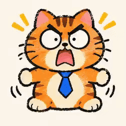

<!-- Generated by scripts/build_readme.py. Edit source data, locale catalogs and generator scripts. -->

# 橘猫打工人十二款表情网格

[← 返回全部案例](../../README.zh-CN.md#all-cases)

<a href="README.md"></a> <a href="README.zh-CN.md"></a>

**作者自报模型 · 仅核对来源；未独立复现**

保存一张12格静态表情网格与原帖公开的三段动态附件；未声称12段独立动画全部公开，同一角色集合合并为一例。 公开文字指令对应12格静图；三段动态的逐条追加指令未公开，不补造动画提示词。

## 图片 / 动画文件


- [橘猫打工人十二款表情网格](https://pbs.twimg.com/media/HWUzoi4WYAAHCTr?format=jpg&name=large) · image
  - 署名：karanwithai
  - 使用条件：source-attributed. 通过原帖图片查看器的正常浏览器下载保存JPEG大图；单独记录HTTP直链返回403。保留作者署名，不声明已取得转载许可；MIT不覆盖此素材。
  - [来源 / 权利依据](https://x.com/karanwithai/status/2118156092865994837)
[打开仓库内视频文件](../../assets/examples/social-orange-office-cat-expression-grid/source-02.mp4)

- [橘猫打工人十二款表情网格](https://video.twimg.com/tweet_video/HWUzpqJWMAAq-Ll.mp4) · video
  - 署名：karanwithai
  - 使用条件：source-attributed. 公开来源附件，保留作者署名，未找到转载许可证；仓库MIT协议不覆盖此素材。
  - [来源 / 权利依据](https://x.com/karanwithai/status/2118156092865994837)
[打开仓库内视频文件](../../assets/examples/social-orange-office-cat-expression-grid/source-03.mp4)

- [橘猫打工人十二款表情网格](https://video.twimg.com/tweet_video/HWUzrCOXcAADdJI.mp4) · video
  - 署名：karanwithai
  - 使用条件：source-attributed. 公开来源附件，保留作者署名，未找到转载许可证；仓库MIT协议不覆盖此素材。
  - [来源 / 权利依据](https://x.com/karanwithai/status/2118156092865994837)
[打开仓库内视频文件](../../assets/examples/social-orange-office-cat-expression-grid/source-04.mp4)

- [橘猫打工人十二款表情网格](https://video.twimg.com/tweet_video/HWUzsLIWkAA7sb8.mp4) · video
  - 署名：karanwithai
  - 使用条件：source-attributed. 公开来源附件，保留作者署名，未找到转载许可证；仓库MIT协议不覆盖此素材。
  - [来源 / 权利依据](https://x.com/karanwithai/status/2118156092865994837)


- [橘猫打工人十二款表情网格——由原MP4转码的GIF展示副本](https://x.com/karanwithai/status/2118156092865994837) · gif
  - 署名：karanwithai
  - 使用条件：source-attributed. 由已存档原MP4转码的GIF展示副本，不冒充原始GIF附件；原MP4保持不变。
  - [来源 / 权利依据](https://x.com/karanwithai/status/2118156092865994837)


- [橘猫打工人十二款表情网格——由原MP4转码的GIF展示副本](https://x.com/karanwithai/status/2118156092865994837) · gif
  - 署名：karanwithai
  - 使用条件：source-attributed. 由已存档原MP4转码的GIF展示副本，不冒充原始GIF附件；原MP4保持不变。
  - [来源 / 权利依据](https://x.com/karanwithai/status/2118156092865994837)


- [橘猫打工人十二款表情网格——由原MP4转码的GIF展示副本](https://x.com/karanwithai/status/2118156092865994837) · gif
  - 署名：karanwithai
  - 使用条件：source-attributed. 由已存档原MP4转码的GIF展示副本，不冒充原始GIF附件；原MP4保持不变。
  - [来源 / 权利依据](https://x.com/karanwithai/status/2118156092865994837)

## 原帖与素材获取状态

- 核对日期：2026-11-09 (UTC)
- 原帖：可打开. 已读取原帖及公开指令；模型归因为作者自报。
- 素材：已存入仓库. 本例选定的公开附件均已存档；原MP4与明确标注的GIF转码副本分别保存并记录哈希，查看器JPEG使用实际下载地址。
- [逐项尝试与结果](../../cases/social-orange-office-cat-expression-grid/source.json)

## 原始提示词

```text
画一套12款橘猫打工人表情包，圆脸胖橘戴蓝领带，粗黑蜡笔线条、橙蓝配色、米白底，表情夸张搞笑，角色保持一致。按3列×4行排列，分别配字：开心、气成河豚、委屈巴巴、笑不活了、收到、啊？、累瘫了、我裂开了、先装死、蹲个后续、没眼看、下班！
```

[原始提示词 (.txt)](../../cases/social-orange-office-cat-expression-grid/prompt.txt)

保存一张12格静态表情网格与原帖公开的三段动态附件；未声称12段独立动画全部公开，同一角色集合合并为一例。 公开文字指令对应12格静图；三段动态的逐条追加指令未公开，不补造动画提示词。

[原提示词见来源](https://x.com/karanwithai/status/2118156317034693026)

## 来源与核对信息

- ID: social-orange-office-cat-expression-grid
- 作者：karanwithai
- [原始来源](https://x.com/karanwithai/status/2118156092865994837)
- 模型：GPT Image 2.6
- 版本：版本未注明
- 依据：作者在原帖明确说明本作品使用GPT Image 2.6。原文摘录：ChatGPT Images 2.6 居然能直接出 GIF 表情包了。。依据为作者自报；本仓库未独立复现。
- 收录：2026-11-09 (UTC)
- 来源核对：2026-11-09 (UTC)

标注来源不等于取得素材许可。仓库 MIT 协议不覆盖第三方输出；本地素材逐项记录来源与使用状态，source-attributed 不代表开放许可。
