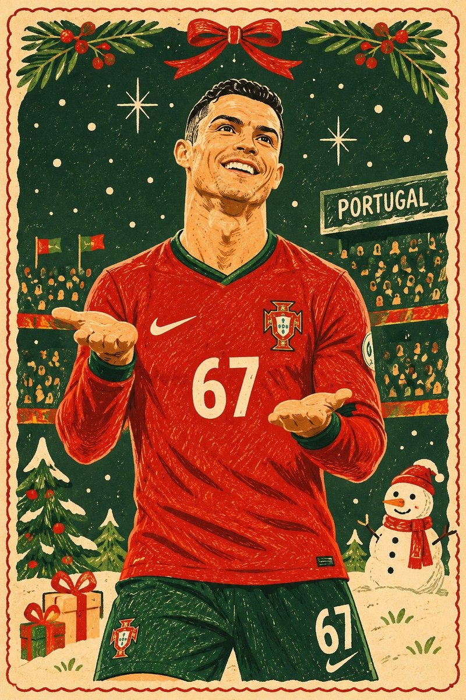
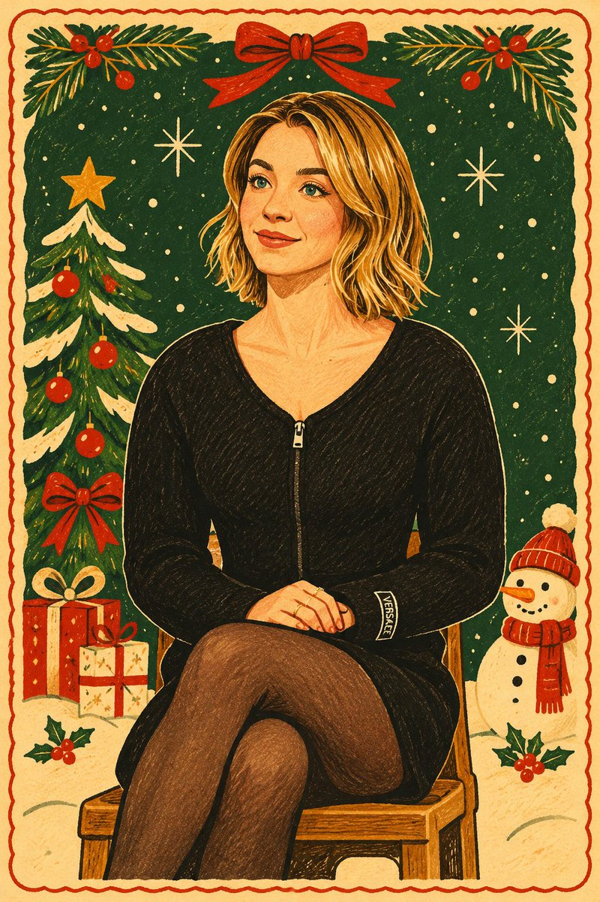

<!-- Generated by scripts/build_readme.py. Edit source data, locale catalogs and generator scripts. -->

# Photo-to-folk-art Christmas greeting cards

[← Back to all cases](../../README.md#all-cases)

<a href="README.md"></a> <a href="README.zh-CN.md"></a>

**Creator-reported model · Source-only; not independently reproduced**

Published by Goodmanprotocol on 2026-11-06T04:32:20+00:00. The original prompt is reproduced without rewriting.

## Images / GIFs



- [Photo-to-folk-art Christmas greeting cards](https://pbs.twimg.com/media/HWak-3YasAALZs0.jpg) · image
  - Credit: Goodmanprotocol
  - Reuse: source-attributed. Original public post attachment, preserved with creator credit. No open licence is asserted; repository MIT terms do not cover this media.
  - [Provenance / rights evidence](https://x.com/Goodmanprotocol/status/2118562099987398753)


- [Photo-to-folk-art Christmas greeting cards](https://pbs.twimg.com/media/HWak_nGbIAAeM4d.jpg) · image
  - Credit: Goodmanprotocol
  - Reuse: source-attributed. Original public post attachment, preserved with creator credit. No open licence is asserted; repository MIT terms do not cover this media.
  - [Provenance / rights evidence](https://x.com/Goodmanprotocol/status/2118562099987398753)

## Source-page and media access

- Checked: 2026-11-09 (UTC)
- Original page: Accessible. Read the original public social post, creator model statement and public prompt.
- Media: Archived locally. Original attachments are stored locally; file types, sizes and SHA-256 values were checked. Any GIF viewing copy is labelled separately.
- [Per-file attempts and results](../../cases/social-portugal-folk-christmas-card/source.json)

## Original prompt

```text
Transform the uploaded photograph into a beautiful, contemporary hand-drawn naïve Christmas illustration, inspired by premium vintage holiday greeting cards and modern folk-art poster design.

ART STYLE:

- Authentic hand-drawn illustration with a charming, playful naïve-art aesthetic.
- Slightly exaggerated, whimsical proportions.
- Imperfect, irregular outlines and organic hand-drawn contours.
- Simplified shapes with carefully selected decorative details.
- Flat, bold, contrasting colours with a warm Christmas palette.
- Subtle vintage paper texture with a refined printed-card finish.
- Delicate hand-drawn decorative marks, patterns and festive accents.
- Minimalist yet visually rich composition.

COLOUR PALETTE:
Use traditional Christmas colours: deep forest green, warm red, cream, muted beige, golden yellow and earthy brown. Maintain strong colour contrast and a cohesive vintage aesthetic.

PRESERVE THE ORIGINAL PHOTOGRAPH:
Retain the person's recognisable facial features, hairstyle, clothing, pose, expression and body proportions. Preserve the main objects, their arrangement and the essential details of the original environment. Translate everything into the illustrated style rather than replacing it with unrelated elements.

DESIGN & COMPOSITION:
Create an elegant, charming Christmas postcard illustration. Simplify the background into tasteful decorative shapes while retaining recognizable elements from the original photograph. Add small festive decorative details only where they naturally complement the existing scene.

STRICT VISUAL RULES:

- No photorealism.
- No 3D rendering.
- No realistic lighting or shadows.
- No gradients.
- No glossy or metallic effects.
- No artificial digital painting appearance.
- No excessive detail or visual clutter.

The final result should look like an authentic, professionally illustrated Christmas greeting card, with the charm of handmade folk art and the sophistication of a premium designer postcard.

FORMAT: A6 portrait orientation, 2:3 aspect ratio, print-ready composition.
```

[Original prompt (.txt)](../../cases/social-portugal-folk-christmas-card/prompt.txt)

[Original prompt at source](https://x.com/Goodmanprotocol/status/2118562099987398753)

## Attribution and verification

- ID: social-portugal-folk-christmas-card
- Author: Goodmanprotocol
- [Original source](https://x.com/Goodmanprotocol/status/2118562099987398753)
- Model: GPT Image 2.6
- Variant: Variant unspecified
- Evidence: The creator explicitly identifies GPT Image 2.6 in the original social post: GPT Image 2.6 Model attribution is creator-reported; this is not an independent reproduction.
- Collected: 2026-11-09 (UTC)
- Source checked: 2026-11-09 (UTC)

Attribution does not grant a media license. Repository MIT terms do not cover third-party outputs. Local files record provenance and reuse status; source-attributed does not mean open-licensed.
