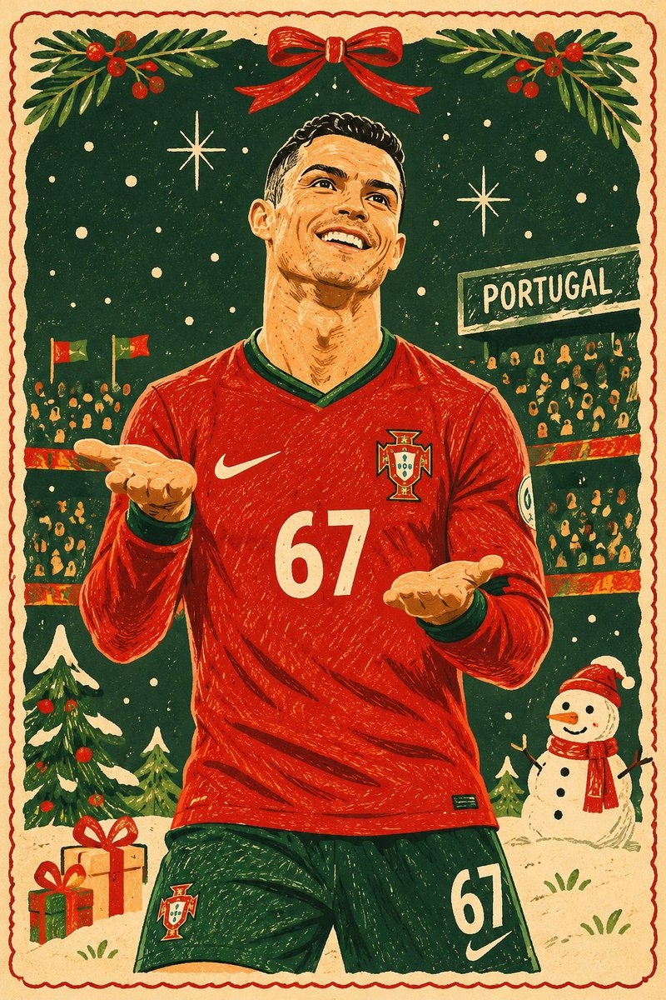

<!-- Generated by scripts/build_readme.py. Edit source data, locale catalogs and generator scripts. -->

# 照片转民间艺术风圣诞贺卡

[← 返回全部案例](../../README.zh-CN.md#all-cases)

<a href="README.md"></a> <a href="README.zh-CN.md"></a>

**作者自报模型 · 仅核对来源；未独立复现**

作者 Goodmanprotocol 发布于 2026-11-06T04:32:20+00:00。提示词按原文收录，未改写。

## 图片 / GIF



- [照片转民间艺术风圣诞贺卡](https://pbs.twimg.com/media/HWak-3YasAALZs0.jpg) · image
  - 署名：Goodmanprotocol
  - 使用条件：source-attributed. 原样保存的公开原帖附件，保留作者署名。未声明开放许可；仓库 MIT 协议不覆盖此素材。
  - [来源 / 权利依据](https://x.com/Goodmanprotocol/status/2118562099987398753)


- [照片转民间艺术风圣诞贺卡](https://pbs.twimg.com/media/HWak_nGbIAAeM4d.jpg) · image
  - 署名：Goodmanprotocol
  - 使用条件：source-attributed. 原样保存的公开原帖附件，保留作者署名。未声明开放许可；仓库 MIT 协议不覆盖此素材。
  - [来源 / 权利依据](https://x.com/Goodmanprotocol/status/2118562099987398753)

## 原帖与素材获取状态

- 核对日期：2026-11-09 (UTC)
- 原帖：可打开. 已读取社媒原帖、作者模型声明及公开原提示词。
- 素材：已存入仓库. 已保存原始附件，并核对文件类型、大小和 SHA-256；GIF 转码展示副本单独注明。
- [逐项尝试与结果](../../cases/social-portugal-folk-christmas-card/source.json)

## 原始提示词

```text
Transform the uploaded photograph into a beautiful, contemporary hand-drawn naïve Christmas illustration, inspired by premium vintage holiday greeting cards and modern folk-art poster design.

ART STYLE:

- Authentic hand-drawn illustration with a charming, playful naïve-art aesthetic.
- Slightly exaggerated, whimsical proportions.
- Imperfect, irregular outlines and organic hand-drawn contours.
- Simplified shapes with carefully selected decorative details.
- Flat, bold, contrasting colours with a warm Christmas palette.
- Subtle vintage paper texture with a refined printed-card finish.
- Delicate hand-drawn decorative marks, patterns and festive accents.
- Minimalist yet visually rich composition.

COLOUR PALETTE:
Use traditional Christmas colours: deep forest green, warm red, cream, muted beige, golden yellow and earthy brown. Maintain strong colour contrast and a cohesive vintage aesthetic.

PRESERVE THE ORIGINAL PHOTOGRAPH:
Retain the person's recognisable facial features, hairstyle, clothing, pose, expression and body proportions. Preserve the main objects, their arrangement and the essential details of the original environment. Translate everything into the illustrated style rather than replacing it with unrelated elements.

DESIGN & COMPOSITION:
Create an elegant, charming Christmas postcard illustration. Simplify the background into tasteful decorative shapes while retaining recognizable elements from the original photograph. Add small festive decorative details only where they naturally complement the existing scene.

STRICT VISUAL RULES:

- No photorealism.
- No 3D rendering.
- No realistic lighting or shadows.
- No gradients.
- No glossy or metallic effects.
- No artificial digital painting appearance.
- No excessive detail or visual clutter.

The final result should look like an authentic, professionally illustrated Christmas greeting card, with the charm of handmade folk art and the sophistication of a premium designer postcard.

FORMAT: A6 portrait orientation, 2:3 aspect ratio, print-ready composition.
```

[原始提示词 (.txt)](../../cases/social-portugal-folk-christmas-card/prompt.txt)

[原提示词见来源](https://x.com/Goodmanprotocol/status/2118562099987398753)

## 来源与核对信息

- ID: social-portugal-folk-christmas-card
- 作者：Goodmanprotocol
- [原始来源](https://x.com/Goodmanprotocol/status/2118562099987398753)
- 模型：GPT Image 2.6
- 版本：版本未注明
- 依据：作者在社媒原帖明确说明使用 GPT Image 2.6：GPT Image 2.6 依据为作者自报，本仓库未独立复现。
- 收录：2026-11-09 (UTC)
- 来源核对：2026-11-09 (UTC)

标注来源不等于取得素材许可。仓库 MIT 协议不覆盖第三方输出；本地素材逐项记录来源与使用状态，source-attributed 不代表开放许可。
