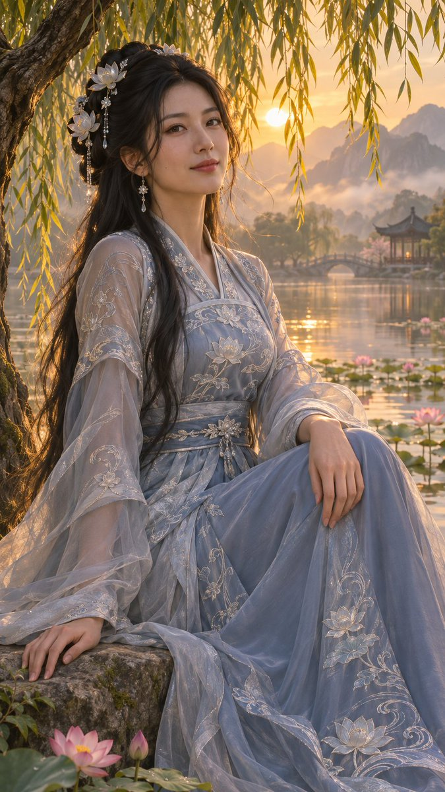

<!-- Generated by scripts/build_readme.py. Edit source data, locale catalogs and generator scripts. -->

# Seated hanfu woman by lotus pond at sunset

[← Back to all cases](../../README.md#all-cases)

<a href="README.md"></a> <a href="README.zh-CN.md"></a>

**Creator-reported model · Source-only; not independently reproduced**

Published by fengnian_ai on 2026-11-05T16:55:27+00:00. The original prompt is reproduced without rewriting.

## Images / GIFs



- [Seated hanfu woman by lotus pond at sunset](https://pbs.twimg.com/media/HWYEunFbQAAqOE1.jpg) · image
  - Credit: fengnian_ai
  - Reuse: source-attributed. Original public post attachment, preserved with creator credit. No open licence is asserted; repository MIT terms do not cover this media.
  - [Provenance / rights evidence](https://x.com/fengnian_ai/status/2118386725676552194)

## Source-page and media access

- Checked: 2026-11-09 (UTC)
- Original page: Accessible. Read the original public social post, creator model statement and public prompt.
- Media: Archived locally. Original attachments are stored locally; file types, sizes and SHA-256 values were checked. Any GIF viewing copy is labelled separately.
- [Per-file attempts and results](../../cases/social-seated-hanfu-woman-lotus-pond/source.json)

## Original prompt

```text
An original cinematic semi-realistic fantasy portrait of a clearly adult East Asian woman, age 28, seated on a lakeside stone beneath trailing willow branches at golden hour. Long black hair with delicate pale lotus ornaments, elegant silver-blue embroidered silk hanfu with opaque bodice and modest neckline, airy outer sleeves, long skirt naturally draped over her legs. Three-quarter seated composition, vertical 9:16 framing. Warm golden backlight through leaves, soft mist, distant mountain silhouettes, a tranquil reflective pond and small pink lotus blossoms. Natural skin texture, individual hair strands, intricate silver embroidery, believable hands and anatomy, soft atmospheric depth. No text, no watermark, no logos.
```

[Original prompt (.txt)](../../cases/social-seated-hanfu-woman-lotus-pond/prompt.txt)

[Original prompt at source](https://x.com/fengnian_ai/status/2118386725676552194)

## Attribution and verification

- ID: social-seated-hanfu-woman-lotus-pond
- Author: fengnian_ai
- [Original source](https://x.com/fengnian_ai/status/2118386725676552194)
- Model: GPT Image 2.6
- Variant: Variant unspecified
- Evidence: The creator explicitly identifies GPT Image 2.6 in the original social post: 左：GPT Image 2.6        Model attribution is creator-reported; this is not an independent reproduction.
- Collected: 2026-11-09 (UTC)
- Source checked: 2026-11-09 (UTC)

Attribution does not grant a media license. Repository MIT terms do not cover third-party outputs. Local files record provenance and reuse status; source-attributed does not mean open-licensed.
