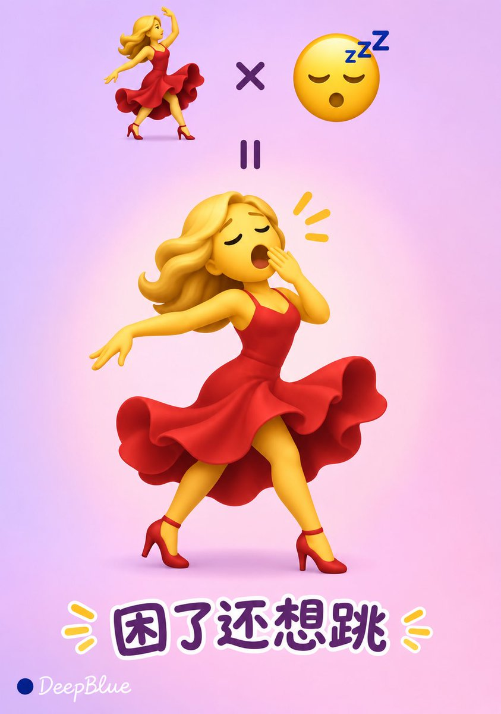
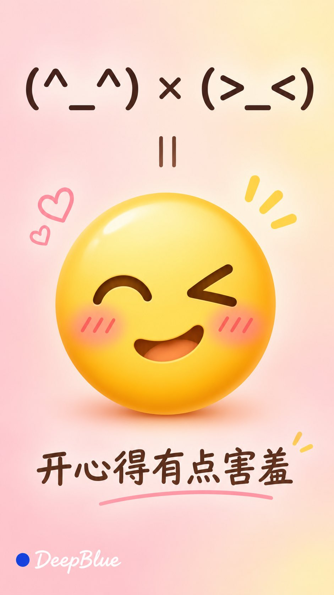
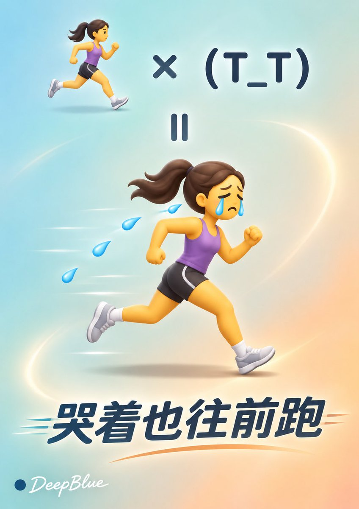
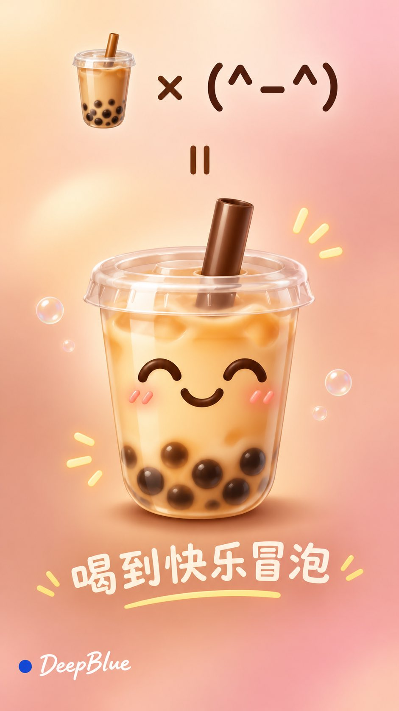

<!-- Generated by scripts/build_readme.py. Edit source data, locale catalogs and generator scripts. -->

# Emoji and kaomoji fusion posters

[← Back to all cases](../../README.md#all-cases)

<a href="README.md"></a> <a href="README.zh-CN.md"></a>

**Creator-reported model · Source-only; not independently reproduced**

Published by DeepBlueX0 on 2026-11-05T09:37:46+00:00. The original prompt is reproduced without rewriting.

## Images / GIFs



- [Emoji and kaomoji fusion posters](https://pbs.twimg.com/media/HWWhUJYbwAAPRhJ.jpg) · image
  - Credit: DeepBlueX0
  - Reuse: source-attributed. Original public post attachment, preserved with creator credit. No open licence is asserted; repository MIT terms do not cover this media.
  - [Provenance / rights evidence](https://x.com/DeepBlueX0/status/2118276577322750086)


- [Emoji and kaomoji fusion posters](https://pbs.twimg.com/media/HWWhUJXa4AAeX0t.jpg) · image
  - Credit: DeepBlueX0
  - Reuse: source-attributed. Original public post attachment, preserved with creator credit. No open licence is asserted; repository MIT terms do not cover this media.
  - [Provenance / rights evidence](https://x.com/DeepBlueX0/status/2118276577322750086)


- [Emoji and kaomoji fusion posters](https://pbs.twimg.com/media/HWWhUM1acAAdw5V.jpg) · image
  - Credit: DeepBlueX0
  - Reuse: source-attributed. Original public post attachment, preserved with creator credit. No open licence is asserted; repository MIT terms do not cover this media.
  - [Provenance / rights evidence](https://x.com/DeepBlueX0/status/2118276577322750086)


- [Emoji and kaomoji fusion posters](https://pbs.twimg.com/media/HWWhUMwaMAAcEuw.jpg) · image
  - Credit: DeepBlueX0
  - Reuse: source-attributed. Original public post attachment, preserved with creator credit. No open licence is asserted; repository MIT terms do not cover this media.
  - [Provenance / rights evidence](https://x.com/DeepBlueX0/status/2118276577322750086)

## Source-page and media access

- Checked: 2026-11-09 (UTC)
- Original page: Accessible. Read the original public social post, creator model statement and public prompt.
- Media: Archived locally. Original attachments are stored locally; file types, sizes and SHA-256 values were checked. Any GIF viewing copy is labelled separately.
- [Per-file attempts and results](../../cases/social-sleepy-star-eyed-emoji-fusion/source.json)

## Original prompt

```text
iOS 系統Emoji × 顏文字× 全新表情設計

每張獨立選擇兩個或多個不同的 Emoji 或顏文字進行融合，開放探索人物、動物、食物、物件、自然元素與各種情緒。

整組變化來源類別與組合方式，探索 Emoji 與 Emoji、Emoji 與顏文字、多個顏文字等不同搭配，讓顏文字多次參與融合。每張選擇不同組合與心情，減少主體和表達重復。

先確定本張的融合配方，提取各來源最有辨識度的五官、神態、輪廓、動作或字符特徵，將它們融合成一個完整的新表情，表達一種有趣的情緒或狀態。

根據來源自身形態設計結果：臉部表情重點融合五官與神態；帶手勢或全身形態的表情保留有助於識別的身體結構；動物、物件和自然元素保留關鍵外形；顏文字的眼睛、嘴巴、符號或字符排列自然融入新表情。身體、四肢與動作由組合和表達需要決定。

融合結果保持簡潔的表情圖標感，以主體輪廓和關鍵特徵傳達心情，細節適度，縮小後仍清晰可辨。

畫面從上到下展示融合公式：上方用「×」連接所選來源，中間將「＝」旋轉90°，呈現為兩條並排的細竪線，下方展示融合後的新表情。新表情明顯大於來源，是畫面的視覺重點。

公式中的 Emoji 參照 iOS 系統對應表情的外觀，保留容易辨認的造型、顏色、神態與動作。公式中的顏文字以清晰字符原樣呈現，保持所選字符及排列完整。

融合後的新表情採用與 iOS Emoji 協調的視覺風格：造型簡潔圓潤，表情鮮明，色彩飽滿，具有柔和漸變、細膩高光與輕微立體感。人物、動物與物件保留各自適合的形態，整體如同同一套系統表情。

根據新表情的情緒與主體配色，自由選擇協調的低飽和漸變背景，在新表情後方加入柔和的主題色光暈。光暈與主體保持適當的明度或色相差異，讓表情輪廓清楚可辨。

在新表情附近寫一句簡短自然的中文心情短句，準確表達融合後的意思。字體形態與筆畫氣質呼應情緒，文字完整清晰，與表情和公式保持適當間距。

公式符號、顏文字與背景保持足夠對比。畫面疏密協調，留白自然。

竪版 9:16，n=10。每張為獨立單圖，逐張生成，不拼圖。

左下簽名：深藍色實心圓點在前，白色手寫體 DeepBlue 在後
```

[Original prompt (.txt)](../../cases/social-sleepy-star-eyed-emoji-fusion/prompt.txt)

[Original prompt at source](https://x.com/DeepBlueX0/status/2118276577322750086)

## Attribution and verification

- ID: social-sleepy-star-eyed-emoji-fusion
- Author: DeepBlueX0
- [Original source](https://x.com/DeepBlueX0/status/2118276577322750086)
- Model: GPT Image 2.6
- Variant: Variant unspecified
- Evidence: The creator explicitly identifies GPT Image 2.6 in the original social post: 💝 GPT image 2.6 Prompt: Model attribution is creator-reported; this is not an independent reproduction.
- Collected: 2026-11-09 (UTC)
- Source checked: 2026-11-09 (UTC)

Attribution does not grant a media license. Repository MIT terms do not cover third-party outputs. Local files record provenance and reuse status; source-attributed does not mean open-licensed.
