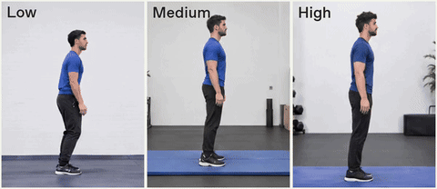

<!-- Generated by scripts/build_readme.py. Edit source data, locale catalogs and generator scripts. -->

# Standing backflip at three complexity levels

[← Back to all cases](../../README.md#all-cases)

<a href="README.md"></a> <a href="README.zh-CN.md"></a>

**Creator-reported model · Source-only; not independently reproduced**

Original prompt wording is preserved. Only the task phrase is public; no full API request is claimed. See the precise source and item-level media notes; requested parameters are not independently verified output properties.

## Images / animation files

[Open local video file](../../assets/examples/social-standing-backflip-complexity/source-01.mp4)

- [Standing backflip at three complexity levels](https://video.twimg.com/amplify_video/2118130005637308416/vid/avc1/1200x520/J1p8CYk5Stg-sK5U.mp4?tag=29) · video
  - Credit: gabrielchua
  - Reuse: source-attributed. Public source attachment with creator credit; no redistribution licence was located. Repository MIT terms do not cover this media.
  - [Provenance / rights evidence](https://x.com/gabrielchua/status/2118135343354720648)


- [Standing backflip at three complexity levels — derived GIF viewing copy](https://x.com/gabrielchua/status/2118135343354720648) · gif
  - Credit: gabrielchua
  - Reuse: source-attributed. Derived GIF viewing copy made from the archived source MP4. Not an original GIF attachment; source MP4 remains unchanged.
  - [Provenance / rights evidence](https://x.com/gabrielchua/status/2118135343354720648)

## Source-page and media access

- Checked: 2026-11-09 (UTC)
- Original page: Accessible. Read the original post and source-shared instructions; attribution remains creator-reported.
- Media: Archived locally. All selected public source attachments are archived. Original MP4s and separately labelled derived GIF viewing copies are stored with hashes. Viewer JPEGs use their actual download URLs.
- [Per-file attempts and results](../../cases/social-standing-backflip-complexity/source.json)

## Original prompt

```text
create a GIF of a man doing a standing backflip
```

[Original prompt (.txt)](../../cases/social-standing-backflip-complexity/prompt.txt)

Original prompt wording is preserved. Only the task phrase is public; no full API request is claimed. See the precise source and item-level media notes; requested parameters are not independently verified output properties.

[Original prompt at source](https://x.com/gabrielchua/status/2118135343354720648)

## Attribution and verification

- ID: social-standing-backflip-complexity
- Author: gabrielchua
- [Original source](https://x.com/gabrielchua/status/2118135343354720648)
- Model: GPT Image 2.6
- Variant: Flare
- Evidence: The author states that this experiment used the GPT Image 2.6 API and Flare; low/medium/high are complexity labels, not quality labels.
- Collected: 2026-11-09 (UTC)
- Source checked: 2026-11-09 (UTC)

Attribution does not grant a media license. Repository MIT terms do not cover third-party outputs. Local files record provenance and reuse status; source-attributed does not mean open-licensed.
