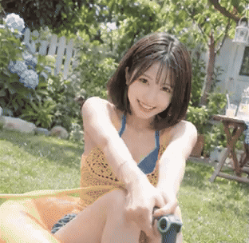

<!-- Generated by scripts/build_readme.py. Edit source data, locale catalogs and generator scripts. -->

# Summer garden water-gun animation

[← Back to all cases](../../README.md#all-cases)

<a href="README.md"></a> <a href="README.zh-CN.md"></a>

**Creator-reported model · Source-only; not independently reproduced**

Original prompt wording is preserved.  See the precise source and item-level media notes; requested parameters are not independently verified output properties.

## Images / animation files


**Reference/input image, not a generated output.**

- [Summer garden water-gun animation](https://pbs.twimg.com/media/HWUs6utbwAAgLxv?format=jpg&name=large) · image
  - Credit: nima2qisi2
  - Reuse: source-attributed. JPEG provided by the original post image viewer, saved through the normal browser download flow. Direct HTTP retrieval returned 403. Creator credit retained; no redistribution licence asserted; MIT excludes this media.
  - [Provenance / rights evidence](https://x.com/nima2qisi2/status/2118150226330734787)
[Open local video file](../../assets/examples/social-summer-garden-water-gun/source-02.mp4)

- [Summer garden water-gun animation](https://video.twimg.com/tweet_video/HWUtOnfbQAABlR8.mp4) · video
  - Credit: nima2qisi2
  - Reuse: source-attributed. Public source attachment with creator credit; no redistribution licence was located. Repository MIT terms do not cover this media.
  - [Provenance / rights evidence](https://x.com/nima2qisi2/status/2118150226330734787)
[Open local video file](../../assets/examples/social-summer-garden-water-gun/source-03.mp4)

- [Summer garden water-gun animation](https://video.twimg.com/tweet_video/HWUtOnlboAAGF-X.mp4) · video
  - Credit: nima2qisi2
  - Reuse: source-attributed. Public source attachment with creator credit; no redistribution licence was located. Repository MIT terms do not cover this media.
  - [Provenance / rights evidence](https://x.com/nima2qisi2/status/2118150226330734787)


- [Summer garden water-gun animation — derived GIF viewing copy](https://x.com/nima2qisi2/status/2118150226330734787) · gif
  - Credit: nima2qisi2
  - Reuse: source-attributed. Derived GIF viewing copy made from the archived source MP4. Not an original GIF attachment; source MP4 remains unchanged.
  - [Provenance / rights evidence](https://x.com/nima2qisi2/status/2118150226330734787)


- [Summer garden water-gun animation — derived GIF viewing copy](https://x.com/nima2qisi2/status/2118150226330734787) · gif
  - Credit: nima2qisi2
  - Reuse: source-attributed. Derived GIF viewing copy made from the archived source MP4. Not an original GIF attachment; source MP4 remains unchanged.
  - [Provenance / rights evidence](https://x.com/nima2qisi2/status/2118150226330734787)

## Source-page and media access

- Checked: 2026-11-09 (UTC)
- Original page: Accessible. Read the original post and source-shared instructions; attribution remains creator-reported.
- Media: Archived locally. All selected public source attachments are archived. Original MP4s and separately labelled derived GIF viewing copies are stored with hashes. Viewer JPEGs use their actual download URLs.
- [Per-file attempts and results](../../cases/social-summer-garden-water-gun/source.json)

## Original prompt

```text
请以这个内容创建一个 GIF，内容是： # JAPANESE SUMMER｜夏日元气少女
**10秒日系青春活力MV视频提示词**

**画面规格：** 9:16 竖屏，10秒，30fps，写实摄影质感。

**人物设定：**
22岁成年东亚女性，清透冷白皮肤，短款深棕色波波头，轻薄空气刘海，五官甜美可爱，身材匀称。穿着参考图中的蓝色泳装、黄色镂空针织罩衫及牛仔短裤。人物保持统一，性格活泼俏皮，笑容自然，有青春少女的灵动感。

**整体风格：**
Japanese Youth MV / Japanese Summer Pop / Youthful Cinematic Montage。

明亮通透的夏日阳光，翠绿花园，蓝色天空，橙色充气泳圈，水花飞溅。采用日本青春电影式混剪，快速切换全景、中景、近景和人物特写。画面具有轻微胶片颗粒、柔和高光、自然镜头运动。

### 01｜10秒分镜设计

**0—1.2秒｜开场钩子**
低机位快速推进，女主坐在橙色充气泳圈上，双手拿着水枪，突然发现镜头，露出惊喜的笑容，水流突然朝镜头喷来。

**1.2—2.4秒｜俏皮特写**
快速硬切面部近景，女主被水花溅到，轻轻眯眼，随后露出调皮笑容，发丝随着动作轻轻晃动。阳光在脸颊形成漂亮的光斑。

**2.4—3.6秒｜青春动态**
侧面低机位，女主赤脚轻轻踢起草坪上的水花，镜头快速横向跟拍，橙色泳圈在前景掠过，形成自然遮挡转场。

**3.6—4.8秒｜视觉节奏**
俯拍镜头，女主拿着水枪在草坪上转身，水流划出弧线。镜头快速向下俯冲，再跟随水花向上抬起。

**4.8—6.0秒｜少女感特写**
正面近景，女主双手举起水枪，突然向镜头喷水，水珠在阳光下形成晶莹的高光，女主笑着躲避镜头。

**6.0—7.3秒｜活力爆发**
快速硬切至侧后方，女主从泳圈上轻巧起身，转身甩动头发，黄色针织罩衫随动作自然摆动，镜头进行半圈快速环绕。

**7.3—8.7秒｜夏日氛围**
广角镜头，女主在草坪上轻快地转圈，双手张开，阳光穿过树叶洒落，水花从前景飞过，画面充满夏日青春气息。

**8.7—10秒｜记忆点结尾**
突然切换正面近景，女主向镜头靠近，俏皮地歪头眨眼，随后拿起水枪再次喷水，水花覆盖整个镜头，最后定格在明亮的白色水花中。

### 02｜音乐与剪辑

原创日系青春J-POP配乐：
- 轻快的电吉他、明亮合成器、活泼贝斯与清脆鼓点。
- 约155—165 BPM，具有夏日偶像MV的轻盈节奏。
- 开场直接进入音乐，不要冗长铺垫。
- 每次鼓点配合一次硬切或动作变化。
- 中间加入少量0.3—0.5秒高速慢动作水花特写，再迅速恢复正常速度。
- 结尾音乐与水花覆盖镜头同步收束。

### 03｜摄影与画面约束

1. 混剪必须具有明显的景别变化，避免全程一个机位。
2. 人物始终是画面视觉中心，保持同一张脸、发型和服装。
3. 人物动作自然轻快，表情丰富，笑容甜美但不过度表演。
4. 保留真实皮肤纹理、自然阳光与水珠物理效果。
5. 镜头切换干净利落，利用水花、泳圈和人物动作完成匹配剪辑。
6. 不要广告片质感，不要商业产品展示，不要字幕、文字、Logo、水印。
7. 避免人物变脸、服装改变、手指畸形、肢体错位及水枪结构变形。

**最终效果：像一支10秒的日本夏日青春偶像MV，轻松、明亮、活泼、俏皮，让人感受到夏天的快乐。**
```

[Original prompt (.txt)](../../cases/social-summer-garden-water-gun/prompt.txt)

Original prompt wording is preserved.  See the precise source and item-level media notes; requested parameters are not independently verified output properties.

[Original prompt at source](https://x.com/nima2qisi2/status/2118150229811920912)

## Attribution and verification

- ID: social-summer-garden-water-gun
- Author: nima2qisi2
- [Original source](https://x.com/nima2qisi2/status/2118150226330734787)
- Model: GPT Image 2.6
- Variant: Variant unspecified
- Evidence: The creator explicitly identifies GPT Image 2.6 for this work. Source excerpt: 卧槽，Chat GPT Image2.6 这波更新有点强啊！ 别以为只能做表情包这么简单，详细指令评论区👇 Creator-reported only; not independently reproduced.
- Collected: 2026-11-09 (UTC)
- Source checked: 2026-11-09 (UTC)

Attribution does not grant a media license. Repository MIT terms do not cover third-party outputs. Local files record provenance and reuse status; source-attributed does not mean open-licensed.
