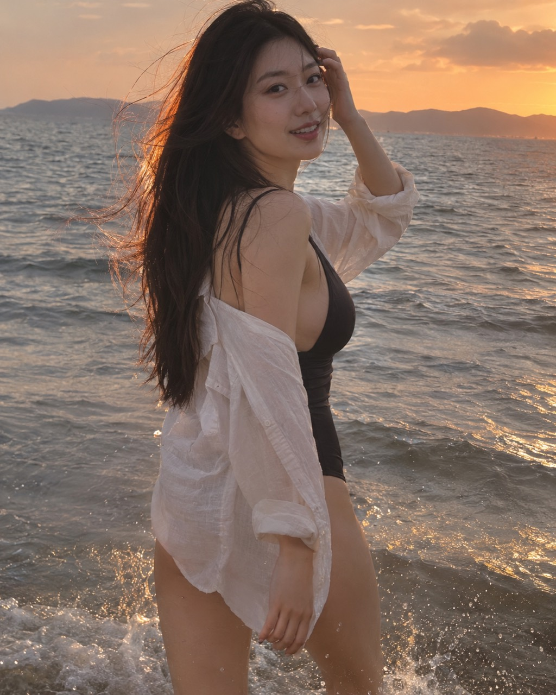
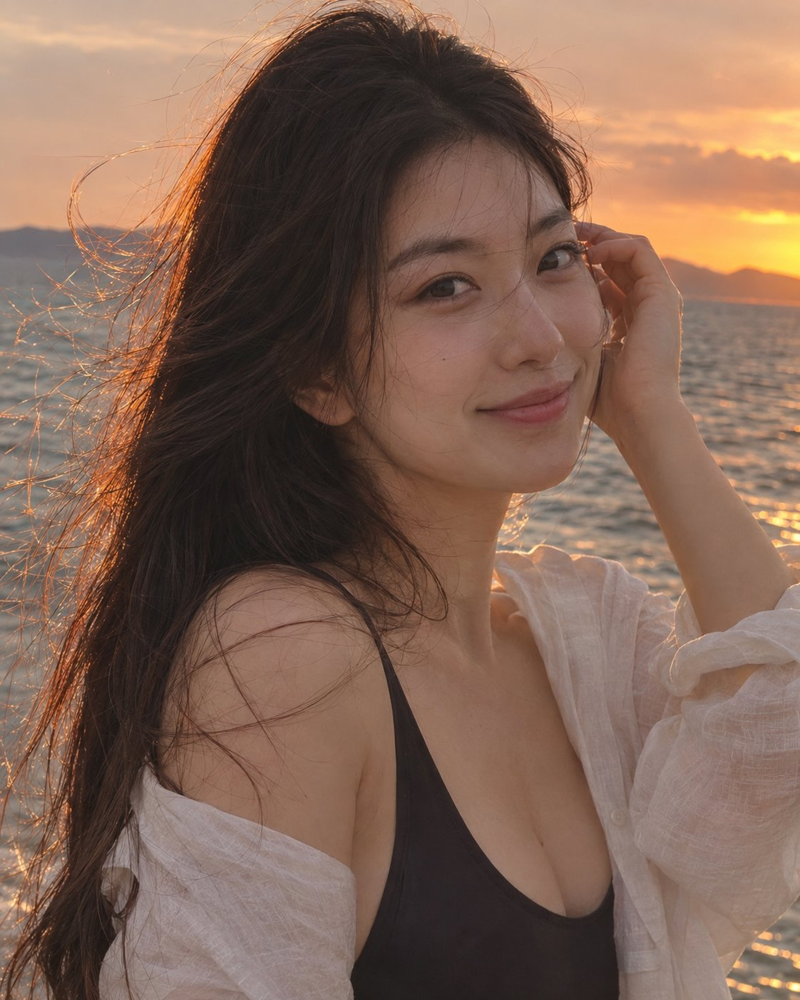
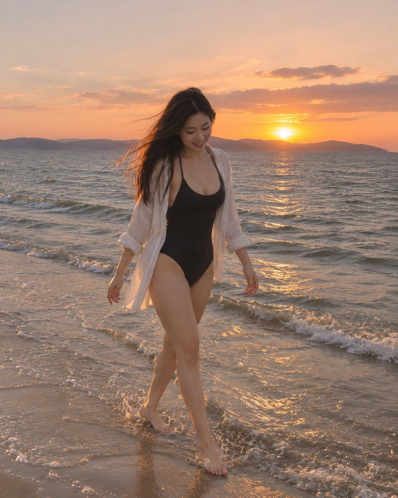
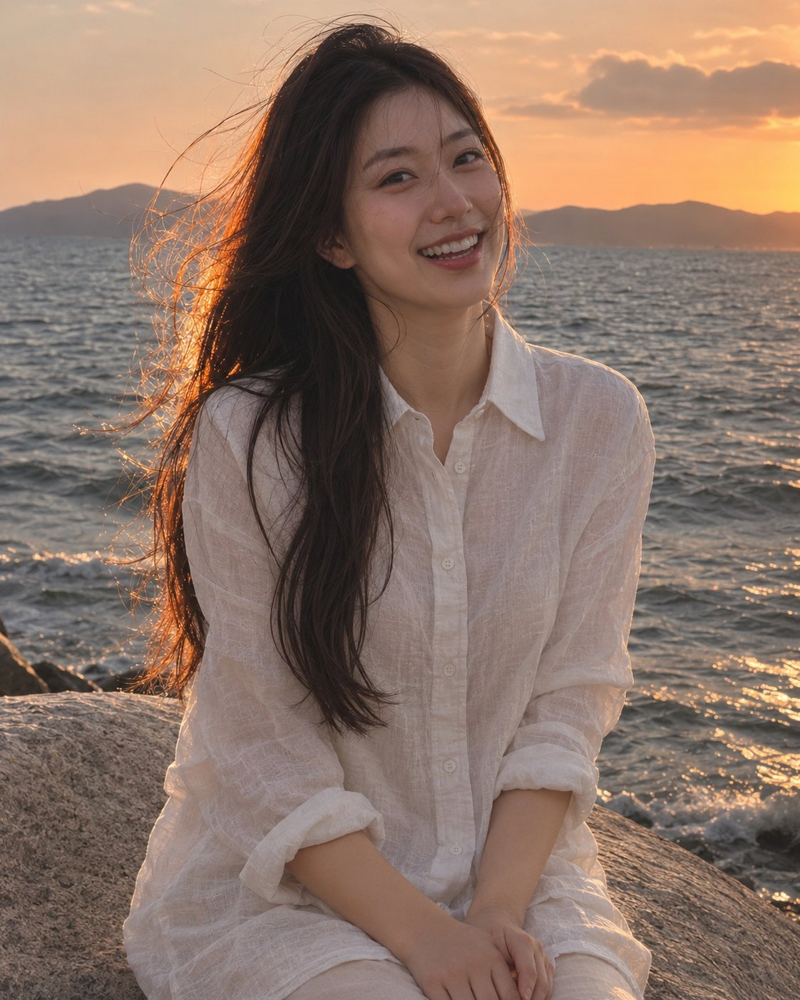

<!-- Generated by scripts/build_readme.py. Edit source data, locale catalogs and generator scripts. -->

# 夕阳海边回头的女子

[← 返回全部案例](../../README.zh-CN.md#all-cases)

<a href="README.md"></a> <a href="README.zh-CN.md"></a>

**作者自报模型 · 仅核对来源；未独立复现**

作者 sonny_eacc 发布于 2026-11-05T05:37:59+00:00。提示词按原文收录，未改写。

## 图片 / GIF



- [夕阳海边回头的女子](https://pbs.twimg.com/media/HWVqadTaQAEJi5R.jpg) · image
  - 署名：sonny_eacc
  - 使用条件：source-attributed. 原样保存的公开原帖附件，保留作者署名。未声明开放许可；仓库 MIT 协议不覆盖此素材。
  - [来源 / 权利依据](https://x.com/sonny_eacc/status/2118216234445791408)


- [夕阳海边回头的女子](https://pbs.twimg.com/media/HWVqadSaUAA103E.jpg) · image
  - 署名：sonny_eacc
  - 使用条件：source-attributed. 原样保存的公开原帖附件，保留作者署名。未声明开放许可；仓库 MIT 协议不覆盖此素材。
  - [来源 / 权利依据](https://x.com/sonny_eacc/status/2118216234445791408)


- [夕阳海边回头的女子](https://pbs.twimg.com/media/HWVqadQa8AARCXy.jpg) · image
  - 署名：sonny_eacc
  - 使用条件：source-attributed. 原样保存的公开原帖附件，保留作者署名。未声明开放许可；仓库 MIT 协议不覆盖此素材。
  - [来源 / 权利依据](https://x.com/sonny_eacc/status/2118216234445791408)


- [夕阳海边回头的女子](https://pbs.twimg.com/media/HWVqadUbYAEwPGe.jpg) · image
  - 署名：sonny_eacc
  - 使用条件：source-attributed. 原样保存的公开原帖附件，保留作者署名。未声明开放许可；仓库 MIT 协议不覆盖此素材。
  - [来源 / 权利依据](https://x.com/sonny_eacc/status/2118216234445791408)

## 原帖与素材获取状态

- 核对日期：2026-11-09 (UTC)
- 原帖：可打开. 已读取社媒原帖、作者模型声明及公开原提示词。
- 素材：已存入仓库. 已保存原始附件，并核对文件类型、大小和 SHA-256；GIF 转码展示副本单独注明。
- [逐项尝试与结果](../../cases/social-sunset-beach-look-back/source.json)

## 原始提示词

```text
【首图】
生成一张4:5竖版写实人像照片。一位25岁的成年东亚美女，黑色长发，五官精致，身材修长匀称，穿黑色连体泳衣，外搭敞开的白色亚麻衬衫。傍晚赤脚走在海边浅水中，被身后的人叫住，回头看向镜头，露出刚开始笑的自然表情，一只手轻轻按住被海风吹起的头发。拍到大腿，人物占画面主体，前景有细碎浪花，夕阳从侧后方照亮发丝。像旅行时偶然拍到的漂亮瞬间，保留真实皮肤纹理、衣料褶皱和轻微抓拍感，色彩自然，无文字、水印。

【续图方法】
上传首图作参考，保持同一成年女性的五官、发型、服装、海边夕阳和真实肤质。每次单独生成一张，分别追加：
①近景：胸口以上，拨头发，轻轻微笑。
②全身：赤脚走在浅水里，低头看浪花。
③坐姿：白衬衫扣好，坐在海边岩石上，半身构图，自然大笑。
```

[原始提示词 (.txt)](../../cases/social-sunset-beach-look-back/prompt.txt)

[原提示词见来源](https://x.com/sonny_eacc/status/2118216507025187281)

## 来源与核对信息

- ID: social-sunset-beach-look-back
- 作者：sonny_eacc
- [原始来源](https://x.com/sonny_eacc/status/2118216234445791408)
- 模型：GPT Image 2.6
- 版本：版本未注明
- 依据：作者在社媒原帖明确说明使用 GPT Image 2.6：试了最新的 GPT Image 2.6，先生成一张海边写真，再拿首图续出一组。 依据为作者自报，本仓库未独立复现。
- 收录：2026-11-09 (UTC)
- 来源核对：2026-11-09 (UTC)

标注来源不等于取得素材许可。仓库 MIT 协议不覆盖第三方输出；本地素材逐项记录来源与使用状态，source-attributed 不代表开放许可。
