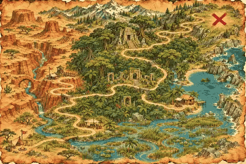

<!-- Generated by scripts/build_readme.py. Edit source data, locale catalogs and generator scripts. -->

# Treasure-map route animation

[← Back to all cases](../../README.md#all-cases)

<a href="README.md"></a> <a href="README.zh-CN.md"></a>

**Creator-reported model · Source-only; not independently reproduced**

Original prompt wording is preserved.  See the precise source and item-level media notes; requested parameters are not independently verified output properties.

## Images / animation files

[Open local video file](../../assets/examples/social-treasure-map-route-loop/source-01.mp4)

- [Treasure-map route animation](https://video.twimg.com/amplify_video/2119050722574766080/vid/avc1/480x320/tE9VN7kDpPzrpzGN.mp4?tag=29) · video
  - Credit: aiwarts
  - Reuse: source-attributed. Public source attachment with creator credit; no redistribution licence was located. Repository MIT terms do not cover this media.
  - [Provenance / rights evidence](https://x.com/aiwarts/status/2119435411667980473)


- [Treasure-map route animation — derived GIF viewing copy](https://x.com/aiwarts/status/2119435411667980473) · gif
  - Credit: aiwarts
  - Reuse: source-attributed. Derived GIF viewing copy made from the archived source MP4. Not an original GIF attachment; source MP4 remains unchanged.
  - [Provenance / rights evidence](https://x.com/aiwarts/status/2119435411667980473)

## Source-page and media access

- Checked: 2026-11-09 (UTC)
- Original page: Accessible. Read the original post and source-shared instructions; attribution remains creator-reported.
- Media: Archived locally. All selected public source attachments are archived. Original MP4s and separately labelled derived GIF viewing copies are stored with hashes. Viewer JPEGs use their actual download URLs.
- [Per-file attempts and results](../../cases/social-treasure-map-route-loop/source.json)

## Original prompt

```text
复古探险寻宝手绘路线图，动态 GIF，泛黄古老牛皮纸羊皮纸地图质感，手绘等高线与山川河流，一条红色的虚线轨迹从左下角出发像活蛇般沿着山谷快速向前蜿蜒穿梭，轨迹前端是一辆可爱的复古小越野车在颠簸狂奔，每到达一个补给站地标，一枚立体红色图钉便伴随微小冲击波咚地一声精准扎在地图上，最终在右上角的大红叉宝藏点画圈点亮，冒险故事感
```

[Original prompt (.txt)](../../cases/social-treasure-map-route-loop/prompt.txt)

Original prompt wording is preserved.  See the precise source and item-level media notes; requested parameters are not independently verified output properties.

[Original prompt at source](https://x.com/aiwarts/status/2119435411667980473)

## Attribution and verification

- ID: social-treasure-map-route-loop
- Author: aiwarts
- [Original source](https://x.com/aiwarts/status/2119435411667980473)
- Model: GPT Image 2.6
- Variant: Variant unspecified
- Evidence: The creator introduces this article as their GPT Image 2.6 experiment and pairs each selected workflow with a public instruction and attached demonstration. Creator-reported only; no independent reproduction.
- Collected: 2026-11-09 (UTC)
- Source checked: 2026-11-09 (UTC)

Attribution does not grant a media license. Repository MIT terms do not cover third-party outputs. Local files record provenance and reuse status; source-attributed does not mean open-licensed.
