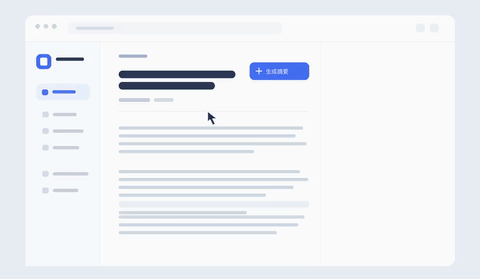

<!-- Generated by scripts/build_readme.py. Edit source data, locale catalogs and generator scripts. -->

# Web summary interaction animation

[← Back to all cases](../../README.md#all-cases)

<a href="README.md"></a> <a href="README.zh-CN.md"></a>

**Creator-reported model · Source-only; not independently reproduced**

Original prompt wording is preserved.  See the precise source and item-level media notes; requested parameters are not independently verified output properties.

## Images / animation files

[Open local video file](../../assets/examples/social-web-summary-interaction-loop/source-01.mp4)

- [Web summary interaction animation](https://video.twimg.com/amplify_video/2119050872328200192/vid/avc1/1100x640/-Mpw5iEuop7lXcpN.mp4?tag=29) · video
  - Credit: aiwarts
  - Reuse: source-attributed. Public source attachment with creator credit; no redistribution licence was located. Repository MIT terms do not cover this media.
  - [Provenance / rights evidence](https://x.com/aiwarts/status/2119435411667980473)


- [Web summary interaction animation — derived GIF viewing copy](https://x.com/aiwarts/status/2119435411667980473) · gif
  - Credit: aiwarts
  - Reuse: source-attributed. Derived GIF viewing copy made from the archived source MP4. Not an original GIF attachment; source MP4 remains unchanged.
  - [Provenance / rights evidence](https://x.com/aiwarts/status/2119435411667980473)

## Source-page and media access

- Checked: 2026-11-09 (UTC)
- Original page: Accessible. Read the original post and source-shared instructions; attribution remains creator-reported.
- Media: Archived locally. All selected public source attachments are archived. Original MP4s and separately labelled derived GIF viewing copies are stored with hashes. Viewer JPEGs use their actual download URLs.
- [Per-file attempts and results](../../cases/social-web-summary-interaction-loop/source.json)

## Original prompt

```text
制作一段 3 秒、可无缝循环的网页产品演示动图。鼠标点击文章右上角的“生成摘要”按钮，按钮短暂显示加载状态，右侧随即展开简洁的摘要卡片。镜头固定，保留真实界面布局，让点击和结果清晰可见；动画轻快、克制，不添加其他操作或虚构文案。
```

[Original prompt (.txt)](../../cases/social-web-summary-interaction-loop/prompt.txt)

Original prompt wording is preserved.  See the precise source and item-level media notes; requested parameters are not independently verified output properties.

[Original prompt at source](https://x.com/aiwarts/status/2119435411667980473)

## Attribution and verification

- ID: social-web-summary-interaction-loop
- Author: aiwarts
- [Original source](https://x.com/aiwarts/status/2119435411667980473)
- Model: GPT Image 2.6
- Variant: Variant unspecified
- Evidence: The creator introduces this article as their GPT Image 2.6 experiment and pairs each selected workflow with a public instruction and attached demonstration. Creator-reported only; no independent reproduction.
- Collected: 2026-11-09 (UTC)
- Source checked: 2026-11-09 (UTC)

Attribution does not grant a media license. Repository MIT terms do not cover third-party outputs. Local files record provenance and reuse status; source-attributed does not mean open-licensed.
