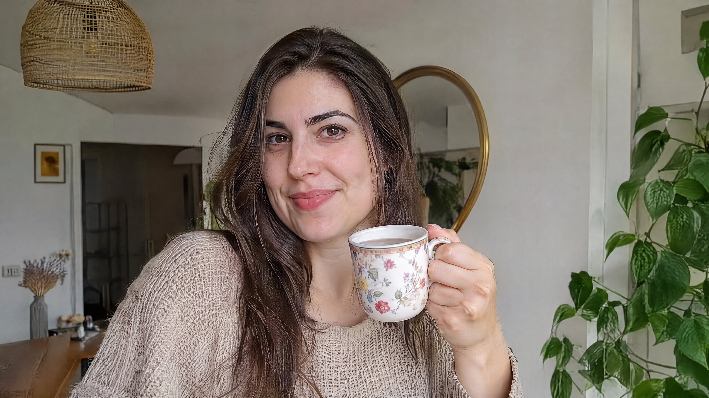

<!-- Generated by scripts/build_readme.py. Edit source data, locale catalogs and generator scripts. -->

# Woman holding floral tea mug indoors

[← Back to all cases](../../README.md#all-cases)

<a href="README.md"></a> <a href="README.zh-CN.md"></a>

**Creator-reported model · Source-only; not independently reproduced**

Published by v3rt0x_ on 2026-11-05T01:05:15+00:00. The original prompt is reproduced without rewriting.

## Images / GIFs



- [Woman holding floral tea mug indoors](https://pbs.twimg.com/media/HWUrkFiXMAAmGRv.jpg) · image
  - Credit: v3rt0x_
  - Reuse: source-attributed. Original public post attachment, preserved with creator credit. No open licence is asserted; repository MIT terms do not cover this media.
  - [Provenance / rights evidence](https://x.com/v3rt0x_/status/2118147596891901957)

## Source-page and media access

- Checked: 2026-11-09 (UTC)
- Original page: Accessible. Read the original public social post, creator model statement and public prompt.
- Media: Archived locally. Original attachments are stored locally; file types, sizes and SHA-256 values were checked. Any GIF viewing copy is labelled separately.
- [Per-file attempts and results](../../cases/social-woman-holding-tea-mug/source.json)

## Original prompt

```text
a realistic photo of a woman holding a cup of tea inside her home
```

[Original prompt (.txt)](../../cases/social-woman-holding-tea-mug/prompt.txt)

[Original prompt at source](https://x.com/v3rt0x_/status/2118147596891901957)

## Attribution and verification

- ID: social-woman-holding-tea-mug
- Author: v3rt0x_
- [Original source](https://x.com/v3rt0x_/status/2118147596891901957)
- Model: GPT Image 2.6
- Variant: Variant unspecified
- Evidence: The creator explicitly identifies GPT Image 2.6 in the original social post: Gpt image 2.6 (Left) vs 2.5 (Right)  Model attribution is creator-reported; this is not an independent reproduction.
- Collected: 2026-11-09 (UTC)
- Source checked: 2026-11-09 (UTC)

Attribution does not grant a media license. Repository MIT terms do not cover third-party outputs. Local files record provenance and reuse status; source-attributed does not mean open-licensed.
