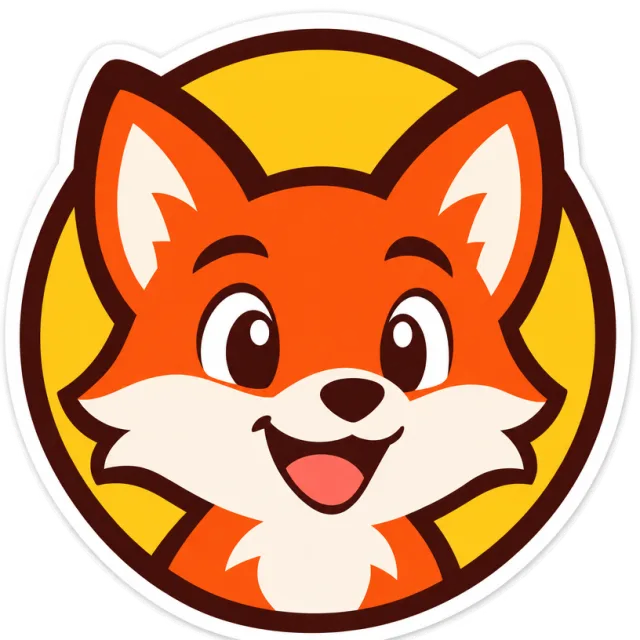

<!-- Generated by scripts/build_readme.py. Edit source data, locale catalogs and generator scripts. -->

# 扁平狐狸吉祥物徽章

[← 返回全部案例](../../README.zh-CN.md#all-cases)

 

**作者自报模型 · 仅核对来源；未独立复现**

带有透明外围像素的矢量风格栅格 WebP，并非 SVG，也不能证明 SVG 导出可用。保留的页面文字包含完整公开提示词，位于“What You Can Make with GPT Image 2.6”→“Graphic”→“Prompt”；请通过来源链接查看原文。 2026-11-08 的离线恢复复核确认留存来源映射与原文件完整性，不证明后台执行或当前可访问性。

## 图片 / GIF

- [圆形扁平色彩徽章中的友好狐狸头像。](https://artworks.aicartoongenerator.io/assets/pages/models/gpt-image-2-6/outputs/uc-fox-badge.webp) · image
  - 署名：Toonderly
  - 使用条件：source-attributed. 公开来源样例原样存档并署名。未核实转载许可，非开放许可素材，不受仓库 MIT 许可证覆盖。
  - [来源 / 权利依据](https://aicartoongenerator.io/models/gpt-image-2-6)

## 原帖与素材获取状态

- 核对日期：2026-11-05 (UTC)
- 原帖：可打开. 历史来源访问记录日期为 2026-11-05；2026-11-08 离线复核保留的原始来源证据，未检查当前可访问性。
- 素材：已存入仓库. 2026-11-08 复核留存原文件的 SHA-256、字节数与完整解码，以静帧检查每个 GIF 帧及 MP4 的各个不同帧；不等于新的实时播放或在线访问测试。
- [逐项尝试与结果](../../docs/NOWRAP_CELLCOG_TOONDERLY_RECOVERY_AUDIT_2026-11-08.md)

## 原始提示词

[原提示词见来源](https://aicartoongenerator.io/models/gpt-image-2-6)

来源公开了真实提示词。本仓库链接原文，不伪造或转载完整长提示词；所需输入与参数请在原文查看。

## 来源与核对信息

- ID: toonderly-fox-badge
- 作者：Toonderly
- [原始来源](https://aicartoongenerator.io/models/gpt-image-2-6)
- 模型：GPT Image 2.6
- 版本：Sunburst
- 依据：保留的 2026 年 11 月 5 日页面文字明确称 Toonderly 自有生成样例（包括两段 GIF）使用 GPT Image 2.6 Sunburst。此归属适用于输出，不意味着参考输入也由该模型生成。单独归属官方公告的鲸鱼图片已排除。这些是发布方声明，并非本项目独立复现的生成。
- 收录：2026-11-05 (UTC)
- 来源核对：2026-11-08 (UTC)

标注来源不等于取得素材许可。仓库 MIT 协议不覆盖第三方输出；本地素材逐项记录来源与使用状态，source-attributed 不代表开放许可。
