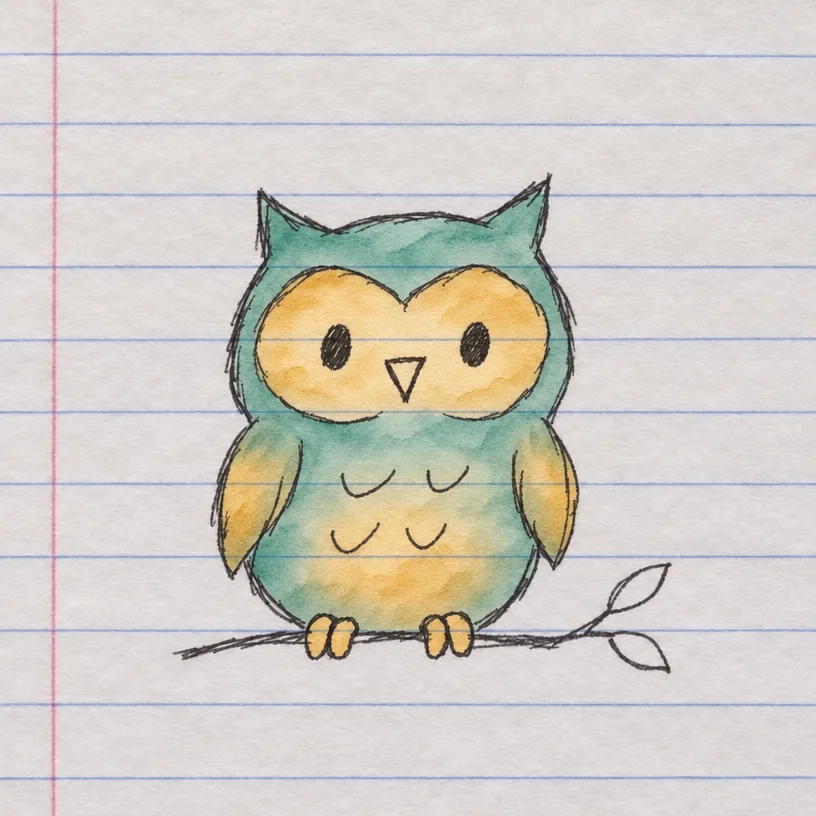
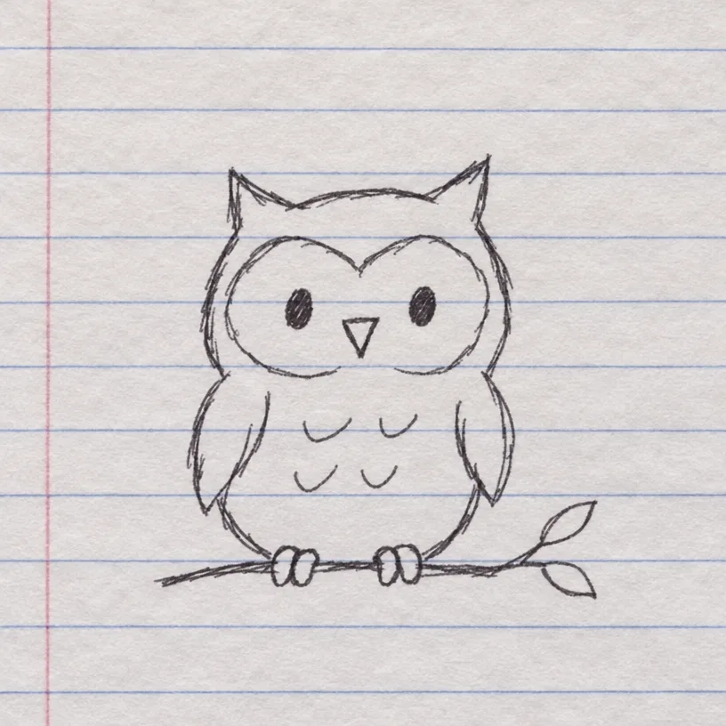

<!-- Generated by scripts/build_readme.py. Edit source data, locale catalogs and generator scripts. -->

# Owl doodle watercolor edit

[← Back to all cases](../../README.md#all-cases)

 

**Creator-reported model · Source-only; not independently reproduced**

The source pairs the pen drawing with the watercolor edit; both are archived. Offline recovery recheck on 2026-11-08 confirms retained source mapping and original file integrity, not backend execution or current availability.

## Images / GIFs

- [Teal and ochre watercolor washes added to an owl drawing.](https://artworks.aicartoongenerator.io/assets/pages/models/gpt-image-2-6/outputs/gallery-06-owl-watercolor.webp) · image
  - Credit: Toonderly
  - Reuse: source-attributed. Public source sample archived unchanged with attribution. No redistribution license verified; not open-licensed and not covered by the repository MIT license.
  - [Provenance / rights evidence](https://aicartoongenerator.io/models/gpt-image-2-6)

**Reference/input image, not a generated output.**

- [Original pen-drawn owl doodle reference](https://artworks.aicartoongenerator.io/assets/pages/models/gpt-image-2-6/outputs/gallery-02-owl-doodle.webp) · image
  - Credit: Toonderly
  - Reuse: source-attributed. Public source sample archived unchanged with attribution. No redistribution license verified; not open-licensed and not covered by the repository MIT license.
  - [Provenance / rights evidence](https://aicartoongenerator.io/models/gpt-image-2-6)

## Source-page and media access

- Checked: 2026-11-05 (UTC)
- Original page: Accessible. Historical source access is recorded for 2026-11-05. Retained original source evidence was rechecked offline on 2026-11-08; no current availability check was made.
- Media: Archived locally. Retained original bytes were rechecked by SHA-256, byte length and full decoding on 2026-11-08. Every GIF frame and each distinct MP4 frame was inspected as still frames; this is not new timed playback or an online access test.
- [Per-file attempts and results](../../docs/NOWRAP_CELLCOG_TOONDERLY_RECOVERY_AUDIT_2026-11-08.md)

## Original prompt

**PLACEHOLDER: prompt not publicly provided.**

## Attribution and verification

- ID: toonderly-owl-watercolor
- Author: Toonderly
- [Original source](https://aicartoongenerator.io/models/gpt-image-2-6)
- Model: GPT Image 2.6
- Variant: Sunburst
- Evidence: The retained 2026-11-05 page text explicitly attributes Toonderly’s own generated samples, including both GIFs, to GPT Image 2.6 Sunburst. This applies to the output, not a claim that reference inputs were generated by that model. The separately credited official whale imagery is excluded. These are publisher claims, not independently reproduced generations.
- Collected: 2026-11-05 (UTC)
- Source checked: 2026-11-08 (UTC)

Attribution does not grant a media license. Repository MIT terms do not cover third-party outputs. Local files record provenance and reuse status; source-attributed does not mean open-licensed.
