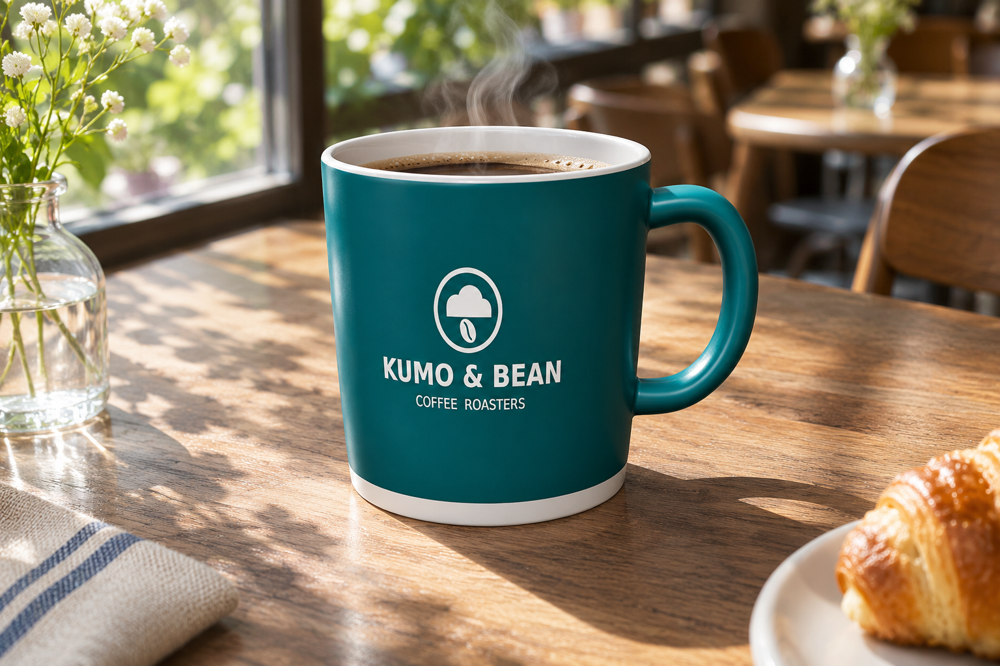
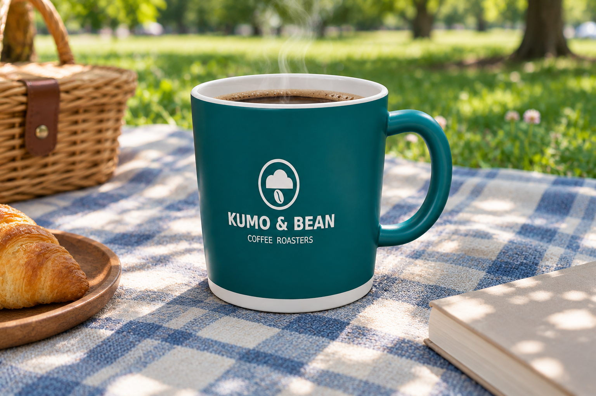
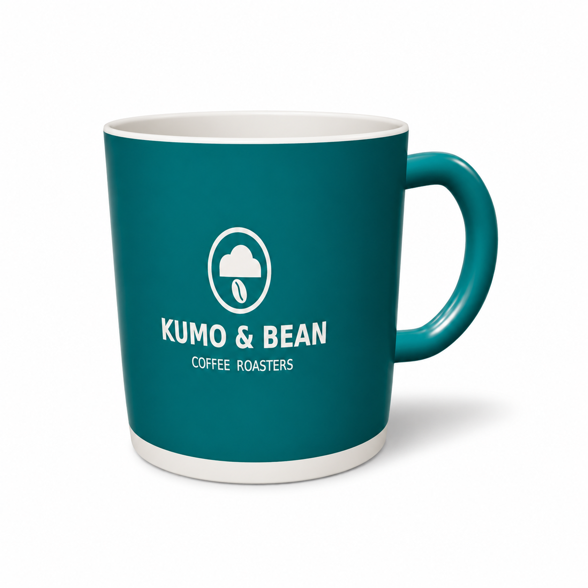
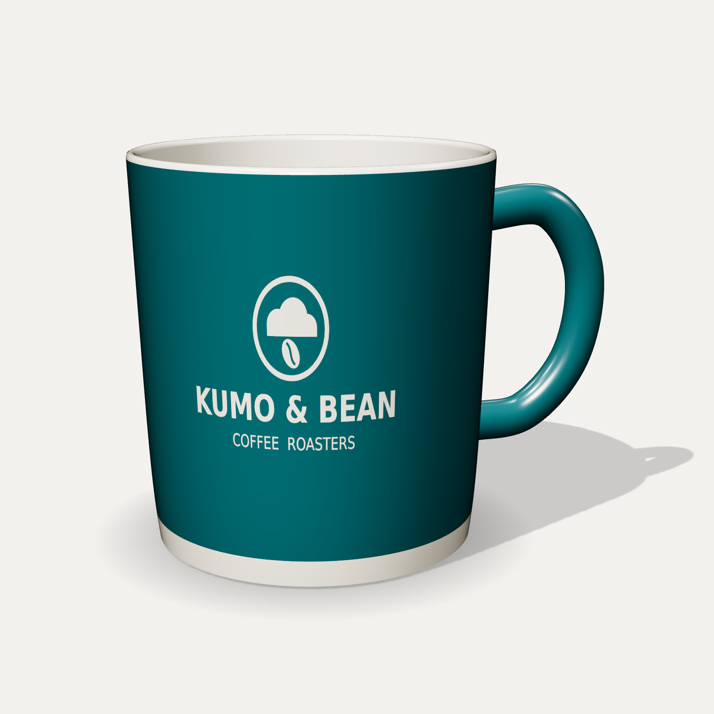

<!-- Generated by scripts/build_readme.py. Edit source data, locale catalogs and generator scripts. -->

# Saved mug reference across three scenes

[← Back to all cases](../../README.md#all-cases)

 

**Creator-reported model · Source-only; not independently reproduced**

One reference-reuse series, not three separate tests: a cafe table, a park picnic and a square white-background ecommerce image. The three public Japanese prompts are expanded in the source. The source reports preserved color, logo and shape, while noting that the cafe and picnic outputs add coffee without being asked. The mug reference is an input, not an additional 2.6 output. No independent generation was run.

## Images / GIFs

- [Teal KUMO & BEAN mug filled with coffee on a sunlit cafe table](https://weel.co.jp/wp-content/uploads/%E6%9C%9D%E3%81%AE%E9%99%BD%E3%81%A0%E3%81%BE%E3%82%8A%E3%81%A8%E3%82%AF%E3%83%A2%EF%BC%86%E3%83%93%E3%83%BC%E3%83%B3%E3%81%AE%E3%83%9E%E3%82%B0.png) · image
  - Credit: WEEL (ウィール) / WEEL Inc.
  - Reuse: source-attributed. Unmodified public example archived with source attribution. No explicit redistribution licence has been verified. Attribution and public availability are not permission; the repository MIT licence does not cover this media. Character, trademark and other third-party rights may apply.
  - [Provenance / rights evidence](https://weel.co.jp/media/tech/chatgpt-images-2-6/#index_id27)

- [The teal branded mug filled with coffee on a checked picnic blanket](https://weel.co.jp/wp-content/uploads/%E6%9C%A8%E6%BC%8F%E3%82%8C%E6%97%A5%E3%81%AE%E3%83%94%E3%82%AF%E3%83%8B%E3%83%83%E3%82%AF%E3%82%B3%E3%83%BC%E3%83%92%E3%83%BC.png) · image
  - Credit: WEEL (ウィール) / WEEL Inc.
  - Reuse: source-attributed. Unmodified public example archived with source attribution. No explicit redistribution licence has been verified. Attribution and public availability are not permission; the repository MIT licence does not cover this media. Character, trademark and other third-party rights may apply.
  - [Provenance / rights evidence](https://weel.co.jp/media/tech/chatgpt-images-2-6/#index_id27)

- [The teal branded mug isolated on white for an ecommerce thumbnail](https://weel.co.jp/wp-content/uploads/%E7%99%BD%E3%81%84%E8%83%8C%E6%99%AF%E3%81%AE%E3%83%86%E3%82%A3%E3%83%BC%E3%83%AB%E3%83%9E%E3%82%B0%E3%80%8CKUMO-BEAN%E3%80%8D.png) · image
  - Credit: WEEL (ウィール) / WEEL Inc.
  - Reuse: source-attributed. Unmodified public example archived with source attribution. No explicit redistribution licence has been verified. Attribution and public availability are not permission; the repository MIT licence does not cover this media. Character, trademark and other third-party rights may apply.
  - [Provenance / rights evidence](https://weel.co.jp/media/tech/chatgpt-images-2-6/#index_id27)

**Reference/input image, not a generated output.**

- [Reference input: teal KUMO & BEAN mug on a pale neutral background](https://weel.co.jp/wp-content/uploads/mug.png) · image
  - Credit: WEEL (ウィール) / WEEL Inc.
  - Reuse: source-attributed. Unmodified public example archived with source attribution. No explicit redistribution licence has been verified. Attribution and public availability are not permission; the repository MIT licence does not cover this media. Character, trademark and other third-party rights may apply.
  - [Provenance / rights evidence](https://weel.co.jp/media/tech/chatgpt-images-2-6/#index_id27)

## Source-page and media access

- Checked: 2026-11-08 (UTC)
- Original page: Accessible. The existing original article returned HTTP 200. Its own hands-on section maps this specific workflow, prompt and media to a creator-reported Images 2.6 test; the variant remains unspecified.
- Media: Archived locally. Normally accessible originals were matched to exact page URLs, re-fetched for byte comparison, decoded and visually inspected. Link-only exceptions, if any, are explained per file. No generation was independently reproduced.
- [Per-file attempts and results](../../docs/WEEL_STRUGGLE_SOURCE_AUDIT_2026-11-08.md)

## Original prompt

[Original prompt at source](https://weel.co.jp/media/tech/chatgpt-images-2-6/#index_id27)

The source publishes the actual prompt. This repository links to it rather than inventing or republishing the full text. Required inputs and parameters remain at the source.

## Attribution and verification

- ID: weel-saved-mug-scenes
- Author: WEEL (ウィール) / WEEL Inc.
- [Original source](https://weel.co.jp/media/tech/chatgpt-images-2-6/#index_id27)
- Model: GPT Image 2.6
- Variant: Variant unspecified
- Evidence: WEEL labels the hands-on section “ChatGPT Images 2.6を実際に使って検証してみた” and says it saved a mug reference named マグ, then called it from a new chat for three scenes. The article supplies the input, three individual prompts and three results. This is the publisher’s model attribution; the underlying Flare/Sunburst variant is not disclosed.
- Collected: 2026-11-05 (UTC)
- Source checked: 2026-11-08 (UTC)

Attribution does not grant a media license. Repository MIT terms do not cover third-party outputs. Local files record provenance and reuse status; source-attributed does not mean open-licensed.
