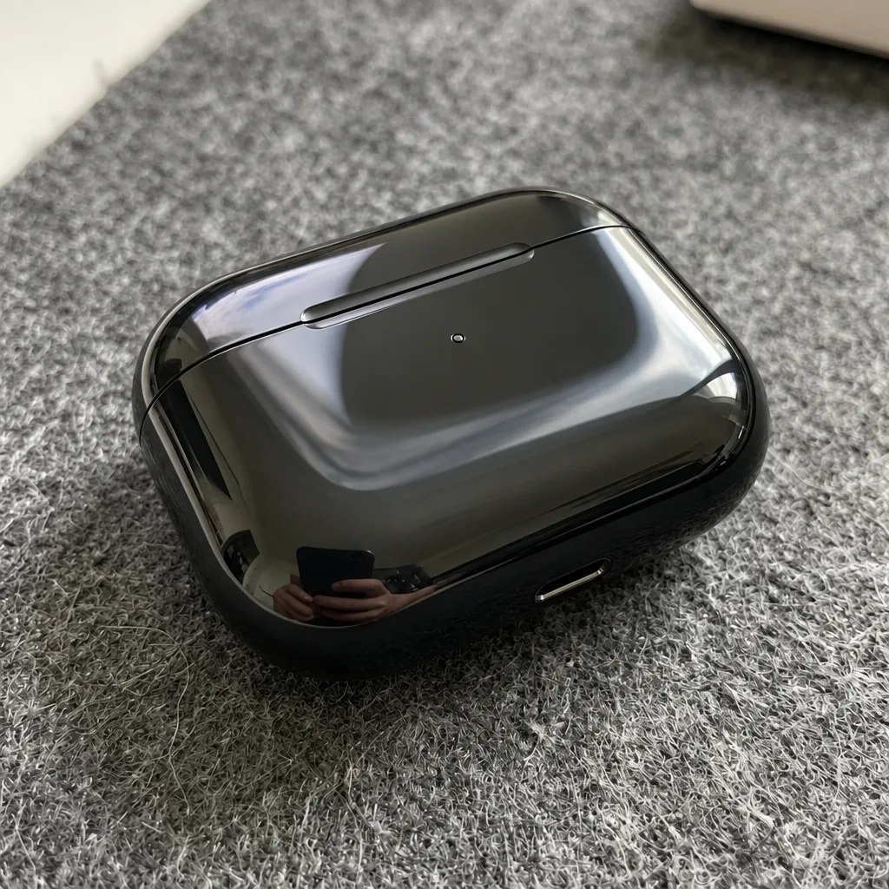

<!-- Generated by scripts/build_readme.py. Edit source data, locale catalogs and generator scripts. -->

# Remove Dust and Fingerprints

[← Back to all cases](../../README.md#all-cases)

 

**Creator-reported model · Source-only; not independently reproduced**

Only the published GPT Image 2.6 result is archived. The reference photo and Nano Banana comparison are not model outputs in this case and are not copied. The page links a separate prompt page, but that separate page and exact wording were not inspected in this recovery review; prompt availability is marked unverified. No prompt was reconstructed from the picture or title. Each brief uses its own source photo and task; no variant or frame is counted as a separate case. The source reports eight brushed edits used automatic guide masks, not the new markup layer; exact per-case mask assignment is not independently established.

## Images / GIFs

- [Glossy black earbud case on textured gray fabric.](https://yepshot.com/explore/cleanup-dust-fingerprints-after-gpt26.webp) · image
  - Credit: YepShot
  - Reuse: source-attributed. Unmodified copy of the publicly posted file. No explicit redistribution license verified. Attribution is not permission; the repository MIT license does not cover this media.
  - [Provenance / rights evidence](https://yepshot.com/nano-banana-2-1-vs-gpt-image-2-6)

## Source-page and media access

- Checked: 2026-11-08 (UTC)
- Original page: Accessible. Reopened only the known primary article for the existing retained cases. Model labels and exact original media links were checked, with the GIF-to-WebP source change disclosed. No new case search.
- Media: Archived locally. All retained original media URLs returned HTTP 200 and matched their stored SHA-256 and byte counts. Stills and every animation frame were decoded and visually reviewed. SVG safety and rendering were checked. A link-only edit reference is not another archived output.
- [Per-file attempts and results](../../docs/AIVIDEOS_YEPSHOT_RECOVERY_AUDIT_2026-11-08.md)

## Original prompt

**Prompt availability unverified**

Public availability of the original prompt has not been verified. The original source is credited below.

## Attribution and verification

- ID: yepshot-cleanup-dust-fingerprints
- Author: YepShot
- [Original source](https://yepshot.com/nano-banana-2-1-vs-gpt-image-2-6)
- Model: GPT Image 2.6
- Variant: Flare
- Evidence: The primary comparison page reopened on 2026-11-08 explicitly labels the original full-size file link as a GPT Image 2.6 result. Its updated methods report one Flare medium-quality, auto-aspect-ratio 1K edit via fal.ai on 2026-11-06. This resolves the older retained article that described only a GPT Image 2.5 test. Publisher self-report, not an independently verified backend run.
- Collected: 2026-11-06 (UTC)
- Source checked: 2026-11-08 (UTC)

Attribution does not grant a media license. Repository MIT terms do not cover third-party outputs. Local files record provenance and reuse status; source-attributed does not mean open-licensed.
