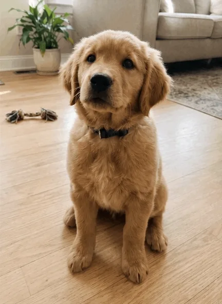
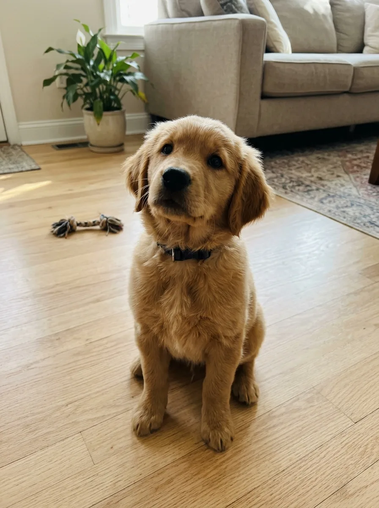

<!-- Generated by scripts/build_readme.py. Edit source data, locale catalogs and generator scripts. -->

# 小狗歪头动画

[← 返回全部案例](../../README.zh-CN.md#all-cases)

 

**作者自报模型 · 仅核对来源；未独立复现**

来源称其为 GIF，但原始下载文件实际为动态 WebP：9 帧，每帧 200 毫秒，共 1.8 秒循环。已检查全部 9 帧及单独的 AI 生成参考图，并核对公开详情页提示词。GPT Image 2.6 归因来自作者，此例未确认 Flare 或 Sunburst 变体。 2026-11-08离线恢复复核了留存来源证据与原文件完整性，未测试当前来源访问、动画播放或模型执行。

## 图片 / GIF

- [客厅里歪头的金色小狗。](https://yepshot.com/explore/gif-pet-head-tilt-after.webp) · image
  - 署名：YepShot
  - 使用条件：source-attributed. 未经修改的来源素材，保留创作者署名。未核实明确转载许可；署名不等于授权，仓库 MIT 许可不覆盖此素材。
  - [来源 / 权利依据](https://yepshot.com/explore/gif-pet-head-tilt)

**参考 / 输入图，不是生成结果。**

- [AI 生成的客厅中坐着的金色小狗。](https://yepshot.com/explore/gif-pet-head-tilt-before.webp) · image
  - 署名：YepShot
  - 使用条件：source-attributed. 未经修改的来源素材，保留创作者署名。未核实明确转载许可；署名不等于授权，仓库 MIT 许可不覆盖此素材。
  - [来源 / 权利依据](https://yepshot.com/explore/gif-pet-head-tilt)

## 原帖与素材获取状态

- 核对日期：2026-11-06 (UTC)
- 原帖：未知. 收集者于2026-11-05检查来源访问；此前审核于2026-11-06复查留存证据，本次于2026-11-08再次离线复核。两次本地审核均不证明当前可访问性。
- 素材：已存入仓库. 已核对原始存档字节、格式、元数据及画面。仅链接项目不含仓库素材副本；不声称已实时播放。
- [逐项尝试与结果](../../docs/YEPSHOT_ZZO_RECOVERY_AUDIT_2026-11-08.md)

## 原始提示词

[原提示词见来源](https://yepshot.com/explore/gif-pet-head-tilt)

来源公开了真实提示词。本仓库链接原文，不伪造或转载完整长提示词；所需输入与参数请在原文查看。

## 来源与核对信息

- ID: yepshot-pet-head-tilt
- 作者：YepShot
- [原始来源](https://yepshot.com/explore/gif-pet-head-tilt)
- 模型：GPT Image 2.6
- 版本：版本未注明
- 依据：https://yepshot.com/gpt-image-2-6 明确称四个链接示例均由 YepShot 使用 GPT Image 2.6、左侧 AI 生成参考图及卡片提示词制作，并称这些示例为其 2026 年 11 月 5 日在 fal.ai 上的自行测试。另列的 Flare 价格测试不能证明每个示例的版本。 这是来源归因，并非独立模型验证。
- 收录：2026-11-05 (UTC)
- 来源核对：2026-11-08 (UTC)

标注来源不等于取得素材许可。仓库 MIT 协议不覆盖第三方输出；本地素材逐项记录来源与使用状态，source-attributed 不代表开放许可。
