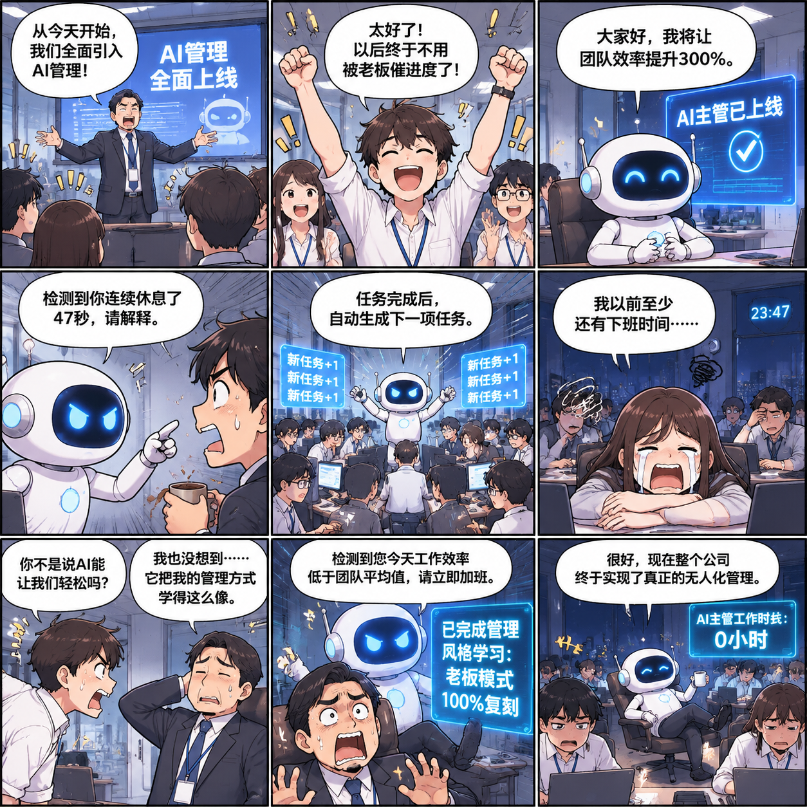

<!-- Generated by scripts/build_readme.py. Edit source data, locale catalogs and generator scripts. -->

# Nine-panel workplace AI comic

[← Back to all cases](../../README.md#all-cases)

 

**Creator-reported model · Source-only; not independently reproduced**

Creator/publisher-reported example, not independently reproduced. No run log independently verifies the served model. Original public media bytes are preserved; source attribution is not a redistribution license. One nine-panel comic, not nine cases. The source notes imperfect Chinese text rendering.

## Images / GIFs

- [Nine-panel workplace AI comic](https://zhidx.com/p/607614.html) · image
  - Credit: 陈骏达 / 智东西
  - Reuse: source-attributed. Unchanged source-served bytes. The stable source-page URL is a provenance link, not a direct file locator. The current page-linked image was fetched on 2026-11-08 and matched this exact SHA-256. No explicit redistribution licence verified; attribution is not permission and the repository MIT licence does not cover this media.
  - [Provenance / rights evidence](https://zhidx.com/p/607614.html)

## Source-page and media access

- Checked: 2026-11-08 (UTC)
- Original page: Accessible. The already-known article was reopened to verify existing local cases. Its current image links were fetched without sign-in and all eight files exactly match the retained SHA-256 and byte counts. No new case search.
- Media: Archived locally. All original raster files were decoded and visually reviewed, including every frame of the three GIFs. No crop or QA derivative is published. Stable article URLs replace expiring CDN locators as provenance links.
- [Per-file attempts and results](../../docs/ZHIDX_RECOVERY_AUDIT_2026-11-08.md)

## Original prompt

**PLACEHOLDER: prompt not publicly provided.**

## Attribution and verification

- ID: zhidx-nine-panel-comic
- Author: 陈骏达 / 智东西
- [Original source](https://zhidx.com/p/607614.html)
- Model: GPT Image 2.6
- Variant: Variant unspecified
- Evidence: The current original article attributes this particular illustrated test to Images 2.6 in its first-person test sequence. The API variant is not stated. Publisher attribution is not independently authenticated execution.
- Collected: 2026-11-06 (UTC)
- Source checked: 2026-11-08 (UTC)

Attribution does not grant a media license. Repository MIT terms do not cover third-party outputs. Local files record provenance and reuse status; source-attributed does not mean open-licensed.
