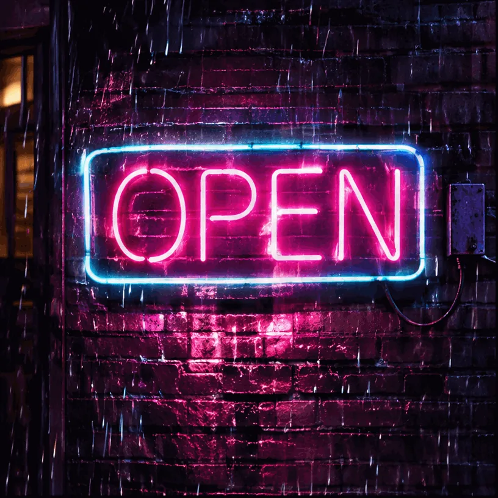

<!-- Generated by scripts/build_readme.py. Edit source data, locale catalogs and generator scripts. -->

# OPEN neon animation preview

[← Back to all cases](../../README.md#all-cases)

 

**Creator-reported model · Source-only; not independently reproduced**

Static poster with pink OPEN neon lettering on a rainy brick wall. The downloaded file is a single-frame WebP poster, not the claimed animation. Original animation URL is unknown. A referenced frontend JavaScript request returned HTTP 403; it was not retried or bypassed. The page displays the prompt for this sample, linked without reconstruction. Offline recovery review on 2026-11-08 rechecked retained source evidence and original file integrity. Current source availability, animation playback and model execution were not tested.

## Images / GIFs

- [Static poster with pink OPEN neon lettering on a rainy brick wall.](https://zzo.ai/samples/gpt-image-2-6/neon-open-sign.webp) · poster
  - Credit: zzo.ai
  - Reuse: source-attributed. Public provider asset archived unmodified with source attribution. No redistribution license was located; attribution is not permission or an open license. This file is only the source-supplied static poster; animation rights and original file remain unverified. Terms checked on 2026-11-05: https://zzo.ai/terms-of-service. Customer-output commercial-use statements do not license these site samples. The repository MIT license does not cover this third-party file.
  - [Provenance / rights evidence](https://zzo.ai/models/gpt-image-2-6)

## Source-page and media access

- Checked: 2026-11-05 (UTC)
- Original page: Accessible. The collector checked source access on 2026-11-05. A prior audit reviewed retained evidence on 2026-11-06, followed by this offline recovery recheck on 2026-11-08. Neither local review establishes current availability.
- Media: Partially archived. The 2026-11-05 manifest records HTTP 200 for the static WebP preview and any listed reference. A referenced frontend-script request returned 403, so original animation URLs remain unknown. This audit did not retry or reacquire content. Every local file is a static image, not an archived animation.
- [Per-file attempts and results](../../docs/YEPSHOT_ZZO_RECOVERY_AUDIT_2026-11-08.md)

## Original prompt

[Original prompt at source](https://zzo.ai/models/gpt-image-2-6)

The source publishes the actual prompt. This repository links to it rather than inventing or republishing the full text. Required inputs and parameters remain at the source.

## Attribution and verification

- ID: zzo-neon-open-sign
- Author: zzo.ai
- [Original source](https://zzo.ai/models/gpt-image-2-6)
- Model: GPT Image 2.6
- Variant: Variant unspecified
- Evidence: zzo.ai lists open neon animation preview in its “Made with GPT Image 2.6” gallery, with a GIF badge and provider sample attribution. The exact Flare/Sunburst variant was not disclosed for this sample. Only its static WebP preview was retrieved; this is not independent model verification.
- Collected: 2026-11-05 (UTC)
- Source checked: 2026-11-08 (UTC)

Attribution does not grant a media license. Repository MIT terms do not cover third-party outputs. Local files record provenance and reuse status; source-attributed does not mean open-licensed.
