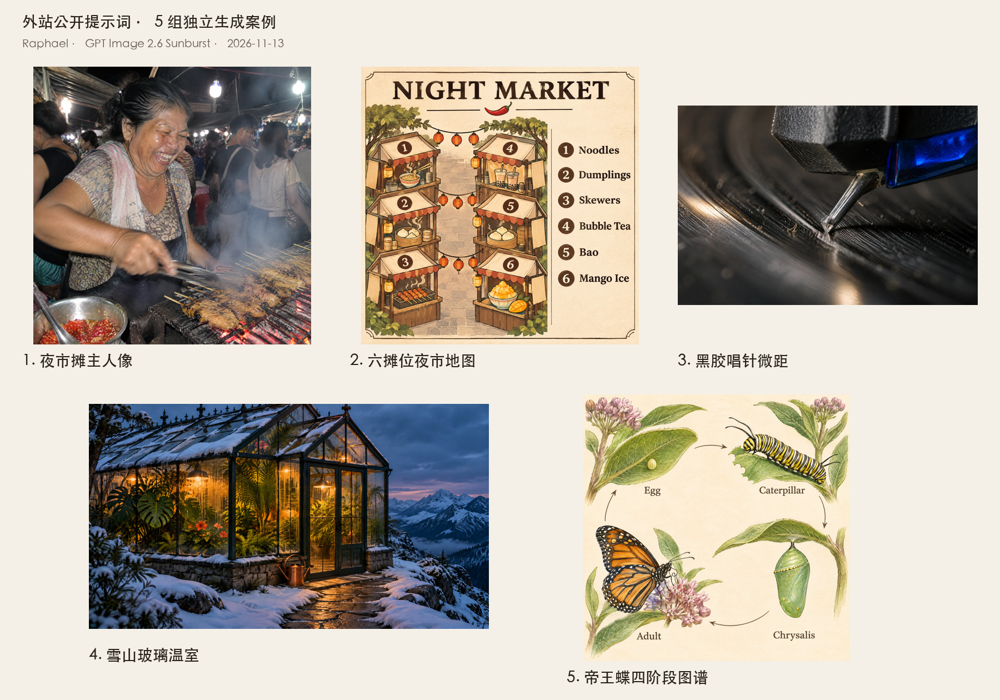

# 外站公开提示词：五组独立生成案例

2026 年 11 月 13 日，从已迁出的外站资料中选取五条公开完整的文生图提示词，经 Raphael 重新生成五张新图，收录到 `content/prompts.json`。外站原图未上传生成服务，也未搬回本仓库。原始提示词、作者和准确来源逐项保留。



## 案例与实际结果

| 案例 | 本次下载尺寸 | 原始提示词来源 | 目视检查与局限 |
| --- | --- | --- | --- |
| [夜市摊主人像](../cases/recreated-night-market-vendor/README.zh-CN.md) | 2048×2048 | [Made：Flare 示例](https://www.made.app/models/gpt-image-2-6-flare#examples-heading) | 笑脸、翻串、炭火烟雾、裸灯和直闪风格可见；动作模糊下不认证手指细节。 |
| [六摊位夜市地图](../cases/recreated-night-market-map/README.zh-CN.md) | 2048×2048 | [Made：Flare 示例](https://www.made.app/models/gpt-image-2-6-flare#examples-heading) | 标题、六条英文图例和编号正确；实际为两列摊位、一条中央通道，未满足原词的两条通道。 |
| [黑胶唱针微距](../cases/recreated-vinyl-stylus-macro/README.zh-CN.md) | 2048×1360 | [Made：Sunburst 示例](https://www.made.app/models/gpt-image-2-6-sunburst#examples-heading) | 唱针、沟槽、灰尘与浅景深可见；机械几何未实测。网页选择 3:2，实际尺寸按下载文件记录。 |
| [雪山玻璃温室](../cases/recreated-snowy-greenhouse/README.zh-CN.md) | 2048×1152 | [Analytics Vidhya：电影感摄影](https://www.analyticsvidhya.com/blog/2026/11/gpt-image-2-6-review/#h-1-a-cinematic-editorial-photograph) | 暖光绿植、积雪、凝露、入口石径和一只铜壶可见；近处屋顶被上缘裁切，不是施工或热工设计。 |
| [帝王蝶四阶段图谱](../cases/recreated-monarch-life-cycle/README.zh-CN.md) | 2048×2048 | [Analytics Vidhya：自然图谱](https://www.analyticsvidhya.com/blog/2026/11/gpt-image-2-6-review/#h-4-a-scientific-field-guide-illustration) | 四象限、四标签及顺时针箭头正确；卵放大展示，比例与物种形态未经专家审校。 |

## 本次执行证据

全部通过 Raphael 文生图网页执行，选择器与生成历史显示 `GPT Image 2.6 Sunburst`。Made 的前两条原示例标为 Flare，本次实际运行 Sunburst，因此只称为使用相同提示词独立生成，不称为原图复刻或双模型对比。

每条均使用原始完整提示词、不上传参考图、关闭 AI Enhance、输出一张图片。网页分辨率选择 `2K`、质量选择 `Standard`、Planning intensity 选择 `Medium`；历史卡片的质量标签为 `Medium`。这些是网页原始标签，未检查底层请求，`api_model_id`、官方 API `quality` 和 `complexity` 保留未知，不推定它们的映射。

每个案例目录包含 `prompt.txt` 和 `generation.json`：记录提示词哈希、网页生成时间、实际尺寸、原始 PNG 哈希、展示图哈希、具体局限及脱敏截图路径。模型和参数证据截取自该条生成卡片，移除了侧栏账号、积分和其他历史。完整制作工程与原始 PNG 保留在仓库外的同级 `raphael-prompt-studio/`。

仓库展示图采用无损 WebP，逐张解码后与下载的 PNG 比较 RGBA 像素，尺寸和像素一致；未做画面修补、重绘或裁切。总览拼图只等比缩小完整画幅并添加标题，不计为第六个案例。

## 来源与使用状态

第三方提示词使用 `source.provenance: collected`、`rights.prompt: source-attributed`；新生成图使用 `rights.preview: own`，明确由本次任务生成。未核实第三方提示词的独立转载许可证，署名不构成授权，仓库 MIT 协议不覆盖这些提示词与生成图。新图不继承外站原图的授权状态。

`verification.status: tested` 表示已真实执行并记录结果，包含未完全满足原词的情况；它不代表用户已批准最终画面，也不代表科学、工程或商业适用性通过审查。

## 仓库维护

README 顶部的“完整提示词”入口直达五组配方，并提供中英文详情页；16 种语言共用生成器。来源案例集仍按原范围维护，外站原始素材未重新进入 `content/source-cases.json`。

```bash
python3 scripts/build_readme.py
python3 scripts/validate.py
python3 scripts/build_readme.py --check
python3 -m unittest discover -s tests -v
```
