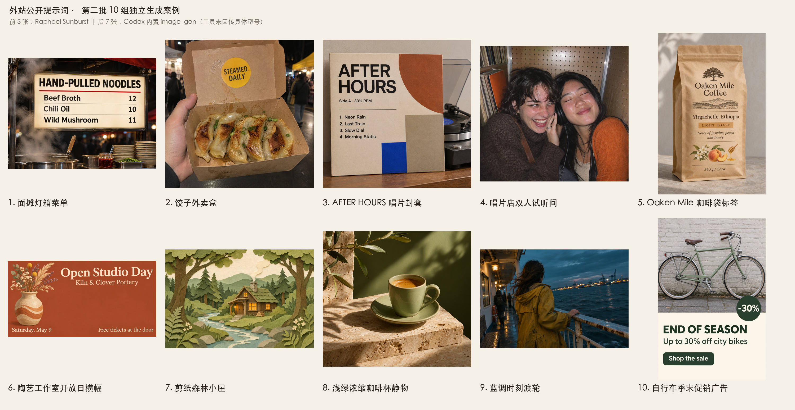

# 外站公开提示词：第二批十组独立生成案例

本批新增十张图片及完整配方，累计十五条。前三条案例经 Raphael 网页生成，后七条使用 Codex 内置 `image_gen` 工具；每条均使用公开原页的完整提示词，不上传外站原图，不与第一批重复。

## 案例与验收

| 案例 | 实际执行平台 | 目视检查及局限 |
| --- | --- | --- |
| [面摊灯箱菜单](../cases/recreated-noodle-lightbox-menu/README.zh-CN.md) | Raphael · Sunburst | 标题与三组菜名、价格匹配，蒸汽可见。 |
| [饺子外卖盒](../cases/recreated-dumpling-takeaway-box/README.zh-CN.md) | Raphael · Sunburst | STEAMED DAILY 标签正确；手只部分入镜，不认证完整手部细节。 |
| [AFTER HOURS 唱片封套](../cases/recreated-after-hours-record-sleeve/README.zh-CN.md) | Raphael · Sunburst | 标题、转速与四行曲目匹配。 |
| [唱片店双人试听间](../cases/recreated-record-listening-booth/README.zh-CN.md) | Codex 内置 image_gen | 笑脸、闭眼、洞洞板及耳机可见；耳机部分位于颈侧，不能确认两人同时佩戴试听。 |
| [Oaken Mile 咖啡标签](../cases/recreated-oaken-mile-coffee-label/README.zh-CN.md) | Codex 内置 image_gen | 品牌、产地、风味及净重可读；Light Roast 改成了 LIGHT ROAST。 |
| [陶艺开放日横幅](../cases/recreated-pottery-open-studio-banner/README.zh-CN.md) | Codex 内置 image_gen | 四组文字和位置匹配；花瓶下缘约达 85% 高度，超过原词约 75% 的要求，风格也带明暗体积。 |
| [剪纸森林小屋](../cases/recreated-paper-cut-forest-cabin/README.zh-CN.md) | Codex 内置 image_gen | 纸艺、绿系、暖窗与蜿蜒河流可见；小屋略偏右，非严格几何居中。 |
| [浅绿咖啡杯静物](../cases/recreated-espresso-cup-still-life/README.zh-CN.md) | Codex 内置 image_gen | 咖啡杯、洞石、绿背景及定向阳光匹配；另加杯碟与橄榄枝，原词未禁止。 |
| [蓝调时刻渡轮](../cases/recreated-blue-hour-ferry/README.zh-CN.md) | Codex 内置 image_gen | 背影、旧黄雨衣、风吹头发、湿锈栏杆及港口灯光匹配；不能验证生成图的实际镜头焦距。 |
| [自行车季末促销](../cases/recreated-bicycle-season-sale-ad/README.zh-CN.md) | Codex 内置 image_gen | 三组文案与折扣徽章正确；照片约占上方 58%，未严格上下各半。 |

“实测”表示真实执行并记录结果，不表示每条指令完全满足。局限已进入中英文详情与每条 `generation.json`。

## 生成方式与模型边界

前三张的选择器、历史卡片和结果路径均显示 GPT Image 2.6 Sunburst，网页选择 2K、Standard、Medium planning intensity、PNG、一张输出，关闭 AI Enhance。历史卡片质量标签为 Medium，保留网页原值，不推定官方参数映射；API 模型 ID 保留未知。

后七张每条只调用一次内置 `image_gen`，直接传入来源原词，未指定该工具没有暴露的尺寸、质量或 seed 参数。工具返回 `image_url` 和保存提示，没有返回具体模型系列、版本或 API 模型 ID，因此 `model.family: null`、`variant: unspecified`、`api_model_id: null`。这些条目是公开提示词的执行记录，不作为已核验 GPT Image 2.6 模型输出，也不标记为 Sunburst 或 Flare。所列尺寸均来自实际下载文件。

## 文件与来源

每条包含 `prompt.txt`、`generation.json`、无损 WebP 展示图与中英文详情。前三条保存脱敏网页卡片截图，后七条保存 `tool-output.json`；公开记录不包含账号、令牌、积分、其他历史或本机绝对路径。原始 PNG 和完整制作记录保存在仓库外的同级制作目录。

十张展示图逐张解码，与原始 PNG 比较 RGBA 像素及尺寸，均保持一致。总览仅等比缩小完整画幅并添加说明，不算额外案例。

提示词分别来自 [Made Flare 示例](https://www.made.app/models/gpt-image-2-6-flare#examples-heading)、[Made Sunburst 示例](https://www.made.app/models/gpt-image-2-6-sunburst#examples-heading)、[MossImage Studio](https://mossimage.studio/blog/gpt-image-2-6)、[CubistAI](https://cubistai.app/zh/ai-models/gpt-image-2-6) 与 [Yir](https://yir.ai/models/gpt-image-2-6)。已核对原页并保留每条准确来源与作者；来源署名不构成提示词使用授权，仓库 MIT 协议不覆盖提示词或生成图。外站原图和原始资料未搬回仓库。
