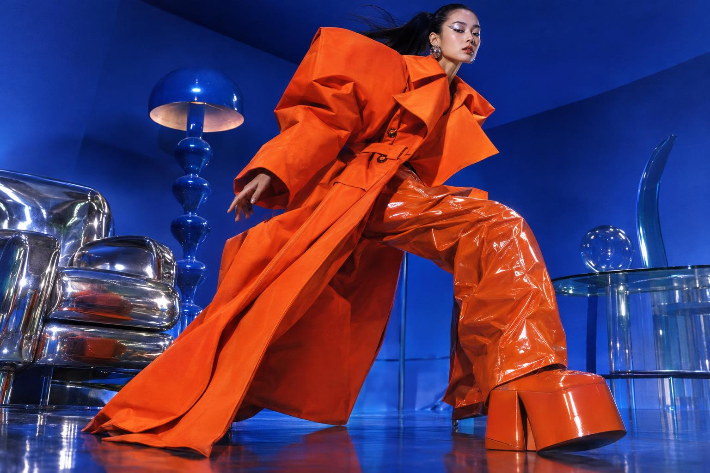
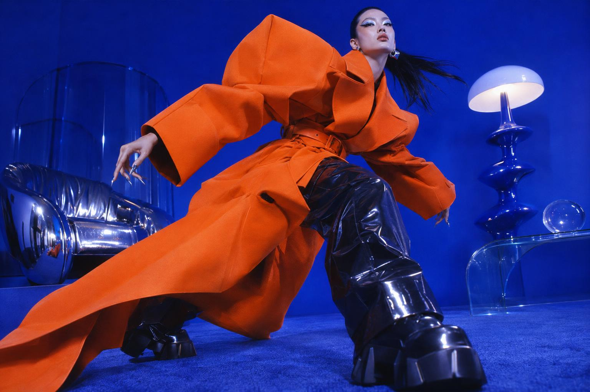

<!-- Generated by scripts/build_readme.py. Edit source data, locale catalogs and generator scripts. -->

# 蓝色摄影棚里的橙色 Y2K 时装

[← 返回外站素材目录](../../README.md#all-cases)

 

**作者自报模型 · 仅核对来源；未独立复现**

同一成年时装人物任务的两种结果，采用夸张橙色服装、低机位和高饱和蓝色摄影棚。此处是构图对照，不声称人物身份一致性已获验证。 来源自述采用 xhigh 质量、high 复杂度并展示首次返回结果；这些设置与模型身份未独立复现。原始指令公开于所链接章节，此处仅提供独立简述，不复制完整提示词，也不将来源的速度、成本或质量排名作为已核实基准。

## 图片 / GIF

- [来源标为 gpt-image-2.6-flare 的「蓝色摄影棚里的橙色 Y2K 时装」结果](https://302.ai/blog/wp-content/uploads/2026/11/asynccode-21.png) · image
  - 署名：302.AI Test Team
  - 使用条件：source-attributed. 保留发布方提供的原始素材。2026-11-08从已知文件地址取得的字节与留存SHA-256及大小一致。未验证明确转载许可，公开可访问及署名不等于授权，仓库MIT不覆盖此素材。
  - [来源 / 权利依据](https://302.ai/blog/302-ai-benchmark-lab-review-on-gpt-image-2-6-flare-and-sunburst/)

- [来源标为 gpt-image-2.6-sunburst 的「蓝色摄影棚里的橙色 Y2K 时装」结果](https://302.ai/blog/wp-content/uploads/2026/11/asynccode-22.png) · image
  - 署名：302.AI Test Team
  - 使用条件：source-attributed. 保留发布方提供的原始素材。2026-11-08从已知文件地址取得的字节与留存SHA-256及大小一致。未验证明确转载许可，公开可访问及署名不等于授权，仓库MIT不覆盖此素材。
  - [来源 / 权利依据](https://302.ai/blog/302-ai-benchmark-lab-review-on-gpt-image-2-6-flare-and-sunburst/)

## 原帖与素材获取状态

- 核对日期：2026-11-08 (UTC)
- 原帖：可打开. 仅重新打开已知来源与模型页面，为既有本地案例核对示例地址及模型标签。所有留存素材地址均成功取得文件，SHA-256及字节数与原件一致，未搜索新案例。
- 素材：已存入仓库. 保留原始字节；所有静图及GIF全部帧完整解码并目视核验。参考拼图不是生成输出，不发布质检派生图。
- [逐项尝试与结果](../../../docs/302_GPTIMAGEHUB_RECOVERY_AUDIT_2026-11-08.md)

## 原始提示词

[原提示词见来源](https://302.ai/blog/302-ai-benchmark-lab-review-on-gpt-image-2-6-flare-and-sunburst/#aioseo-%E6%A1%88%E4%BE%8B2-%E6%96%87%E7%94%9F%E5%9B%BE-%E6%97%B6%E5%B0%9A%E6%91%84%E5%BD%B1-55)

来源公开了真实提示词。本仓库链接原文，不伪造或转载完整长提示词；所需输入与参数请在原文查看。

## 来源与核对信息

- ID: 302-y2k-orange-fashion
- 作者：302.AI Test Team
- [原始来源](https://302.ai/blog/302-ai-benchmark-lab-review-on-gpt-image-2-6-flare-and-sunburst/)
- 模型：GPT Image 2.6
- 版本：Flare / Sunburst
- 依据：原文第 2 节在两份结果文件前分别直接标注 GPT-Image-2.6 Flare 与 gpt-image-2.6-sunburst。文章明确列出两个 API 模型 ID，并说明使用 302.AI API 在线调试。文件归因依据紧邻标签，不依据排列顺序或产品发布背景。这是来源自述结果，并非独立观察到的 API 响应。
- 收录：2026-11-06 (UTC)
- 来源核对：2026-11-08 (UTC)

标注来源不等于取得素材许可。仓库 MIT 协议不覆盖第三方输出；本地素材逐项记录来源与使用状态，source-attributed 不代表开放许可。
