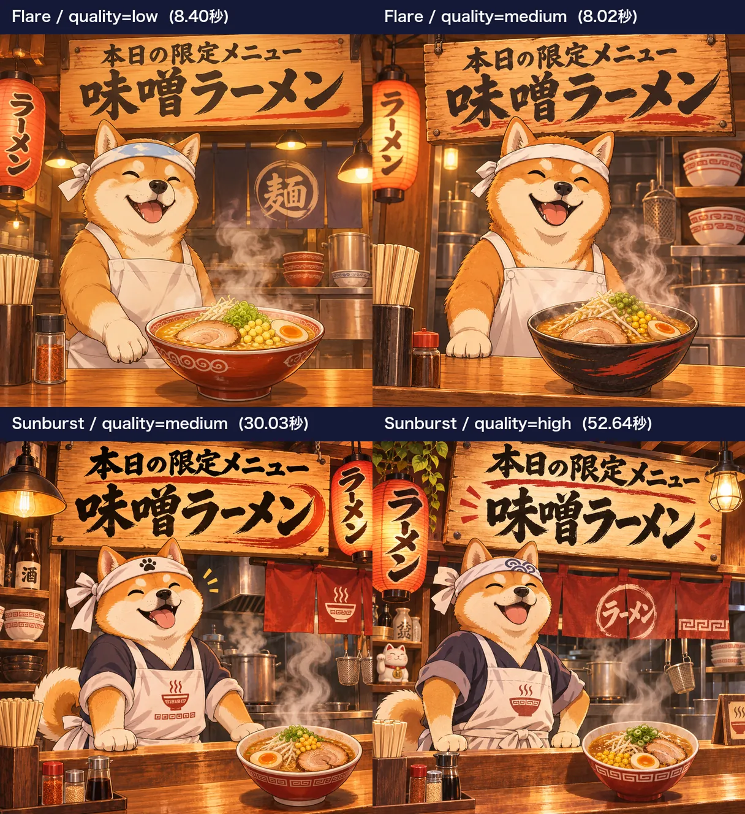
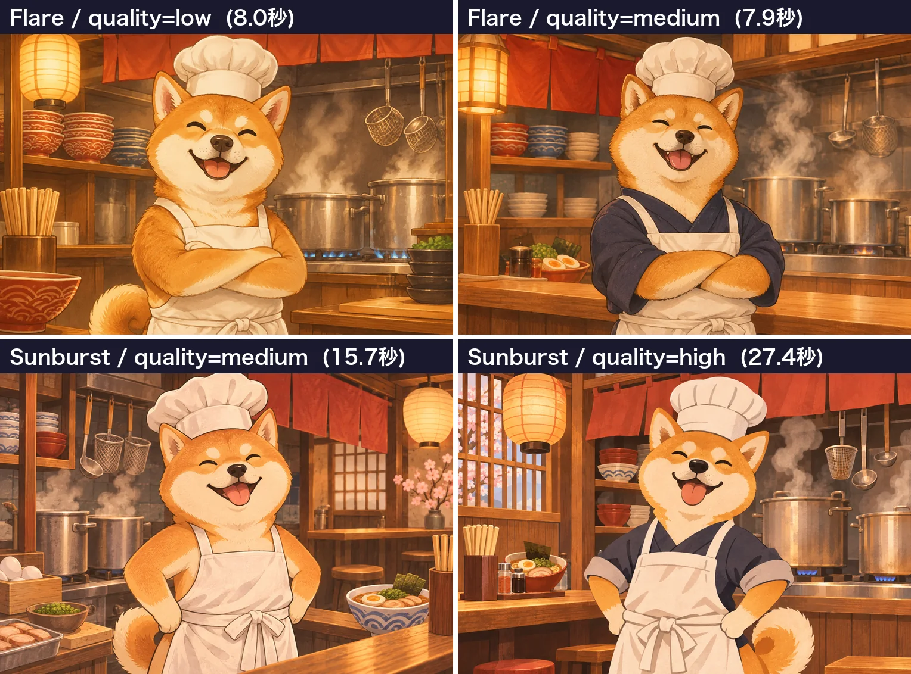

<!-- Generated by scripts/build_readme.py. Edit source data, locale catalogs and generator scripts. -->

# 柴犬拉面店：两轮画质对比

[← 返回外站素材目录](../../README.md#all-cases)

 

**作者自报模型 · 仅核对来源；未独立复现**

两张原始带标签四宫格组成一个画质及计时系列，不拆为八个案例。未公开完整生成提示词，不以题材描述替代。

## 图片 / GIF

- [柴犬拉面店：两轮画质对比。两张原始带标签四宫格组成一个画质及计时系列，不拆为八个案例。未公开完整生成提示词，不以题材描述替代。](https://ai-garage.jp/images/article-figures/gpt-image-2-6-flare-sunburst-api-test-7.webp) · image
  - 署名：Seiya Yagashiro / ai-garage
  - 使用条件：source-attributed. 公开来源副本，保留原作者署名。未核实明确转载许可证。公开可见及署名不构成授权，仓库 MIT 许可证不覆盖此媒体。
  - [来源 / 权利依据](https://ai-garage.jp/news/gpt-image-2-6-flare-sunburst-api-test/)

- [柴犬拉面店：两轮画质对比。两张原始带标签四宫格组成一个画质及计时系列，不拆为八个案例。未公开完整生成提示词，不以题材描述替代。](https://ai-garage.jp/images/article-figures/gpt-image-2-6-flare-sunburst-api-test-1.webp) · image
  - 署名：Seiya Yagashiro / ai-garage
  - 使用条件：source-attributed. 公开来源副本，保留原作者署名。未核实明确转载许可证。公开可见及署名不构成授权，仓库 MIT 许可证不覆盖此媒体。
  - [来源 / 权利依据](https://ai-garage.jp/news/gpt-image-2-6-flare-sunburst-api-test/)

## 原帖与素材获取状态

- 核对日期：2026-11-05 (UTC)
- 原帖：可打开. 已在普通浏览器中核对公开原页面及展示的模型归因，无需登录。
- 素材：已存入仓库. 两张原始 WebP 对比拼图原样存档：1216 × 1328（313,364 字节）与 1528 × 1132（267,924 字节）。已核查格式、完整图像解码、尺寸及哈希。两张四宫格仍合计为一个画质及计时系列。
- [逐项尝试与结果](../../../docs/AI_GARAGE_RAMEN_SOURCE_2026-11-05.md)

## 原始提示词

**占位：原作者未公开提示词。**

## 来源与核对信息

- ID: ai-garage-ramen-quality-series
- 作者：Seiya Yagashiro / ai-garage
- [原始来源](https://ai-garage.jp/news/gpt-image-2-6-flare-sunburst-api-test/)
- 模型：GPT Image 2.6
- 版本：Flare / Sunburst
- 依据：Seiya Yagashiro 的 11 月 5 日原始报告描述自行进行的 GPT Image 2.6 API 测试，并标注展示的变体。这是来源归因，非独立复现。
- 收录：2026-11-05 (UTC)
- 来源核对：2026-11-05 (UTC)

标注来源不等于取得素材许可。仓库 MIT 协议不覆盖第三方输出；本地素材逐项记录来源与使用状态，source-attributed 不代表开放许可。
