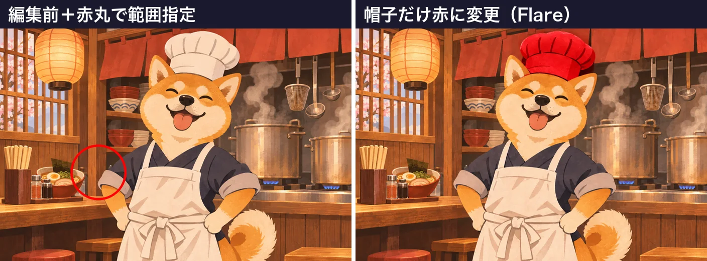

<!-- Generated by scripts/build_readme.py. Edit source data, locale catalogs and generator scripts. -->

# Red chef hat despite conflicting markup

[← Back to external website archive](../../README.md#all-cases)

 

**Creator-reported model · Source-only; not independently reproduced**

Original before/after composite. The input marks an object away from the hat, while the written instruction changes the hat. Input remains context only.

## Images / GIFs

- [Red chef hat despite conflicting markup. Original before/after composite. The input marks an object away from the hat, while the written instruction changes the hat. Input remains context only.](https://ai-garage.jp/images/article-figures/gpt-image-2-6-flare-sunburst-api-test-4.webp) · image
  - Credit: Seiya Yagashiro / ai-garage
  - Reuse: source-attributed. Public-source copy with original author attribution. No explicit redistribution license was verified. Public availability and credit do not grant permission; the repository MIT license does not cover this media.
  - [Provenance / rights evidence](https://ai-garage.jp/news/gpt-image-2-6-flare-sunburst-api-test/)

## Source-page and media access

- Checked: 2026-11-05 (UTC)
- Original page: Accessible. Original public page and displayed model attribution checked in a normal browser without login.
- Media: Archived locally. The original 1408 × 522 WebP before/after comparison is archived unchanged (117,792 bytes). Its format, full raster decoding, dimensions and hashes were checked. The marked input at left is context; only the right panel is the attributed Flare edit.
- [Per-file attempts and results](../../../docs/AI_GARAGE_CHEF_HAT_SOURCE_2026-11-05.md)

## Original prompt

[Original prompt at source](https://ai-garage.jp/news/gpt-image-2-6-flare-sunburst-api-test/)

The source publishes the actual prompt. This repository links to it rather than inventing or republishing the full text. Required inputs and parameters remain at the source.

## Attribution and verification

- ID: ai-garage-red-chef-hat
- Author: Seiya Yagashiro / ai-garage
- [Original source](https://ai-garage.jp/news/gpt-image-2-6-flare-sunburst-api-test/)
- Model: GPT Image 2.6
- Variant: Flare
- Evidence: The November 5 original report by Seiya Yagashiro describes its own GPT Image 2.6 API tests and labels the displayed variants. This is source attribution, not independent reproduction.
- Collected: 2026-11-05 (UTC)
- Source checked: 2026-11-05 (UTC)

Attribution does not grant a media license. Repository MIT terms do not cover third-party outputs. Local files record provenance and reuse status; source-attributed does not mean open-licensed.
