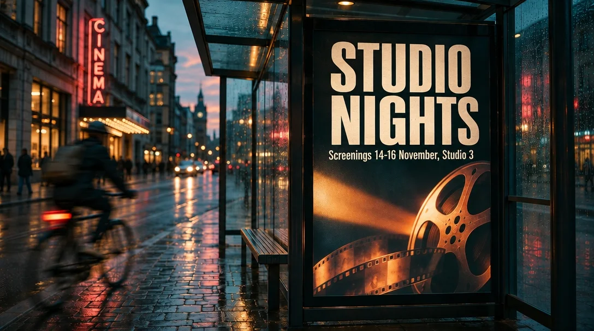

<!-- Generated by scripts/build_readme.py. Edit source data, locale catalogs and generator scripts. -->

# Flare STUDIO NIGHTS headline edit

[← Back to external website archive](../../README.md#all-cases)

 

**Creator-reported model · Source-only; not independently reproduced**

The Flare edited output is archived; the exact Sunburst input remains an original-source link and is marked as a reference, not another output. The reviewed source provides the edit instruction: change the headline to “STUDIO NIGHTS” and keep everything else identical. Visual comparison supports broad composition retention, not pixel-identical preservation. No generation was run.

## Images / GIFs

- [Bus-shelter poster after the headline changes to STUDIO NIGHTS.](https://aivideos.eu/blog/inline/gpt-image-2-6-edit-studio-nights.webp) · image
  - Credit: Richard Byrne / AI Videos
  - Reuse: source-attributed. Unmodified public-source archival copy. No explicit redistribution license verified. Attribution is not permission; the repository MIT license does not cover this media.
  - [Provenance / rights evidence](https://aivideos.eu/blog/gpt-image-2-6)
- [Sunburst AIVIDEOS FILM WEEK poster beside a wet street and blurred cyclist.](https://aivideos.eu/blog/inline/gpt-image-2-6-compare-2-6-sunburst.webp) · image
  - Credit: Richard Byrne / AI Videos
  - Reuse: link-only. Original public media is linked at its source and is not archived in this repository. No redistribution license was verified.
  - [Provenance / rights evidence](https://aivideos.eu/blog/gpt-image-2-6)

## Source-page and media access

- Checked: 2026-11-08 (UTC)
- Original page: Accessible. Reopened only the known primary article for the existing retained cases. Model labels and exact original media links were checked, with the GIF-to-WebP source change disclosed. No new case search.
- Media: Partially archived. All retained original media URLs returned HTTP 200 and matched their stored SHA-256 and byte counts. Stills and every animation frame were decoded and visually reviewed. SVG safety and rendering were checked. A link-only edit reference is not another archived output.
- [Per-file attempts and results](../../../docs/AIVIDEOS_YEPSHOT_RECOVERY_AUDIT_2026-11-08.md)

## Original prompt

[Original prompt at source](https://aivideos.eu/blog/gpt-image-2-6)

The source publishes the actual prompt. This repository links to it rather than inventing or republishing the full text. Required inputs and parameters remain at the source.

## Attribution and verification

- ID: aivideos-flare-headline-edit
- Author: Richard Byrne / AI Videos
- [Original source](https://aivideos.eu/blog/gpt-image-2-6)
- Model: GPT Image 2.6
- Variant: Flare
- Evidence: The source review explicitly describes sending the Sunburst poster to the GPT Image 2.6 Flare edit endpoint to change its headline to “STUDIO NIGHTS”. The edited media URL and its input relationship were recorded during the source review. Attribution is not independently reproduced.
- Collected: 2026-11-06 (UTC)
- Source checked: 2026-11-08 (UTC)

Attribution does not grant a media license. Repository MIT terms do not cover third-party outputs. Local files record provenance and reuse status; source-attributed does not mean open-licensed.
