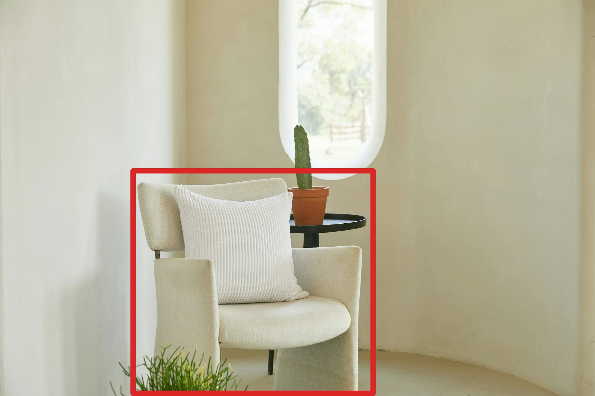

<!-- Generated by scripts/build_readme.py. Edit source data, locale catalogs and generator scripts. -->

# 标注引导的森林绿扶手椅编辑

[← 返回外站素材目录](../../README.md#all-cases)

 

**作者自报模型 · 仅核对来源；未独立复现**

分别存档 2048×1365 标注输入和 1536×1024 输出。主要软包变绿，靠垫保持白色，但椅子前下方支撑变成宽大的绿色延伸部分，未保持原来的椅腿边界。这是带有可见保留错误的编辑示例，而非完美的精准局部编辑。

## 图片 / GIF

**参考 / 输入图，不是生成结果。**

- [红色标注矩形内的原始奶油色扶手椅及白色条纹靠垫。](https://cdn.analyticsvidhya.com/wp-content/uploads/2026/11/image-6-h4tpnt.webp) · image
  - 署名：Vasu Deo Sankrityayan / Analytics Vidhya
  - 使用条件：source-attributed. 原样存档公开来源文件，未转换格式。未核实转载许可。署名不构成授权；仓库 MIT 许可不覆盖第三方素材。
  - [来源 / 权利依据](https://www.analyticsvidhya.com/blog/2026/11/gpt-image-2-6-review/#h-3-a-markup-guided-room-photo-edit)

- [编辑后的森林绿扶手椅，保留白色靠垫并移除红色标注。](https://cdn.analyticsvidhya.com/wp-content/uploads/2026/11/image-7-h4tpnt.webp) · image
  - 署名：Vasu Deo Sankrityayan / Analytics Vidhya
  - 使用条件：source-attributed. 原样存档公开来源文件，未转换格式。未核实转载许可。署名不构成授权；仓库 MIT 许可不覆盖第三方素材。
  - [来源 / 权利依据](https://www.analyticsvidhya.com/blog/2026/11/gpt-image-2-6-review/#h-3-a-markup-guided-room-photo-edit)

## 原帖与素材获取状态

- 核对日期：2026-11-05 (UTC)
- 原帖：可打开. 在普通浏览器打开原文，核对作者、测试小节和公开提示词。
- 素材：已存入仓库. 11 月 8 日本地完整解码并目检本批四项作品的五份原始 WebP。原始素材于 11 月 5 日返回 HTTP 200，本次没有重新请求来源。菜单 PDF 输入不可获取，未存档。
- [逐项尝试与结果](../../../docs/MEDIA_ACCESS_2026-11-08_ANALYTICSVIDHYA_STATIC.md)

## 原始提示词

[原提示词见来源](https://www.analyticsvidhya.com/blog/2026/11/gpt-image-2-6-review/#h-3-a-markup-guided-room-photo-edit)

来源公开了真实提示词。本仓库链接原文，不伪造或转载完整长提示词；所需输入与参数请在原文查看。

## 来源与核对信息

- ID: analyticsvidhya-markup-green-armchair
- 作者：Vasu Deo Sankrityayan / Analytics Vidhya
- [原始来源](https://www.analyticsvidhya.com/blog/2026/11/gpt-image-2-6-review/#h-3-a-markup-guided-room-photo-edit)
- 模型：GPT Image 2.6
- 版本：版本未注明
- 依据：原作者明确将此输出列为五项 Images 2.6 实测之一。未注明具体版本。这是作者自报归因，并非独立复现的模型运行。
- 收录：2026-11-05 (UTC)
- 来源核对：2026-11-05 (UTC)

标注来源不等于取得素材许可。仓库 MIT 协议不覆盖第三方输出；本地素材逐项记录来源与使用状态，source-attributed 不代表开放许可。
