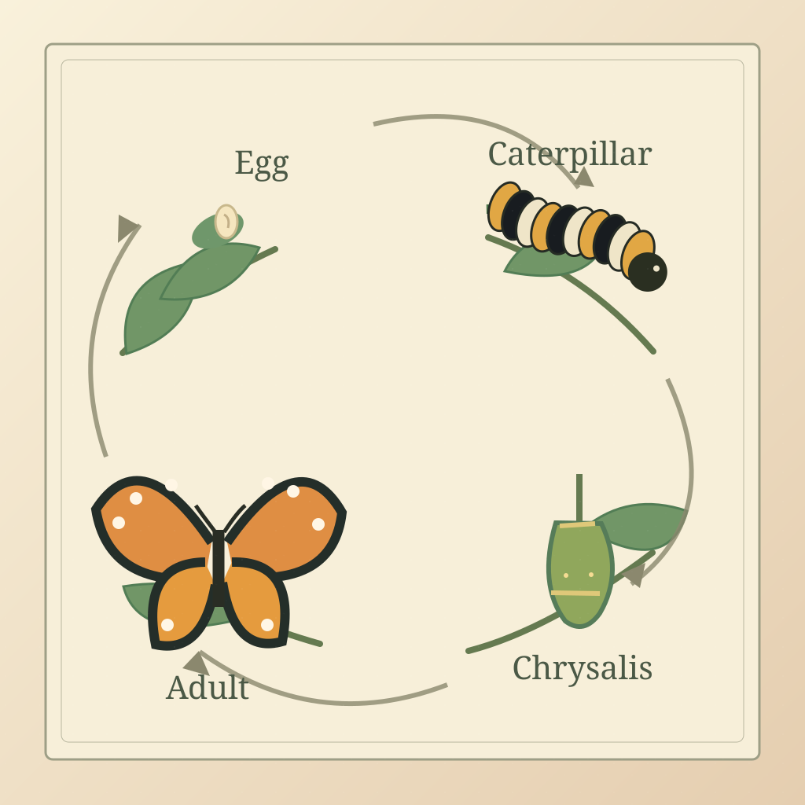

<!-- Generated by scripts/build_readme.py. Edit source data, locale catalogs and generator scripts. -->

# Monarch butterfly life-cycle field-guide plate

[← Back to external website archive](../../README.md#all-cases)

 

**Creator-reported model · Source-only; not independently reproduced**

1536×1024 WebP. Four labeled stages occupy the requested corners with connecting arrows on ivory paper. The egg is shown on a visible leaf surface; the requested underside placement and biological accuracy are not independently established. Treat this as a generated educational illustration requiring expert review, not verified scientific reference material. Independently recreated from publicly available text as an original four-stage SVG natural-history infographic on 2026-11-10, without any third-party image as input. The original third-party output was removed from the current Git tree; the replacement is an original editorial illustration, not a GPT Image 2.6 model result.

## Images / GIFs

- [Watercolor monarch life-cycle plate with Egg, Caterpillar, Chrysalis and Adult labels and connecting arrows.](https://github.com/RaphaelAI-OpenLab/awesome-gpt-image-2-6/blob/main/external-sites/assets/recreated/infographics/analyticsvidhya-monarch-life-cycle.svg) · svg
  - Credit: RaphaelAI-OpenLab
  - Reuse: original. Original original four-stage SVG natural-history infographic made from a public text-only concept, not the original image; no third-party media pixels were reused. The source publisher is retained as credit for the reference idea and text, not for the replacement asset. Not a verified GPT Image 2.6 model output.
  - [Provenance / rights evidence](https://github.com/RaphaelAI-OpenLab/awesome-gpt-image-2-6/blob/main/external-sites/RECREATION_STATUS.md)

## Source-page and media access

- Checked: 2026-11-05 (UTC)
- Original page: Accessible. Original article opened in a normal browser; author, test subsection and published prompt checked.
- Media: Archived locally. Five retained original WebP files across this four-work batch were fully decoded and visually reviewed locally on 8 November. Original media returned HTTP 200 on 5 November; no new source request was made. The menu PDF input is unavailable and is not archived. The previously archived source media was removed from the current repository tree on 2026-11-10 and independently recreated as original SVG art; historical source audit is retained.
- [Per-file attempts and results](../../../docs/MEDIA_ACCESS_2026-11-08_ANALYTICSVIDHYA_STATIC.md)

## Original prompt

[Original prompt at source](https://www.analyticsvidhya.com/blog/2026/11/gpt-image-2-6-review/#h-4-a-scientific-field-guide-illustration)

The source publishes the actual prompt. This repository links to it rather than inventing or republishing the full text. Required inputs and parameters remain at the source.

## Attribution and verification

- ID: analyticsvidhya-monarch-life-cycle
- Author: Vasu Deo Sankrityayan / Analytics Vidhya
- [Original source](https://www.analyticsvidhya.com/blog/2026/11/gpt-image-2-6-review/#h-4-a-scientific-field-guide-illustration)
- Model: GPT Image 2.6
- Variant: Variant unspecified
- Evidence: The original author explicitly presents this output among five hands-on Images 2.6 tests. Variant is not specified. This is author-reported attribution, not an independently reproduced model run.
- Collected: 2026-11-05 (UTC)
- Source checked: 2026-11-05 (UTC)

Attribution does not grant a media license. Repository MIT terms do not cover third-party outputs. Local files record provenance and reuse status; source-attributed does not mean open-licensed.
