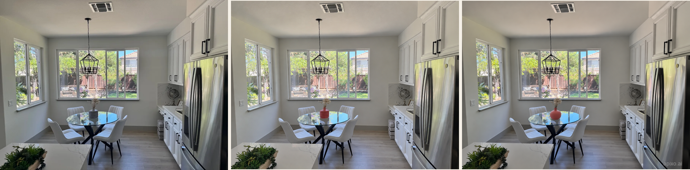

<!-- Generated by scripts/build_readme.py. Edit source data, locale catalogs and generator scripts. -->

# Coral vase markup comparison

[← Back to external website archive](../../README.md#all-cases)

 

**Creator-reported model · Source-only; not independently reproduced**

One comparison task. The retained PNG is a 1816 × 450 composite: OpenAI source photo, APIXO Flare edit, APIXO Sunburst edit, left to right. The original is reference content, not an additional generated work. Coral-red edits are distinct from the official cobalt-blue examples already indexed. The cited 1184 × 880 sizes describe source-reported individual outputs, not this composite. Do not infer pixel preservation, generation speed or model superiority.

## Images / GIFs

- [Comparison: OpenAI source, Flare coral vase, Sunburst coral vase](https://cdn.sanity.io/images/btnqb8h4/production/00b89a9eadd51fb56a5d0f9b0746b5b9a4e1c74c-1816x450.png) · image
  - Credit: Ethan Wang / APIXO; OpenAI source photo in left panel
  - Reuse: source-attributed. Original public-source media retained unchanged with attribution. No independent redistribution license has been verified. Attribution is not permission, and repository MIT terms do not cover this file.
  - [Provenance / rights evidence](https://apixo.ai/blog/gpt-image-2-6-launch)

## Source-page and media access

- Checked: 2026-11-08 (UTC)
- Original page: Accessible. Revisited the existing original page and verified output labels, exact asset URLs (resolving relative paths), and available prompt links. No new-case search.
- Media: Archived locally. Existing local original bytes match recorded SHA-256 and sizes. All image/animation frames were decoded and visually reviewed. The inert SVG was structurally checked and rendered locally for inspection; QA derivatives are not published.
- [Per-file attempts and results](../../../docs/FRAMEMUX_APIXO_BACKLOG_AUDIT_2026-11-08.md)

## Original prompt

[Original prompt at source](https://apixo.ai/blog/gpt-image-2-6-markup-editing)

The source publishes the actual prompt. This repository links to it rather than inventing or republishing the full text. Required inputs and parameters remain at the source.

## Attribution and verification

- ID: apixo-coral-vase-comparison
- Author: Ethan Wang / APIXO
- [Original source](https://apixo.ai/blog/gpt-image-2-6-launch)
- Model: GPT Image 2.6
- Variant: Flare / Sunburst
- Evidence: The source explicitly compares its Flare and Sunburst edits of the same kitchen input. Publisher-reported attribution, not independent reproduction or backend verification.
- Collected: 2026-11-06 (UTC)
- Source checked: 2026-11-08 (UTC)

Attribution does not grant a media license. Repository MIT terms do not cover third-party outputs. Local files record provenance and reuse status; source-attributed does not mean open-licensed.
