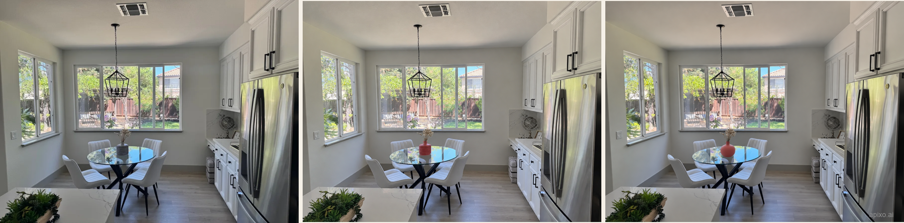

<!-- Generated by scripts/build_readme.py. Edit source data, locale catalogs and generator scripts. -->

# 珊瑚红花瓶标注编辑对比

[← 返回外站素材目录](../../README.md#all-cases)

 

**作者自报模型 · 仅核对来源；未独立复现**

一个对比任务。留存 PNG 是 1816 × 450 拼图，左至右为 OpenAI 来源照片、APIXO Flare 编辑、APIXO Sunburst 编辑。原图是参考内容，不另计生成作品。珊瑚红编辑与已收录的官方钴蓝色结果不同。来源所称 1184 × 880 是单独输出的尺寸，不是此拼图的尺寸。不据此推断像素保持、生成速度或模型优劣。

## 图片 / GIF

- [对比：OpenAI 原图、Flare 珊瑚红花瓶、Sunburst 珊瑚红花瓶](https://cdn.sanity.io/images/btnqb8h4/production/00b89a9eadd51fb56a5d0f9b0746b5b9a4e1c74c-1816x450.png) · image
  - 署名：Ethan Wang / APIXO; OpenAI source photo in left panel
  - 使用条件：source-attributed. 公开来源素材原样保留并署名。未核实独立转载许可证；署名不构成授权，仓库 MIT 条款不覆盖此文件。
  - [来源 / 权利依据](https://apixo.ai/blog/gpt-image-2-6-launch)

## 原帖与素材获取状态

- 核对日期：2026-11-08 (UTC)
- 原帖：可打开. 复核已有原始页面、逐输出标签、准确素材地址（解析相对路径）与可用提示词链接。未搜索新案例。
- 素材：已存入仓库. 本地原始字节与记录的 SHA-256 和大小一致。全部图片及动画帧已解码、目视核验；无活动内容的 SVG 已检查结构并在本地渲染检查，不发布质检派生文件。
- [逐项尝试与结果](../../../docs/FRAMEMUX_APIXO_BACKLOG_AUDIT_2026-11-08.md)

## 原始提示词

[原提示词见来源](https://apixo.ai/blog/gpt-image-2-6-markup-editing)

来源公开了真实提示词。本仓库链接原文，不伪造或转载完整长提示词；所需输入与参数请在原文查看。

## 来源与核对信息

- ID: apixo-coral-vase-comparison
- 作者：Ethan Wang / APIXO
- [原始来源](https://apixo.ai/blog/gpt-image-2-6-launch)
- 模型：GPT Image 2.6
- 版本：Flare / Sunburst
- 依据：APIXO 声称将相同厨房照片、标注图与改色指令分别提交给 Flare 和 Sunburst，并逐项标注比较结果。属于发布方自述，不是独立复现或运行日志验证。
- 收录：2026-11-06 (UTC)
- 来源核对：2026-11-08 (UTC)

标注来源不等于取得素材许可。仓库 MIT 协议不覆盖第三方输出；本地素材逐项记录来源与使用状态，source-attributed 不代表开放许可。
