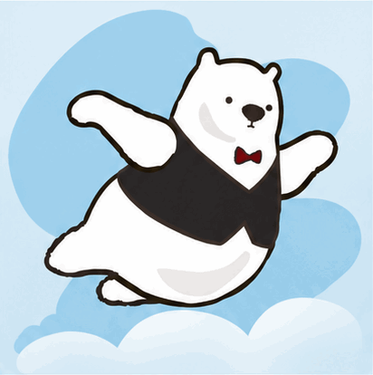

<!-- Generated by scripts/build_readme.py. Edit source data, locale catalogs and generator scripts. -->

# Flying Aruru polar-bear mascot

[← Back to external website archive](../../README.md#all-cases)

 

**Creator-reported model · Source-only; not independently reproduced**

Creator/publisher-reported example, not independently reproduced. No run log independently verifies the served model or variant. The article does not establish the complete exact prompt for this mascot, so it remains not-public. Original public GIF bytes are preserved; source attribution is not a redistribution license.

## Images / GIFs

- [Flying Aruru polar-bear mascot](https://aruru.co.jp/fan/wp-content/uploads/2026/11/chatgpt-images-gif-aruru-fly.gif) · gif
  - Credit: 岩永奈々
  - Reuse: source-attributed. Original public-source media retained unchanged with attribution. No independent redistribution license has been verified. Attribution is not permission, and the repository MIT license does not cover this file.
  - [Provenance / rights evidence](https://aruru.co.jp/chatgpt-images-gif/)

## Source-page and media access

- Checked: 2026-11-08 (UTC)
- Original page: Accessible. Directly revisited the known original public page and matched each archived media URL to the current HTML or embedded prediction record. No new-case search was performed.
- Media: Archived locally. Retained original bytes were checked against recorded SHA-256 and size, fully decoded and visually inspected, including every animation/video frame. No new generation or media download was performed.
- [Per-file attempts and results](../../../docs/FIVE_SOURCES_BACKLOG_AUDIT_2026-11-08.md)

## Original prompt

**PLACEHOLDER: prompt not publicly provided.**

## Attribution and verification

- ID: aruru-flying-polar-bear
- Author: 岩永奈々
- [Original source](https://aruru.co.jp/chatgpt-images-gif/)
- Model: GPT Image 2.6
- Variant: Variant unspecified
- Evidence: Aruru labels the flying mascot as made with ChatGPT Images 2.6 and describes the coffee-steam result as its second experiment in the same hands-on trial. This is the creator’s attribution; the served model and variant are not independently verified.
- Collected: 2026-11-06 (UTC)
- Source checked: 2026-11-08 (UTC)

Attribution does not grant a media license. Repository MIT terms do not cover third-party outputs. Local files record provenance and reuse status; source-attributed does not mean open-licensed.
