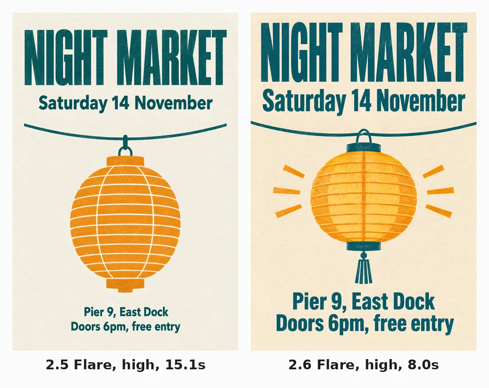

<!-- Generated by scripts/build_readme.py. Edit source data, locale catalogs and generator scripts. -->

# NIGHT MARKET typography comparison

[← Back to external website archive](../../README.md#all-cases)

 

**Creator-reported model · Source-only; not independently reproduced**

The right panel is the eligible 2.6 output; the left older-model comparator is context only, never counted as another output. This is a raster WebP, not SVG. Exact prompt not shown. Here, not-public records that the reviewed source does not provide the exact original prompt; availability elsewhere and the creator’s intent are not established. Offline recovery recheck on 2026-11-08 confirms retained source mapping and original file integrity, not backend execution or current availability.

## Images / GIFs

- [NIGHT MARKET typography comparison. The right panel is the eligible 2.6 output; the left older-model comparator is context only, never counted as another output. This is a raster WebP, not SVG. Exact prompt not shown.](https://cellcog.ai/blog/media/gpt-image-2-6-vs-2-5/slide-2.webp?v=7d7427ace5) · image
  - Credit: Nitish Garg / CellCog
  - Reuse: source-attributed. Public-source copy with original author attribution. No explicit redistribution license was verified. Public availability and credit do not grant permission; the repository MIT license does not cover this media.
  - [Provenance / rights evidence](https://cellcog.ai/blog/gpt-image-2-6-vs-2-5/)

## Source-page and media access

- Checked: 2026-11-05 (UTC)
- Original page: Accessible. Historical source access is recorded for 2026-11-05. Retained original source evidence was rechecked offline on 2026-11-08; no current availability check was made.
- Media: Archived locally. Retained original bytes were rechecked by SHA-256, byte length and full decoding on 2026-11-08. Every GIF frame and each distinct MP4 frame was inspected as still frames; this is not new timed playback or an online access test.
- [Per-file attempts and results](../../../docs/NOWRAP_CELLCOG_TOONDERLY_RECOVERY_AUDIT_2026-11-08.md)

## Original prompt

**PLACEHOLDER: prompt not publicly provided.**

## Attribution and verification

- ID: cellcog-night-market-poster
- Author: Nitish Garg / CellCog
- [Original source](https://cellcog.ai/blog/gpt-image-2-6-vs-2-5/)
- Model: GPT Image 2.6
- Variant: Flare
- Evidence: CellCog reports its own November 5 test; labels inside this original composite identify 2.5 Flare on the left and 2.6 Flare on the right.
- Collected: 2026-11-05 (UTC)
- Source checked: 2026-11-08 (UTC)

Attribution does not grant a media license. Repository MIT terms do not cover third-party outputs. Local files record provenance and reuse status; source-attributed does not mean open-licensed.
