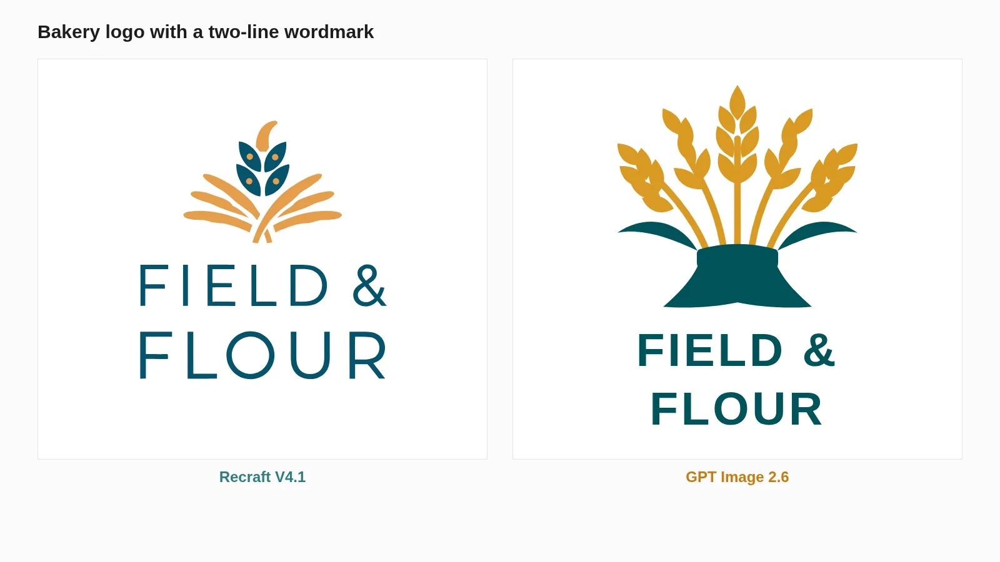
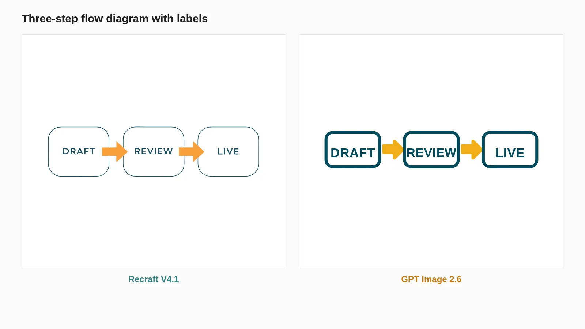
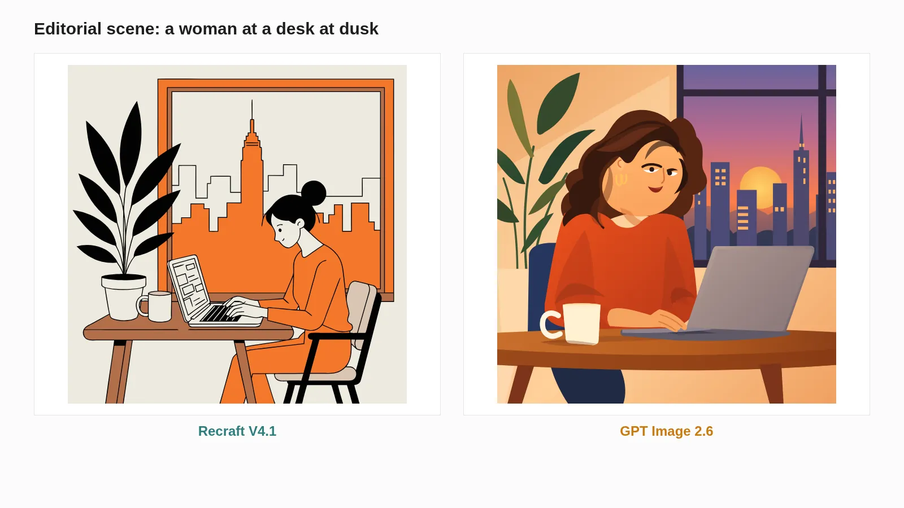
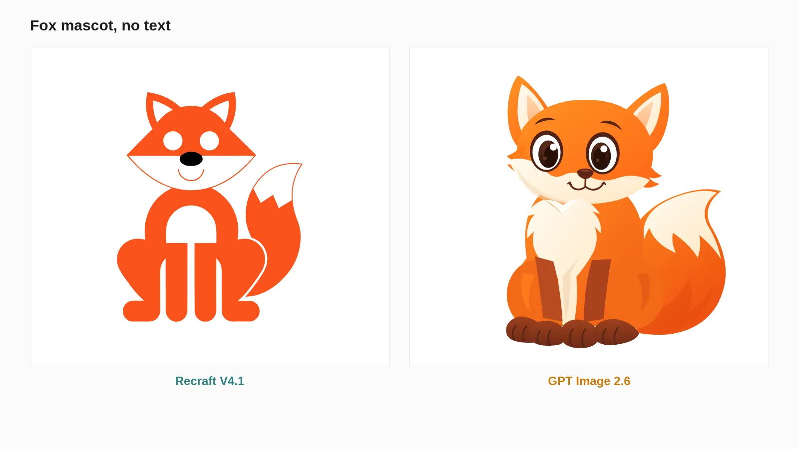
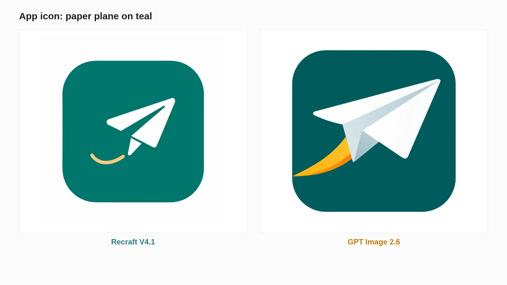
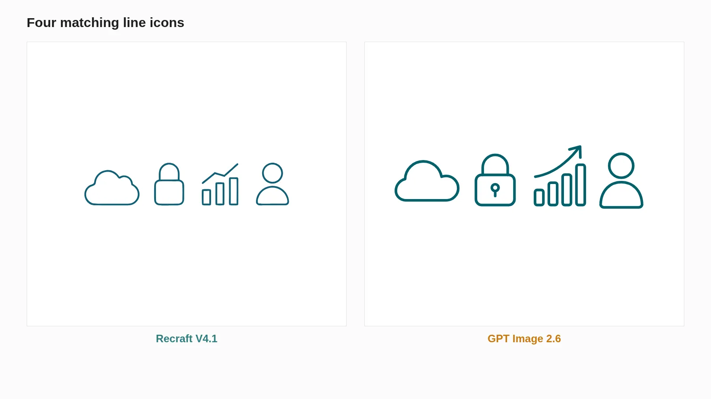

<!-- Generated by scripts/build_readme.py. Edit source data, locale catalogs and generator scripts. -->

# Six vector-test comparison renders

[← Back to external website archive](../../README.md#all-cases)

 

**Creator-reported model · Source-only; not independently reproduced**

Original WebP comparison renders only, not editable SVG files or proof of inert vector structure. Six subjects: bakery wordmark, labelled flow, dusk desk scene, fox mascot, paper-plane app icon and four line icons. Full prompts and original SVG files are not exposed; no prompt reconstructed. Here, not-public records that the reviewed source does not provide the exact original prompt; availability elsewhere and the creator’s intent are not established. Offline recovery recheck on 2026-11-08 confirms retained source mapping and original file integrity, not backend execution or current availability.

## Images / GIFs

- [Bakery wordmark; Recraft left, GPT Image 2.6 right.](https://cellcog.ai/blog/media/recraft-v4-1-vs-gpt-image-2-6-svg/slide-1.webp?v=48a1e42bae) · image
  - Credit: Nitish Garg / CellCog
  - Reuse: source-attributed. Public source sample preserved unchanged with attribution. No redistribution license verified; not open-licensed or covered by the repository MIT license.
  - [Provenance / rights evidence](https://cellcog.ai/blog/recraft-v4-1-vs-gpt-image-2-6-svg/)

- [Three-step labelled flow; Recraft left, GPT Image 2.6 right.](https://cellcog.ai/blog/media/recraft-v4-1-vs-gpt-image-2-6-svg/slide-2.webp?v=ce829acbe4) · image
  - Credit: Nitish Garg / CellCog
  - Reuse: source-attributed. Public source sample preserved unchanged with attribution. No redistribution license verified; not open-licensed or covered by the repository MIT license.
  - [Provenance / rights evidence](https://cellcog.ai/blog/recraft-v4-1-vs-gpt-image-2-6-svg/)

- [Woman at a desk at dusk; Recraft left, GPT Image 2.6 right.](https://cellcog.ai/blog/media/recraft-v4-1-vs-gpt-image-2-6-svg/slide-3.webp?v=453d97ba79) · image
  - Credit: Nitish Garg / CellCog
  - Reuse: source-attributed. Public source sample preserved unchanged with attribution. No redistribution license verified; not open-licensed or covered by the repository MIT license.
  - [Provenance / rights evidence](https://cellcog.ai/blog/recraft-v4-1-vs-gpt-image-2-6-svg/)

- [Orange fox mascot; Recraft left, GPT Image 2.6 right.](https://cellcog.ai/blog/media/recraft-v4-1-vs-gpt-image-2-6-svg/slide-4.webp?v=f18bfdde0a) · image
  - Credit: Nitish Garg / CellCog
  - Reuse: source-attributed. Public source sample preserved unchanged with attribution. No redistribution license verified; not open-licensed or covered by the repository MIT license.
  - [Provenance / rights evidence](https://cellcog.ai/blog/recraft-v4-1-vs-gpt-image-2-6-svg/)

- [Paper-plane app icon; Recraft left, GPT Image 2.6 right.](https://cellcog.ai/blog/media/recraft-v4-1-vs-gpt-image-2-6-svg/slide-5.webp?v=f5120f504b) · image
  - Credit: Nitish Garg / CellCog
  - Reuse: source-attributed. Public source sample preserved unchanged with attribution. No redistribution license verified; not open-licensed or covered by the repository MIT license.
  - [Provenance / rights evidence](https://cellcog.ai/blog/recraft-v4-1-vs-gpt-image-2-6-svg/)

- [Four line icons; Recraft left, GPT Image 2.6 right.](https://cellcog.ai/blog/media/recraft-v4-1-vs-gpt-image-2-6-svg/slide-6.webp?v=d6b28eea92) · image
  - Credit: Nitish Garg / CellCog
  - Reuse: source-attributed. Public source sample preserved unchanged with attribution. No redistribution license verified; not open-licensed or covered by the repository MIT license.
  - [Provenance / rights evidence](https://cellcog.ai/blog/recraft-v4-1-vs-gpt-image-2-6-svg/)

## Source-page and media access

- Checked: 2026-11-05 (UTC)
- Original page: Accessible. Historical source access is recorded for 2026-11-05. Retained original source evidence was rechecked offline on 2026-11-08; no current availability check was made.
- Media: Archived locally. Retained original bytes were rechecked by SHA-256, byte length and full decoding on 2026-11-08. Every GIF frame and each distinct MP4 frame was inspected as still frames; this is not new timed playback or an online access test.
- [Per-file attempts and results](../../../docs/NOWRAP_CELLCOG_TOONDERLY_RECOVERY_AUDIT_2026-11-08.md)

## Original prompt

**PLACEHOLDER: prompt not publicly provided.**

## Attribution and verification

- ID: cellcog-vector-comparison-renders
- Author: Nitish Garg / CellCog
- [Original source](https://cellcog.ai/blog/recraft-v4-1-vs-gpt-image-2-6-svg/)
- Model: GPT Image 2.6
- Variant: Variant unspecified
- Evidence: CellCog identifies the right side of six published comparison images as GPT Image 2.6, paired with Recraft V4.1 on the left. The article describes its own paid SVG tests. Exact image-model variant is not assigned to each slide. These are publisher claims, not independently reproduced results.
- Collected: 2026-11-05 (UTC)
- Source checked: 2026-11-08 (UTC)

Attribution does not grant a media license. Repository MIT terms do not cover third-party outputs. Local files record provenance and reuse status; source-attributed does not mean open-licensed.
