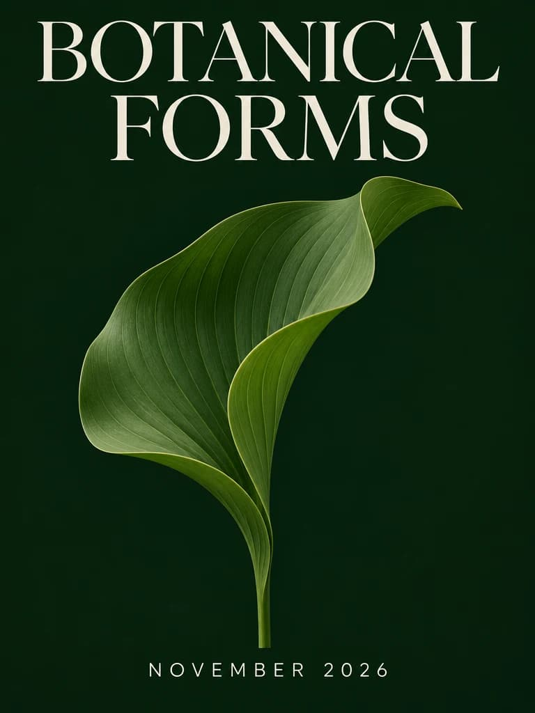

<!-- Generated by scripts/build_readme.py. Edit source data, locale catalogs and generator scripts. -->

# CubistAI 植物形态海报

[← 返回外站素材目录](../../README.md#all-cases)

 

**作者自报模型 · 仅核对来源；未独立复现**

原样存档当前页面准确图片地址提供的文件。底层素材名以WebP结尾，但实际提供的预览为JPEG，故按JPEG扩展名保存。咖啡杯与小屋为1024×768，海报为768×1024。这是既有历史候选的补证，不是新搜索案例。

## 图片 / GIF

- [带象牙白标题的绿色植物展海报。](https://cubistai.app/_next/image?url=%2Fshowcase%2Fgpt-image-2-6%2Fposter.webp&w=3840&q=75&dpl=dpl_Bh2UAbKrAbHWscpNJiT3uJeUCWFp) · image
  - 署名：CubistAI
  - 使用条件：source-attributed. 保留发布方提供的原始字节。未验证明确转载许可，公开访问及署名不等于授权；仓库MIT不覆盖此素材。
  - [来源 / 权利依据](https://cubistai.app/zh/ai-models/gpt-image-2-6)

## 原帖与素材获取状态

- 核对日期：2026-11-08 (UTC)
- 原帖：可打开. 重新打开已知一手来源，为既有候选核对具体示例标签、提示词与素材地址，未搜索新案例。
- 素材：已存入仓库. 成功取得发布方提供的文件并原样保留，检查格式、尺寸、哈希、完整逐帧解码与视觉内容。Opusly历史GIF哈希一致，其余九份文件本次从既有候选原页补取。
- [逐项尝试与结果](../../../docs/MODEL_HOLDS_RECOVERY_AUDIT_2026-11-08.md)

## 原始提示词

[原提示词见来源](https://cubistai.app/zh/ai-models/gpt-image-2-6)

来源公开了真实提示词。本仓库链接原文，不伪造或转载完整长提示词；所需输入与参数请在原文查看。

## 来源与核对信息

- ID: community-cubistai-botanical-poster
- 作者：CubistAI
- [原始来源](https://cubistai.app/zh/ai-models/gpt-image-2-6)
- 模型：GPT Image 2.6
- 版本：版本未注明
- 依据：当前已知模型页将本具体示例及其图片元素标为GPT Image 2.6，并在旁边公开关联提示词。未明确此具体示例属于Flare还是Sunburst；归因来自发布方，未经独立复现。
- 收录：2026-11-06 (UTC)
- 来源核对：2026-11-08 (UTC)

标注来源不等于取得素材许可。仓库 MIT 协议不覆盖第三方输出；本地素材逐项记录来源与使用状态，source-attributed 不代表开放许可。
