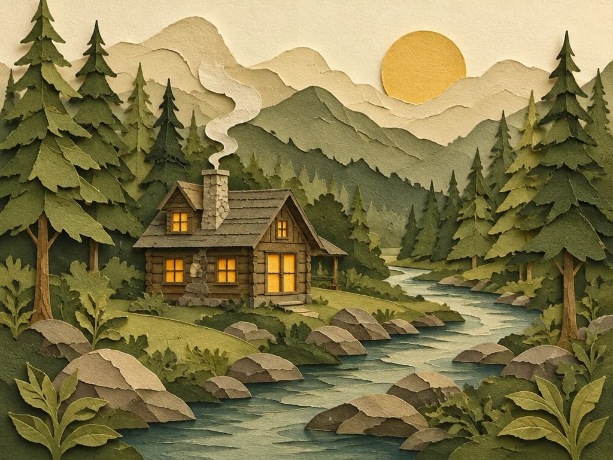

<!-- Generated by scripts/build_readme.py. Edit source data, locale catalogs and generator scripts. -->

# CubistAI paper-cut forest cabin

[← Back to external website archive](../../README.md#all-cases)

 

**Creator-reported model · Source-only; not independently reproduced**

The exact publisher-served image URL from the current page is archived unchanged. The underlying asset name ends in WebP, but the served preview is actually JPEG and is saved with a JPEG extension. The cup/cabin files decode as 1024×768 and the poster as 768×1024. This is an existing historical candidate whose missing evidence was rechecked, not a newly searched case.

## Images / GIFs

- [Layered paper-cut cabin and winding river in green tones.](https://cubistai.app/_next/image?url=%2Fshowcase%2Fgpt-image-2-6%2Fillustration.webp&w=3840&q=75&dpl=dpl_Bh2UAbKrAbHWscpNJiT3uJeUCWFp) · image
  - Credit: CubistAI
  - Reuse: source-attributed. Unchanged publisher-served bytes. No explicit redistribution licence verified. Public access and attribution do not establish permission; repository MIT does not cover this media.
  - [Provenance / rights evidence](https://cubistai.app/zh/ai-models/gpt-image-2-6)

## Source-page and media access

- Checked: 2026-11-08 (UTC)
- Original page: Accessible. Known primary source page reopened to resolve this existing candidate; exact example labels, prompts and media URLs checked. No new case search.
- Media: Archived locally. Publisher-served files fetched successfully and preserved without modification. Formats, dimensions, hashes, full frame decoding and visual content were checked. Historical Opusly GIF hashes match; the nine other files were acquired now from already-known candidate pages.
- [Per-file attempts and results](../../../docs/MODEL_HOLDS_RECOVERY_AUDIT_2026-11-08.md)

## Original prompt

[Original prompt at source](https://cubistai.app/zh/ai-models/gpt-image-2-6)

The source publishes the actual prompt. This repository links to it rather than inventing or republishing the full text. Required inputs and parameters remain at the source.

## Attribution and verification

- ID: community-cubistai-paper-cut-cabin
- Author: CubistAI
- [Original source](https://cubistai.app/zh/ai-models/gpt-image-2-6)
- Model: GPT Image 2.6
- Variant: Variant unspecified
- Evidence: The current known model page labels this exact named example and its image element GPT Image 2.6, with the associated prompt alongside. It does not establish Flare versus Sunburst for the individual example. Publisher attribution, not independent reproduction.
- Collected: 2026-11-06 (UTC)
- Source checked: 2026-11-08 (UTC)

Attribution does not grant a media license. Repository MIT terms do not cover third-party outputs. Local files record provenance and reuse status; source-attributed does not mean open-licensed.
