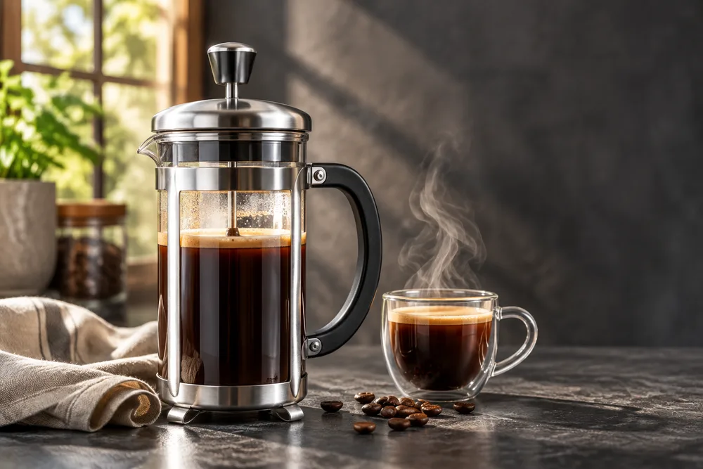
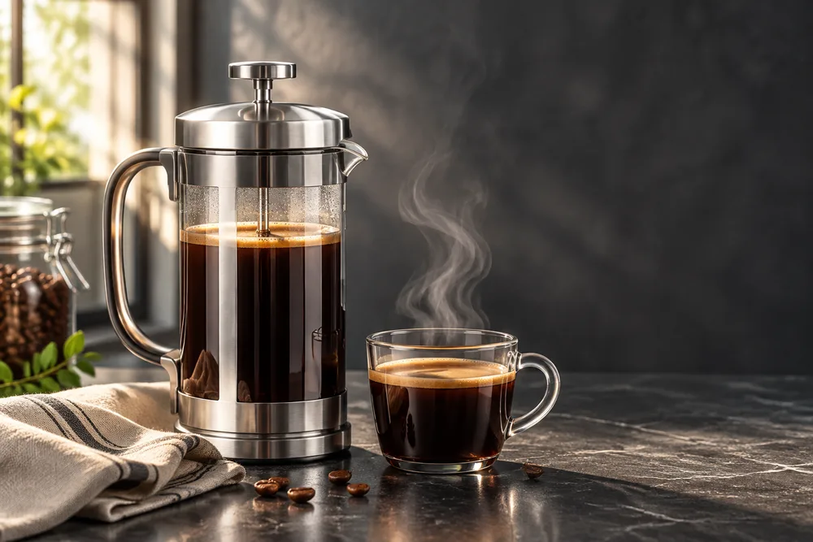
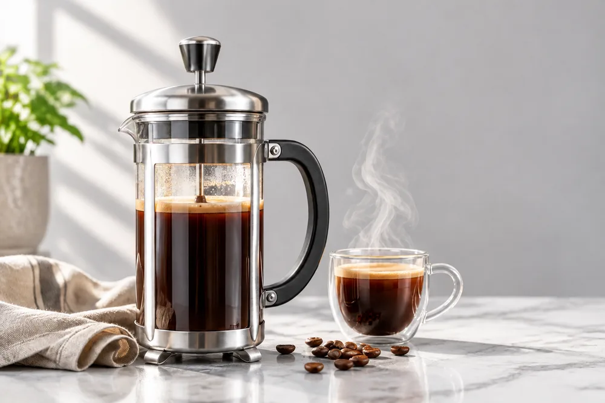
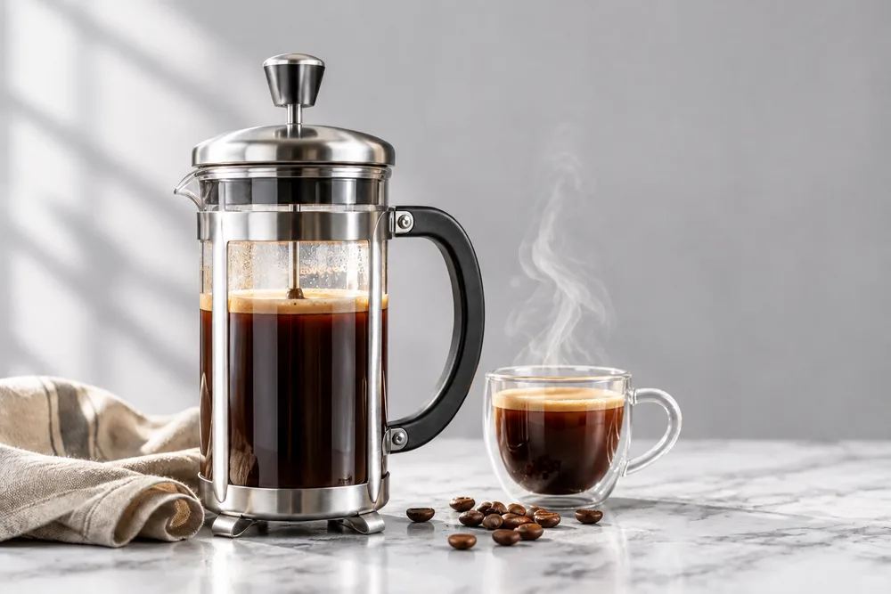

<!-- Generated by scripts/build_readme.py. Edit source data, locale catalogs and generator scripts. -->

# French press product photos and background-edit continuation

[← Back to external website archive](../../README.md#all-cases)

 

**Creator-reported model · Source-only; not independently reproduced**

Two initial product variants and two background edits form one work. Both edits use the Flare product original, retaining the press, cup, napkin and beans. Flare keeps background props while Sunburst clears them. These are synthetic product images, not documentary photographs. Exact generation and edit prompts remain linked at the source. Cited CellCog API timings and older DEV 2.5 tests are not these works. Source files are 1000-pixel WebP editorial exports, not claimed raw 1536-pixel generation files.

## Images / GIFs

- [Product photo generated with GPT Image 2.6 Flare from the same prompt as the other models in this comparison](https://www.gptimagehub.com/guides/gpt-image-2-6/product-2-6-flare.webp) · image
  - Credit: GPT Image Hub
  - Reuse: source-attributed. Public original archived unchanged with attribution. No redistribution license was located; dataset prompt licensing does not license these images. Source attribution is not permission or an open license.
  - [Provenance / rights evidence](https://www.gptimagehub.com/guides/gpt-image-2-6-flare-vs-sunburst)

- [Product photo generated with GPT Image 2.6 Sunburst from the same prompt as the other models in this comparison](https://www.gptimagehub.com/guides/gpt-image-2-6/product-2-6-sunburst.webp) · image
  - Credit: GPT Image Hub
  - Reuse: source-attributed. Public original archived unchanged with attribution. No redistribution license was located; dataset prompt licensing does not license these images. Source attribution is not permission or an open license.
  - [Provenance / rights evidence](https://www.gptimagehub.com/guides/gpt-image-2-6-flare-vs-sunburst)

- [Background swap on the product photo: the GPT Image 2.6 Flare original edited with GPT Image 2.6 Flare](https://www.gptimagehub.com/guides/gpt-image-2-6/edit-background-2-6-flare.webp) · image
  - Credit: GPT Image Hub
  - Reuse: source-attributed. Public original archived unchanged with attribution. No redistribution license was located; dataset prompt licensing does not license these images. Source attribution is not permission or an open license.
  - [Provenance / rights evidence](https://www.gptimagehub.com/guides/gpt-image-2-6-flare-vs-sunburst)

- [Background swap on the product photo: the GPT Image 2.6 Flare original edited with GPT Image 2.6 Sunburst](https://www.gptimagehub.com/guides/gpt-image-2-6/edit-background-2-6-sunburst.webp) · image
  - Credit: GPT Image Hub
  - Reuse: source-attributed. Public original archived unchanged with attribution. No redistribution license was located; dataset prompt licensing does not license these images. Source attribution is not permission or an open license.
  - [Provenance / rights evidence](https://www.gptimagehub.com/guides/gpt-image-2-6-flare-vs-sunburst)

## Source-page and media access

- Checked: 2026-11-06 (UTC)
- Original page: Accessible. Original source returned HTTP 200; retained source evidence reused without refetching.
- Media: Archived locally. All exact public original WebP files fetched unchanged, fully decoded and visually inspected.
- [Per-file attempts and results](../../../docs/GPTIMAGEHUB_ACCESS_2026-11-06.md)

## Original prompt

[Original prompt at source](https://www.gptimagehub.com/guides/gpt-image-2-6-flare-vs-sunburst)

The source publishes the actual prompt. This repository links to it rather than inventing or republishing the full text. Required inputs and parameters remain at the source.

## Attribution and verification

- ID: community-gptimagehub-french-press-edit
- Author: GPT Image Hub
- [Original source](https://www.gptimagehub.com/guides/gpt-image-2-6-flare-vs-sunburst)
- Model: GPT Image 2.6
- Variant: Flare / Sunburst
- Evidence: The original guide labels the French press product photos and background-edit continuation outputs individually as GPT Image 2.6 Flare and Sunburst. Its Sources section identifies the images as its own Saver-route tests on 5 November 2026. This is a creator claim, not independent reproduction.
- Collected: 2026-11-06 (UTC)
- Source checked: 2026-11-06 (UTC)

Attribution does not grant a media license. Repository MIT terms do not cover third-party outputs. Local files record provenance and reuse status; source-attributed does not mean open-licensed.
