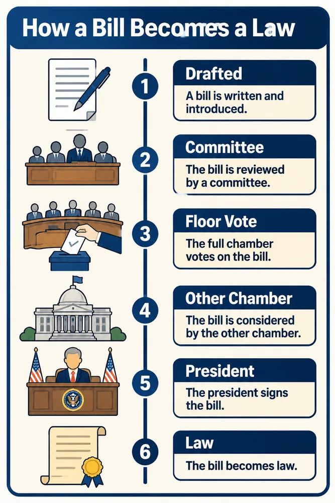
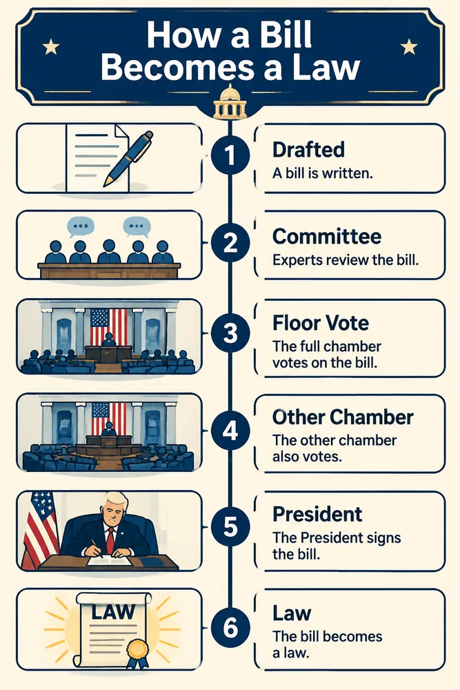

<!-- Generated by scripts/build_readme.py. Edit source data, locale catalogs and generator scripts. -->

# Six-step bill-to-law infographic comparison

[← Back to external website archive](../../README.md#all-cases)

 

**Creator-reported model · Source-only; not independently reproduced**

Two navy-and-cream vertical infographic layouts compare the same six-step brief. Exact generation and edit prompts remain linked at the source. Cited CellCog API timings and older DEV 2.5 tests are not these works. Source files are 1000-pixel WebP editorial exports, not claimed raw 1536-pixel generation files.

## Images / GIFs

- [Six-step infographic generated with GPT Image 2.6 Flare from the same prompt as the other models in this comparison](https://www.gptimagehub.com/guides/gpt-image-2-6/infographic-2-6-flare.webp) · image
  - Credit: GPT Image Hub
  - Reuse: source-attributed. Public original archived unchanged with attribution. No redistribution license was located; dataset prompt licensing does not license these images. Source attribution is not permission or an open license.
  - [Provenance / rights evidence](https://www.gptimagehub.com/guides/gpt-image-2-6-flare-vs-sunburst)

- [Six-step infographic generated with GPT Image 2.6 Sunburst from the same prompt as the other models in this comparison](https://www.gptimagehub.com/guides/gpt-image-2-6/infographic-2-6-sunburst.webp) · image
  - Credit: GPT Image Hub
  - Reuse: source-attributed. Public original archived unchanged with attribution. No redistribution license was located; dataset prompt licensing does not license these images. Source attribution is not permission or an open license.
  - [Provenance / rights evidence](https://www.gptimagehub.com/guides/gpt-image-2-6-flare-vs-sunburst)

## Source-page and media access

- Checked: 2026-11-06 (UTC)
- Original page: Accessible. Original source returned HTTP 200; retained source evidence reused without refetching.
- Media: Archived locally. All exact public original WebP files fetched unchanged, fully decoded and visually inspected.
- [Per-file attempts and results](../../../docs/GPTIMAGEHUB_ACCESS_2026-11-06.md)

## Original prompt

[Original prompt at source](https://www.gptimagehub.com/guides/gpt-image-2-6-flare-vs-sunburst)

The source publishes the actual prompt. This repository links to it rather than inventing or republishing the full text. Required inputs and parameters remain at the source.

## Attribution and verification

- ID: community-gptimagehub-law-infographic
- Author: GPT Image Hub
- [Original source](https://www.gptimagehub.com/guides/gpt-image-2-6-flare-vs-sunburst)
- Model: GPT Image 2.6
- Variant: Flare / Sunburst
- Evidence: The original guide labels the Six-step bill-to-law infographic comparison outputs individually as GPT Image 2.6 Flare and Sunburst. Its Sources section identifies the images as its own Saver-route tests on 5 November 2026. This is a creator claim, not independent reproduction.
- Collected: 2026-11-06 (UTC)
- Source checked: 2026-11-06 (UTC)

Attribution does not grant a media license. Repository MIT terms do not cover third-party outputs. Local files record provenance and reuse status; source-attributed does not mean open-licensed.
