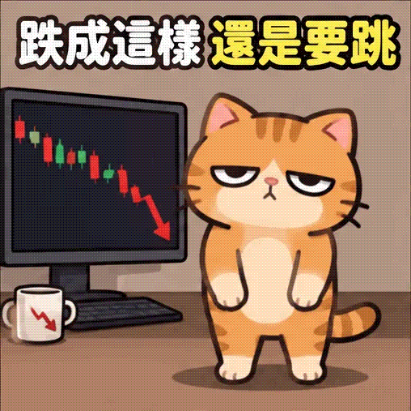
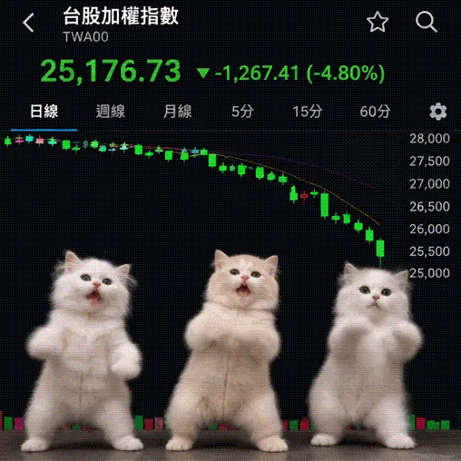
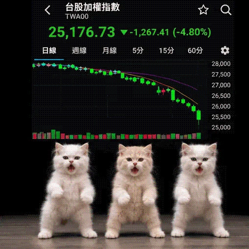

<!-- Generated by scripts/build_readme.py. Edit source data, locale catalogs and generator scripts. -->

# Stock-market kitten meme: three GIF iterations

[← Back to external website archive](../../README.md#all-cases)

 

**Creator-reported model · Source-only; not independently reproduced**

One grouped work: cartoon first version, realistic kitten revision, then a synchronization revision. Source-linked prompts only. Market numbers are synthetic, not financial data. Original GIF bytes were retained, decoded and inspected across all six frames of each file (18 frames total); playback and generation were not tested.

## Images / GIFs

- [Cartoon orange kitten with a falling chart and Traditional Chinese caption.](https://i0.wp.com/gretatsai.com/wp-content/uploads/2026/11/chatgpt-images-2-6-gif-01.webp?resize=508%2C507&ssl=1) · gif
  - Credit: 蔡明淳 (Greta Tsai)
  - Reuse: source-attributed. Public creator example archived unchanged. No redistribution license was located; attribution is not permission or an open license.
  - [Provenance / rights evidence](https://gretatsai.com/chatgpt-images-2-6-gif/)

- [Three pale kittens in front of a synthetic Taiwan market chart.](https://i0.wp.com/gretatsai.com/wp-content/uploads/2026/11/chatgpt-images-2-6-gif-02.webp?resize=508%2C508&ssl=1) · gif
  - Credit: 蔡明淳 (Greta Tsai)
  - Reuse: source-attributed. Public creator example archived unchanged. No redistribution license was located; attribution is not permission or an open license.
  - [Provenance / rights evidence](https://gretatsai.com/chatgpt-images-2-6-gif/)

- [Revised three-kitten sequence with more synchronized poses.](https://i0.wp.com/gretatsai.com/wp-content/uploads/2026/11/chatgpt-images-2-6-gif-03.webp?resize=508%2C508&ssl=1) · gif
  - Credit: 蔡明淳 (Greta Tsai)
  - Reuse: source-attributed. Public creator example archived unchanged. No redistribution license was located; attribution is not permission or an open license.
  - [Provenance / rights evidence](https://gretatsai.com/chatgpt-images-2-6-gif/)

## Source-page and media access

- Checked: 2026-11-06 (UTC)
- Original page: Accessible. Retained November 6 source excerpts identify Images 2.6 and the creator’s own three-version ChatGPT Plus test. No new source request was made for this review.
- Media: Archived locally. The three unchanged GIF files were fully decoded and all 18 frames were visually inspected. Sizes and SHA-256 hashes match the original records. No EXIF or XMP payload was found. Playback and generation were not tested.
- [Per-file attempts and results](../../../docs/GRETA_KITTEN_SOURCE_2026-11-06.md)

## Original prompt

[Original prompt at source](https://gretatsai.com/chatgpt-images-2-6-gif/)

The source publishes the actual prompt. This repository links to it rather than inventing or republishing the full text. Required inputs and parameters remain at the source.

## Attribution and verification

- ID: community-greta-stock-kitten-iterations
- Author: 蔡明淳 (Greta Tsai)
- [Original source](https://gretatsai.com/chatgpt-images-2-6-gif/)
- Model: GPT Image 2.6
- Variant: Variant unspecified
- Evidence: In her Images 2.6 article, Tsai identifies all three kitten versions as her own ChatGPT web Plus tests. This is creator attribution, not independently reproduced model verification.
- Collected: 2026-11-06 (UTC)
- Source checked: 2026-11-06 (UTC)

Attribution does not grant a media license. Repository MIT terms do not cover third-party outputs. Local files record provenance and reuse status; source-attributed does not mean open-licensed.
