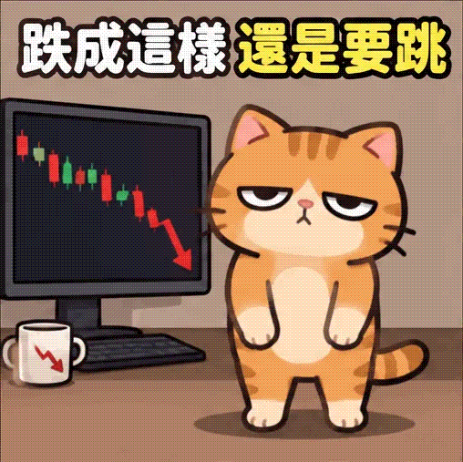
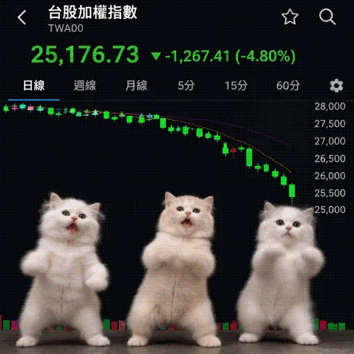
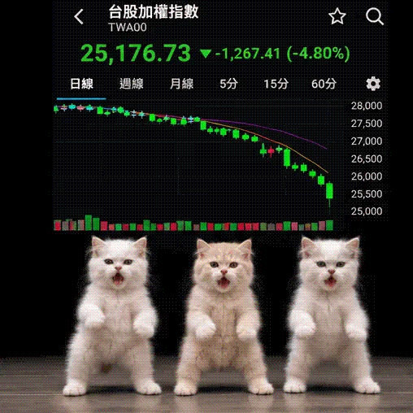

<!-- Generated by scripts/build_readme.py. Edit source data, locale catalogs and generator scripts. -->

# 股市小猫梗图：三版 GIF 迭代

[← 返回外站素材目录](../../README.md#all-cases)

 

**作者自报模型 · 仅核对来源；未独立复现**

作为一个作品组收录：卡通初版、写实小猫改版及同步动作改版。提示词仅链接原文。市场数字为合成内容，不是真实金融数据。保留 GIF 原始字节，完整解码并检查每个文件的六帧；未测试实际播放或生成过程。

## 图片 / GIF

- [橘猫卡通、下跌图表和繁体中文标题。](https://i0.wp.com/gretatsai.com/wp-content/uploads/2026/11/chatgpt-images-2-6-gif-01.webp?resize=508%2C507&ssl=1) · gif
  - 署名：蔡明淳 (Greta Tsai)
  - 使用条件：source-attributed. 公开作者案例，原样存档。未找到再分发许可；署名不等于授权或开放许可。
  - [来源 / 权利依据](https://gretatsai.com/chatgpt-images-2-6-gif/)

- [三只浅色小猫位于合成的台湾市场图表前。](https://i0.wp.com/gretatsai.com/wp-content/uploads/2026/11/chatgpt-images-2-6-gif-02.webp?resize=508%2C508&ssl=1) · gif
  - 署名：蔡明淳 (Greta Tsai)
  - 使用条件：source-attributed. 公开作者案例，原样存档。未找到再分发许可；署名不等于授权或开放许可。
  - [来源 / 权利依据](https://gretatsai.com/chatgpt-images-2-6-gif/)

- [三只小猫动作更同步的修改序列。](https://i0.wp.com/gretatsai.com/wp-content/uploads/2026/11/chatgpt-images-2-6-gif-03.webp?resize=508%2C508&ssl=1) · gif
  - 署名：蔡明淳 (Greta Tsai)
  - 使用条件：source-attributed. 公开作者案例，原样存档。未找到再分发许可；署名不等于授权或开放许可。
  - [来源 / 权利依据](https://gretatsai.com/chatgpt-images-2-6-gif/)

## 原帖与素材获取状态

- 核对日期：2026-11-06 (UTC)
- 原帖：可打开. 留存的11月6日来源摘录明确提及 Images 2.6 及作者亲自进行的三版 ChatGPT Plus 测试。本次审核未重新请求来源。
- 素材：已存入仓库. 完整解码三份未改动的 GIF，并目视检查全部18帧。大小与 SHA-256 均匹配原记录。未发现 EXIF 或 XMP 数据。未测试播放或生成。
- [逐项尝试与结果](../../../docs/GRETA_KITTEN_SOURCE_2026-11-06.md)

## 原始提示词

[原提示词见来源](https://gretatsai.com/chatgpt-images-2-6-gif/)

来源公开了真实提示词。本仓库链接原文，不伪造或转载完整长提示词；所需输入与参数请在原文查看。

## 来源与核对信息

- ID: community-greta-stock-kitten-iterations
- 作者：蔡明淳 (Greta Tsai)
- [原始来源](https://gretatsai.com/chatgpt-images-2-6-gif/)
- 模型：GPT Image 2.6
- 版本：版本未注明
- 依据：蔡明淳在 Images 2.6 文章中说明，三版小猫均由她在 ChatGPT 网页版 Plus 中实测生成。这是作者归因，不是独立复现的模型验证。
- 收录：2026-11-06 (UTC)
- 来源核对：2026-11-06 (UTC)

标注来源不等于取得素材许可。仓库 MIT 协议不覆盖第三方输出；本地素材逐项记录来源与使用状态，source-attributed 不代表开放许可。
