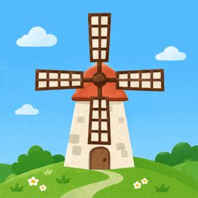

<!-- Generated by scripts/build_readme.py. Edit source data, locale catalogs and generator scripts. -->

# Windmill turning-sails GIF

[← Back to external website archive](../../README.md#all-cases)

 

**Creator-reported model · Source-only; not independently reproduced**

A flat illustration of rotating windmill sails. The creator publishes a descriptive caption; it is not explicitly identified as a complete verbatim generation prompt. Offline recovery review on 2026-11-08 checked original source evidence and unchanged file integrity. This is source attribution, not independent model reproduction.

## Images / GIFs

- [Windmill turning-sails GIF](https://mordenstar.com/uploads/albums/be317507-f6ff-4a55-a6a4-f19e9c006bbc/e5f4a579-8242-4ddd-a054-0946ed14492a.gif) · gif
  - Credit: Mordenstar / vunderba (source attribution)
  - Reuse: source-attributed. Public creator output archived unchanged with source attribution. No independent redistribution license verified. Attribution is not permission; the repository MIT license does not cover this media.
  - [Provenance / rights evidence](https://mordenstar.com/share/gpt-image-26-animation-tests)

## Source-page and media access

- Checked: 2026-11-05 (UTC)
- Original page: Accessible. Retained original page content collected on 2026-11-05 was rechecked offline on 2026-11-08. Historical redirect and preview mapping come from dated collection records; current availability was not tested.
- Media: Archived locally. Original bytes, SHA-256, sizes and actual formats were checked. Every raster frame was decoded and visually reviewed; the unchanged SVG was structurally checked and rendered for review. No new timed playback or model generation.
- [Per-file attempts and results](../../../docs/MORDEN_AI_GARAGE_RECOVERY_AUDIT_2026-11-08.md)

## Original prompt

**Prompt availability unverified**

Public availability of the original prompt has not been verified. The original source is credited below.

## Attribution and verification

- ID: community-hn-windmill
- Author: Mordenstar / vunderba (source attribution)
- [Original source](https://mordenstar.com/share/gpt-image-26-animation-tests)
- Model: GPT Image 2.6
- Variant: Variant unspecified
- Evidence: The retained original Mordenstar gallery is titled Gpt-Image-2.6 Animation Tests and directly describes native animated GIF tests. Original HN comment 50373694 by vunderba claims GPT Image 2.6 runs and links imgpb.com/OzSMKJ; the dated collector record reports its redirect to this gallery. This is creator attribution, not an independently reproduced run or verified variant.
- Collected: 2026-11-05 (UTC)
- Source checked: 2026-11-08 (UTC)

Attribution does not grant a media license. Repository MIT terms do not cover third-party outputs. Local files record provenance and reuse status; source-attributed does not mean open-licensed.
