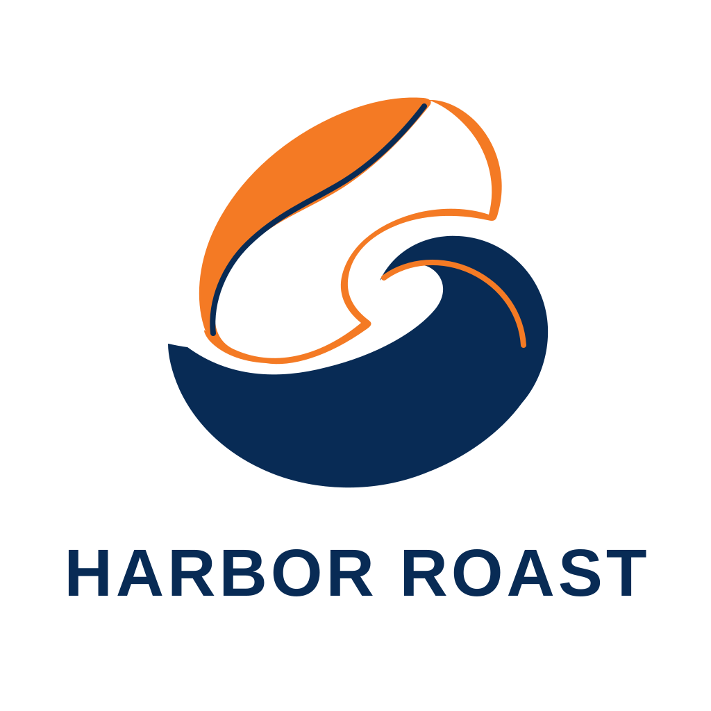

<!-- Generated by scripts/build_readme.py. Edit source data, locale catalogs and generator scripts. -->

# Harbor Roast vector logo

[← Back to external website archive](../../README.md#all-cases)

 

**Creator-reported model · Source-only; not independently reproduced**

A self-contained SVG with an abstract two-color mark and brand lettering. The original file was inspected for active content and rendered locally; no open license was verified.

## Images / GIFs

- [Navy and orange stylized emblem above HARBOR ROAST lettering.](https://image.lightlyn.com/examples/gpt-image-2-6/svg-logo.svg) · svg
  - Credit: Linger / Lightlyn Images
  - Reuse: source-attributed. Public example saved unchanged from its normal source link. No redistribution license was verified. Attribution is provenance, not permission or an open license; the repository MIT license does not cover this file.
  - [Provenance / rights evidence](https://image.lightlyn.com/gpt-image-2-6?lang=en)

## Source-page and media access

- Checked: 2026-11-05 (UTC)
- Original page: Accessible. The article and individual model captions were readable in the normal public browser.
- Media: Archived locally. All media recorded in this case were saved normally and checked for real file format, size and SHA-256. Visual checks and limitations are in the per-file report.
- [Per-file attempts and results](../../../docs/LIGHTLYN_SVG_PROVENANCE_2026-11-06.md)

## Original prompt

[Original prompt at source](https://image.lightlyn.com/gpt-image-2-6?lang=en)

The source publishes the actual prompt. This repository links to it rather than inventing or republishing the full text. Required inputs and parameters remain at the source.

## Attribution and verification

- ID: community-lightlyn-coffee-logo-svg
- Author: Linger / Lightlyn Images
- [Original source](https://image.lightlyn.com/gpt-image-2-6?lang=en)
- Model: GPT Image 2.6
- Variant: Flare
- Evidence: Linger’s 5 November 2026 article labels this specific output as GPT Image 2.6 Flare. This is creator-reported attribution, not independent model reproduction.
- Collected: 2026-11-05 (UTC)
- Source checked: 2026-11-05 (UTC)

Attribution does not grant a media license. Repository MIT terms do not cover third-party outputs. Local files record provenance and reuse status; source-attributed does not mean open-licensed.
