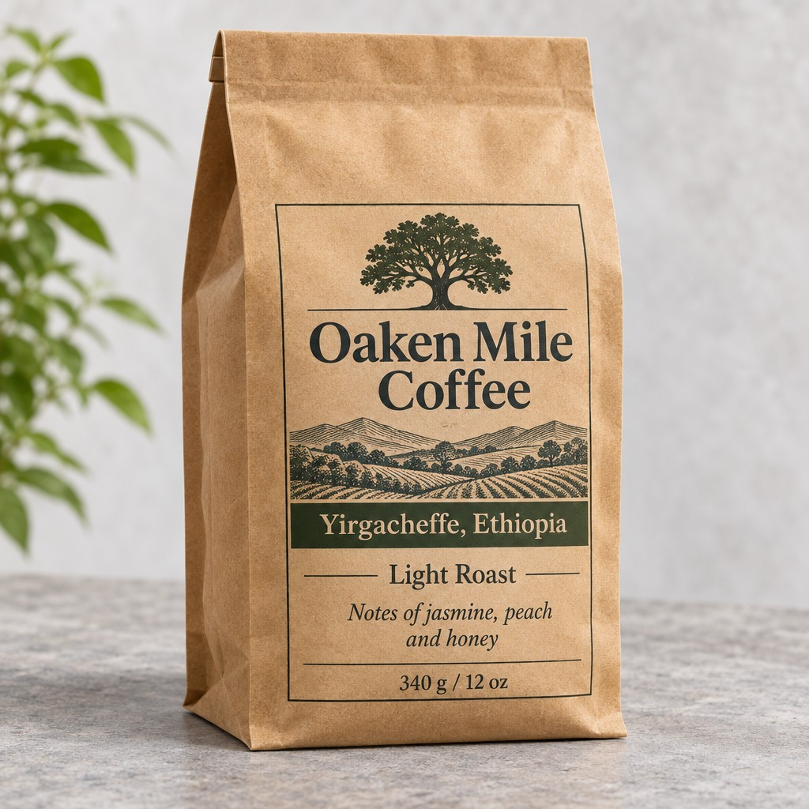
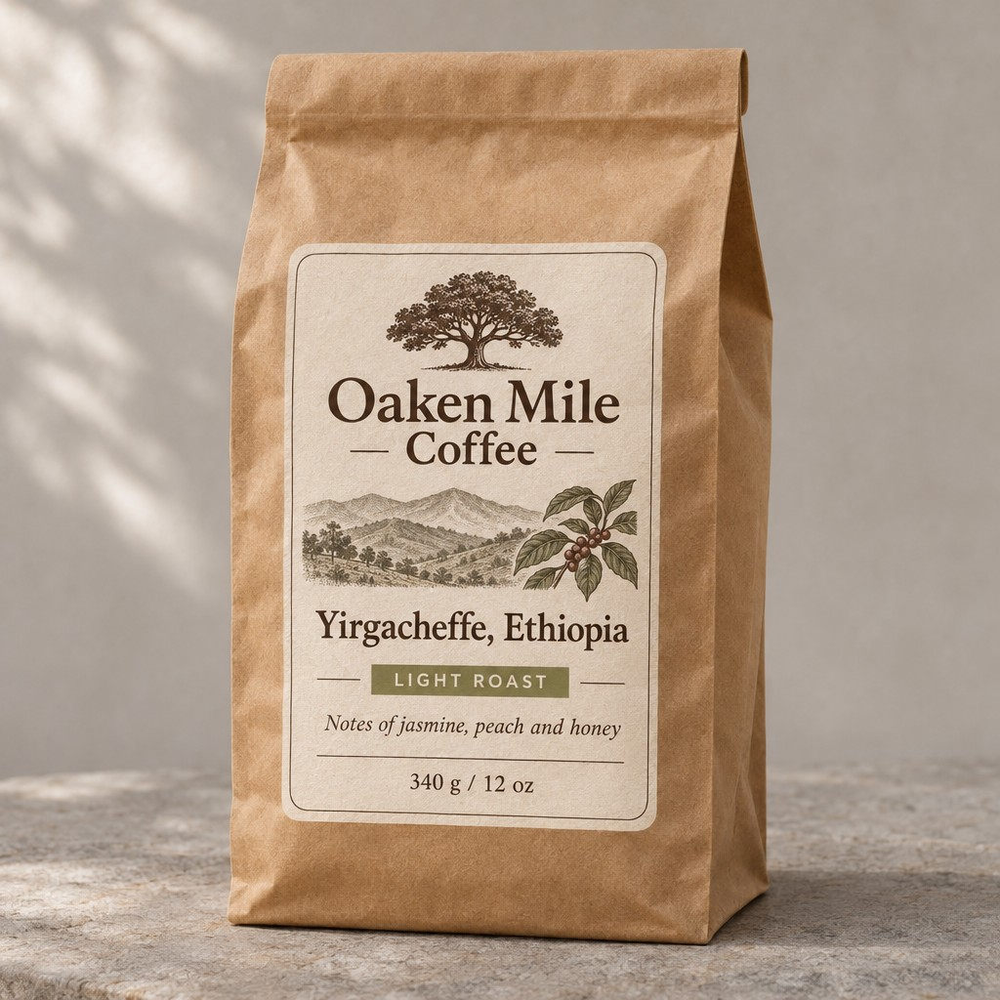

<!-- Generated by scripts/build_readme.py. Edit source data, locale catalogs and generator scripts. -->

# Oaken Mile Coffee 标签：Flare 与 Sunburst

[← 返回外站素材目录](../../README.md#all-cases)

 

**作者自报模型 · 仅核对来源；未独立复现**

牛皮纸咖啡袋，带有 Oaken Mile Coffee / Ethiopia 标签及风味说明。 发布方称每条提示词仅尝试一次且未作编辑；本案例为来源整理，不是我们的基准测试，亦未独立复现。仅收录 Flare 和 Sunburst 输出。

## 图片 / GIF

- [Oaken Mile Coffee 标签：Flare 与 Sunburst：来源提供的 GPT Image 2.6 Flare JPEG](https://mossimage.studio/examples/compare-label-flare.jpg) · image
  - 署名：MossImage Studio Team
  - 使用条件：source-attributed. 保留原始署名、原样存档的公开来源图片。未找到明确转载许可证；署名及仓库版权声明不构成授权，仓库 MIT 许可不覆盖此文件。 直接 HTTP 请求返回 403，但来源文章与全尺寸图片均能在正常公开浏览器中打开，并已通过浏览器支持的保存方式取得。
  - [来源 / 权利依据](https://mossimage.studio/blog/gpt-image-2-6#round-3-a-product-label)

- [Oaken Mile Coffee 标签：Flare 与 Sunburst：来源提供的 GPT Image 2.6 Sunburst JPEG](https://mossimage.studio/examples/compare-label-sunburst.jpg) · image
  - 署名：MossImage Studio Team
  - 使用条件：source-attributed. 保留原始署名、原样存档的公开来源图片。未找到明确转载许可证；署名及仓库版权声明不构成授权，仓库 MIT 许可不覆盖此文件。 直接 HTTP 请求返回 403，但来源文章与全尺寸图片均能在正常公开浏览器中打开，并已通过浏览器支持的保存方式取得。
  - [来源 / 权利依据](https://mossimage.studio/blog/gpt-image-2-6#round-3-a-product-label)

## 原帖与素材获取状态

- 核对日期：2026-11-05 (UTC)
- 原帖：未知. 首次收集时，文章可在公开浏览器中正常打开。之后对同一文章的直接请求返回 HTTP 403；未重新检查当前浏览器可访问性。
- 素材：已存入仓库. 两张已存档 JPEG 的本地文件仍可用，并通过哈希、字节数及解码检查。首次收集时，素材直接请求返回 HTTP 403，但确切全尺寸图片可在公开浏览器中正常打开并保存。本次核对未重新请求素材。
- [逐项尝试与结果](../../../docs/MOSS_PROVENANCE_2026-11-06.md)

## 原始提示词

[原提示词见来源](https://mossimage.studio/blog/gpt-image-2-6#round-3-a-product-label)

来源公开了真实提示词。本仓库链接原文，不伪造或转载完整长提示词；所需输入与参数请在原文查看。

## 来源与核对信息

- ID: community-moss-coffee-label
- 作者：MossImage Studio Team
- [原始来源](https://mossimage.studio/blog/gpt-image-2-6#round-3-a-product-label)
- 模型：GPT Image 2.6
- 版本：Flare / Sunburst
- 依据：页面将这两张结果标注为 GPT Image 2.6 Flare 与 Sunburst。MossImage Studio Team 称其于 2026 年 11 月 5 日通过 fal 生成。这是发布方自述的模型归因，并非独立复现；该网站非官方，与 OpenAI 或 OpenMOSS 无关联。
- 收录：2026-11-05 (UTC)
- 来源核对：2026-11-05 (UTC)

标注来源不等于取得素材许可。仓库 MIT 协议不覆盖第三方输出；本地素材逐项记录来源与使用状态，source-attributed 不代表开放许可。
