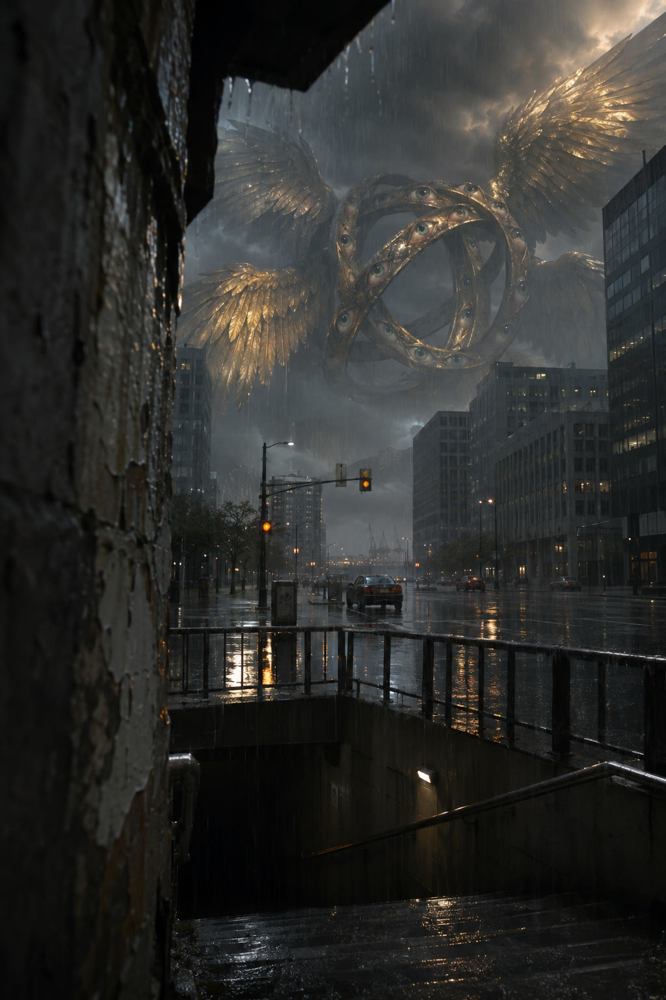

<!-- Generated by scripts/build_readme.py. Edit source data, locale catalogs and generator scripts. -->

# Ophanim-inspired still: The Subway Entrance

[← Back to external website archive](../../README.md#all-cases)

 

**Creator-reported model · Source-only; not independently reproduced**

Golden winged rings above a rain-soaked city avenue, viewed from subway stairs. The source describes this artistic interpretation with a shot-plan prompt that the creator says was also used to make the opening still. The source labels its format as 9:16, but the served still JPEG is 1024 × 1536 (2:3); this file is preserved unchanged. The later Seedance 2.5 animation is excluded.

## Images / GIFs

- [Ophanim-inspired still: The Subway Entrance: GPT Image 2.6 Sunburst source-served JPEG](https://www.prayproductionstudio.com/blog/gpt-image-2-6-ophanim-prompts/still-gold-winged-subway.jpg) · image
  - Credit: Max Bard / Pray Production Studio
  - Reuse: source-attributed. Unmodified public-source image archived with original attribution. An explicit redistribution license was not located; attribution and the repository copyright notice do not grant permission, and the repository MIT license does not cover this file.
  - [Provenance / rights evidence](https://www.prayproductionstudio.com/blog/gpt-image-2-6-ophanim-prompts#oph-subway)

## Source-page and media access

- Checked: 2026-11-05 (UTC)
- Original page: Accessible. Original publisher article opened normally in the public browser without signing in.
- Media: Archived locally. The source-served JPEG downloaded directly and decoded successfully. Its actual 2:3 dimensions are recorded despite the article’s 9:16 label.
- [Per-file attempts and results](../../../docs/OPHANIM_PROVENANCE_2026-11-06.md)

## Original prompt

[Original prompt at source](https://www.prayproductionstudio.com/blog/gpt-image-2-6-ophanim-prompts#oph-subway)

The source publishes the actual prompt. This repository links to it rather than inventing or republishing the full text. Required inputs and parameters remain at the source.

## Attribution and verification

- ID: community-ophanim-subway-entrance
- Author: Max Bard / Pray Production Studio
- [Original source](https://www.prayproductionstudio.com/blog/gpt-image-2-6-ophanim-prompts#oph-subway)
- Model: GPT Image 2.6
- Variant: Sunburst
- Evidence: The article credits Max Bard with four opening stills made using GPT Image 2.6 Sunburst. It separately attributes the subsequent animation to Seedance 2.5; that animation is not included here. This is the creator’s report, not an independent reproduction.
- Collected: 2026-11-05 (UTC)
- Source checked: 2026-11-05 (UTC)

Attribution does not grant a media license. Repository MIT terms do not cover third-party outputs. Local files record provenance and reuse status; source-attributed does not mean open-licensed.
