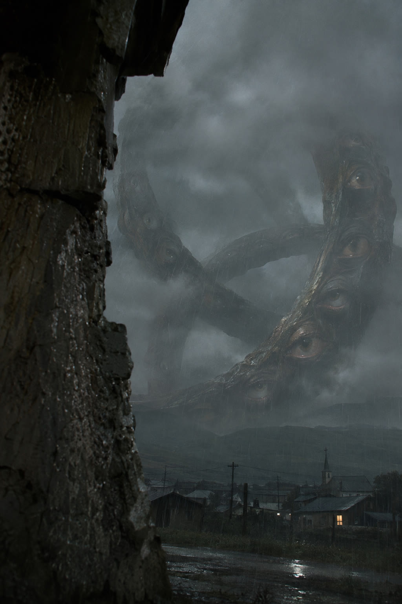

<!-- Generated by scripts/build_readme.py. Edit source data, locale catalogs and generator scripts. -->

# Ophanim 艺术演绎静帧：雨中村庄

[← 返回外站素材目录](../../README.md#all-cases)

 

**作者自报模型 · 仅核对来源；未独立复现**

从湿漉漉的砖石后望向村庄与教堂，空中悬着布满眼睛的深色圆环。原页以镜头方案描述这幅艺术演绎；创作者称该提示词也用于制作开场静帧。 来源页面标示格式为 9:16，但实际提供的静态 JPEG 为 1024 × 1536（2:3）；文件保持原样。后续 Seedance 2.5 动画不收录为 2.6 输出。

## 图片 / GIF

- [Ophanim 艺术演绎静帧：雨中村庄：来源提供的 GPT Image 2.6 Sunburst JPEG](https://www.prayproductionstudio.com/blog/gpt-image-2-6-ophanim-prompts/still-hidden-witness.jpg) · image
  - 署名：Max Bard / Pray Production Studio
  - 使用条件：source-attributed. 保留原始署名、原样存档的公开来源图片。未找到明确转载许可证；署名及仓库版权声明不构成授权，仓库 MIT 许可不覆盖此文件。
  - [来源 / 权利依据](https://www.prayproductionstudio.com/blog/gpt-image-2-6-ophanim-prompts#oph-village)

## 原帖与素材获取状态

- 核对日期：2026-11-05 (UTC)
- 原帖：可打开. 原发布方文章在公开浏览器中正常打开，无需登录。
- 素材：已存入仓库. 来源提供的 JPEG 直接下载及解码成功。实际宽高比为 2:3，与文章的 9:16 标签区别记录。
- [逐项尝试与结果](../../../docs/OPHANIM_PROVENANCE_2026-11-06.md)

## 原始提示词

[原提示词见来源](https://www.prayproductionstudio.com/blog/gpt-image-2-6-ophanim-prompts#oph-village)

来源公开了真实提示词。本仓库链接原文，不伪造或转载完整长提示词；所需输入与参数请在原文查看。

## 来源与核对信息

- ID: community-ophanim-village-rain
- 作者：Max Bard / Pray Production Studio
- [原始来源](https://www.prayproductionstudio.com/blog/gpt-image-2-6-ophanim-prompts#oph-village)
- 模型：GPT Image 2.6
- 版本：Sunburst
- 依据：文章称 Max Bard 使用 GPT Image 2.6 Sunburst 制作了四张开场静帧，之后另用 Seedance 2.5 制作动画；本案例不收录该动画。以上为创作者自述，整理者未独立复现。
- 收录：2026-11-05 (UTC)
- 来源核对：2026-11-05 (UTC)

标注来源不等于取得素材许可。仓库 MIT 协议不覆盖第三方输出；本地素材逐项记录来源与使用状态，source-attributed 不代表开放许可。
