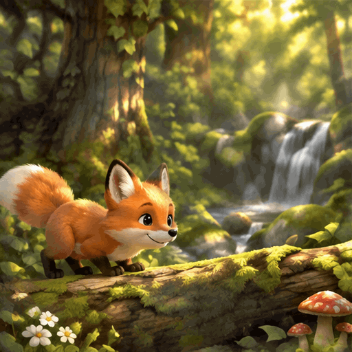
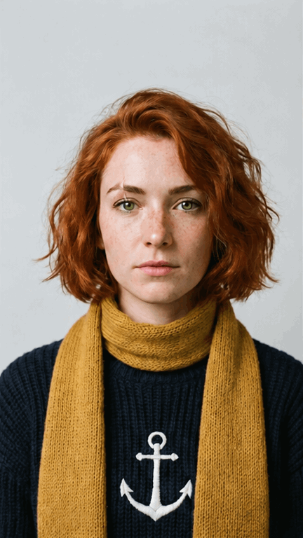

<!-- Generated by scripts/build_readme.py. Edit source data, locale catalogs and generator scripts. -->

# Flixly：六项 GIF 生成与编辑测试

[← 返回外站素材目录](../../README.md#all-cases)

 

**作者自报模型 · 仅核对来源；未独立复现**

既有六项测试合集仍计为一条，保留历史ID，不扩成六条新增案例。包含六份原始GIF并链接原提示词。文章称Mira由此前人像编辑而来，但本次未确立准确输入文件，不猜测或从其他对比中重复复制。提供方的编辑能力陈述未经独立验证。保留全部帧与输出瑕疵，未进行浏览器播放或模型生成。

## 图片 / GIF

- [Sunburst小狐狸跳过森林木头。](https://www.flixly.ai/blog-media/gpt-image-2-6-gif/fox.gif) · gif
  - 署名：Flixly Team
  - 使用条件：source-attributed. 保留发布方提供的原始字节。未验证明确转载许可，公开访问及署名不等于授权；仓库MIT不覆盖此素材。
  - [来源 / 权利依据](https://www.flixly.ai/blog/gpt-image-2-6-gif-maker)

- [Sunburst MORNING RITUAL咖啡杯与流动蒸汽。](https://www.flixly.ai/blog-media/gpt-image-2-6-gif/coffee.gif) · gif
  - 署名：Flixly Team
  - 使用条件：source-attributed. 保留发布方提供的原始字节。未验证明确转载许可，公开访问及署名不等于授权；仓库MIT不覆盖此素材。
  - [来源 / 权利依据](https://www.flixly.ai/blog/gpt-image-2-6-gif-maker)

- [Flare OPEN LATE霓虹灯暗下后重亮。](https://www.flixly.ai/blog-media/gpt-image-2-6-gif/neon.gif) · gif
  - 署名：Flixly Team
  - 使用条件：source-attributed. 保留发布方提供的原始字节。未验证明确转载许可，公开访问及署名不等于授权；仓库MIT不覆盖此素材。
  - [来源 / 权利依据](https://www.flixly.ai/blog/gpt-image-2-6-gif-maker)

- [Sunburst黄色小猫眨眼并竖拇指。](https://www.flixly.ai/blog-media/gpt-image-2-6-gif/sticker.gif) · gif
  - 署名：Flixly Team
  - 使用条件：source-attributed. 保留发布方提供的原始字节。未验证明确转载许可，公开访问及署名不等于授权；仓库MIT不覆盖此素材。
  - [来源 / 权利依据](https://www.flixly.ai/blog/gpt-image-2-6-gif-maker)

- [Flare小屋蜡烛摇动，窗外落雪。](https://www.flixly.ai/blog-media/gpt-image-2-6-gif/snow.gif) · gif
  - 署名：Flixly Team
  - 使用条件：source-attributed. 保留发布方提供的原始字节。未验证明确转载许可，公开访问及署名不等于授权；仓库MIT不覆盖此素材。
  - [来源 / 权利依据](https://www.flixly.ai/blog/gpt-image-2-6-gif-maker)

- [发布方归于Sunburst的Mira人像微笑、眨眼并挥手。](https://www.flixly.ai/blog-media/gpt-image-2-6-gif/mira.gif) · gif
  - 署名：Flixly Team
  - 使用条件：source-attributed. 保留发布方提供的原始字节。未验证明确转载许可，公开访问及署名不等于授权；仓库MIT不覆盖此素材。
  - [来源 / 权利依据](https://www.flixly.ai/blog/gpt-image-2-6-gif-maker)

## 原帖与素材获取状态

- 核对日期：2026-11-08 (UTC)
- 原帖：可打开. 重新打开已知一手来源，为既有候选核对具体示例标签、提示词与素材地址，未搜索新案例。
- 素材：已存入仓库. 成功取得发布方提供的文件并原样保留，检查格式、尺寸、哈希、完整逐帧解码与视觉内容。Opusly历史GIF哈希一致，其余九份文件本次从既有候选原页补取。
- [逐项尝试与结果](../../../docs/MODEL_HOLDS_RECOVERY_AUDIT_2026-11-08.md)

## 原始提示词

[原提示词见来源](https://www.flixly.ai/blog/gpt-image-2-6-gif-maker)

来源公开了真实提示词。本仓库链接原文，不伪造或转载完整长提示词；所需输入与参数请在原文查看。

## 来源与核对信息

- ID: flixly-six-gif-tests
- 作者：Flixly Team
- [原始来源](https://www.flixly.ai/blog/gpt-image-2-6-gif-maker)
- 模型：GPT Image 2.6
- 版本：Flare / Sunburst
- 依据：原文说明六份GIF是在Flixly所做的测试，并为每份准确输出标注模型。狐狸、咖啡、贴纸及Mira归为Sunburst（Mira注明Sunburst Edit），霓虹与雪景归为Flare。参数、首次结果及未编辑陈述均属发布方自述，不是独立观察到的API调用。
- 收录：2026-11-06 (UTC)
- 来源核对：2026-11-08 (UTC)

标注来源不等于取得素材许可。仓库 MIT 协议不覆盖第三方输出；本地素材逐项记录来源与使用状态，source-attributed 不代表开放许可。
