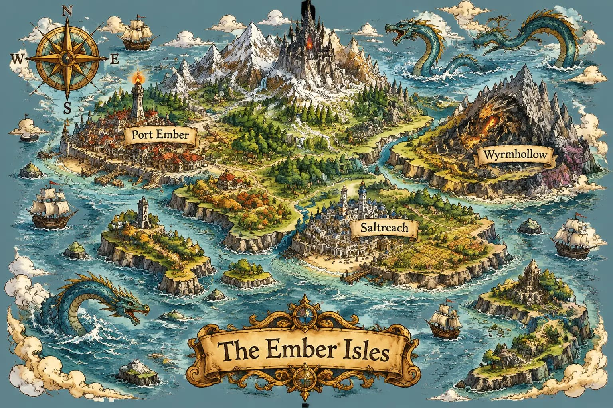

<!-- Generated by scripts/build_readme.py. Edit source data, locale catalogs and generator scripts. -->

# The Ember Isles fantasy map

[← Back to external website archive](../../README.md#all-cases)

 

**Creator-reported model · Source-only; not independently reproduced**

Creator/publisher-reported example, not independently reproduced. No run log independently verifies the served model. Original public media bytes are preserved; source attribution is not a redistribution license. The original model page publishes the associated prompt. Parameters and performance figures remain publisher claims. Saver is the provider’s service-route label, not independently verified evidence of a separate official OpenAI model.

## Images / GIFs

- [The Ember Isles fantasy map](https://www.gptimagehub.com/_next/image?url=%2Fmodels%2Fgpt-image-2-6-sunburst-map.webp&w=2048&q=75&dpl=dpl_7AcecpQN4dYqVme3P5wmTbzBjibd) · image
  - Credit: GPT Image Hub
  - Reuse: source-attributed. Unchanged publisher-served media. On 2026-11-08 the known file URL returned bytes identical to the retained SHA-256 and size. No explicit redistribution licence was verified. Public availability and attribution are not permission; repository MIT does not cover this media.
  - [Provenance / rights evidence](https://www.gptimagehub.com/models/gpt-image-2-6-sunburst-saver)

## Source-page and media access

- Checked: 2026-11-08 (UTC)
- Original page: Accessible. Only the already-known source and model pages were reopened to verify this existing local case. Their example URLs and model labels were checked. All retained media URLs were fetched successfully and matched their original SHA-256 and byte counts. No new case search.
- Media: Archived locally. Original bytes retained. All stills and every GIF frame were fully decoded and visually reviewed. Reference composites are not generated outputs. No QA derivative is published.
- [Per-file attempts and results](../../../docs/302_GPTIMAGEHUB_RECOVERY_AUDIT_2026-11-08.md)

## Original prompt

[Original prompt at source](https://www.gptimagehub.com/models/gpt-image-2-6-sunburst-saver)

The source publishes the actual prompt. This repository links to it rather than inventing or republishing the full text. Required inputs and parameters remain at the source.

## Attribution and verification

- ID: gptimagehub-ember-isles-map
- Author: GPT Image Hub
- [Original source](https://www.gptimagehub.com/models/gpt-image-2-6-sunburst-saver)
- Model: GPT Image 2.6
- Variant: Sunburst
- Evidence: The corresponding GPT Image Hub model page identifies the named Flare/Sunburst Saver route and labels these individual examples as generated or edited on GPT Image Hub on 5 November 2026. This is the publisher’s model attribution.
- Collected: 2026-11-06 (UTC)
- Source checked: 2026-11-08 (UTC)

Attribution does not grant a media license. Repository MIT terms do not cover third-party outputs. Local files record provenance and reuse status; source-attributed does not mean open-licensed.
