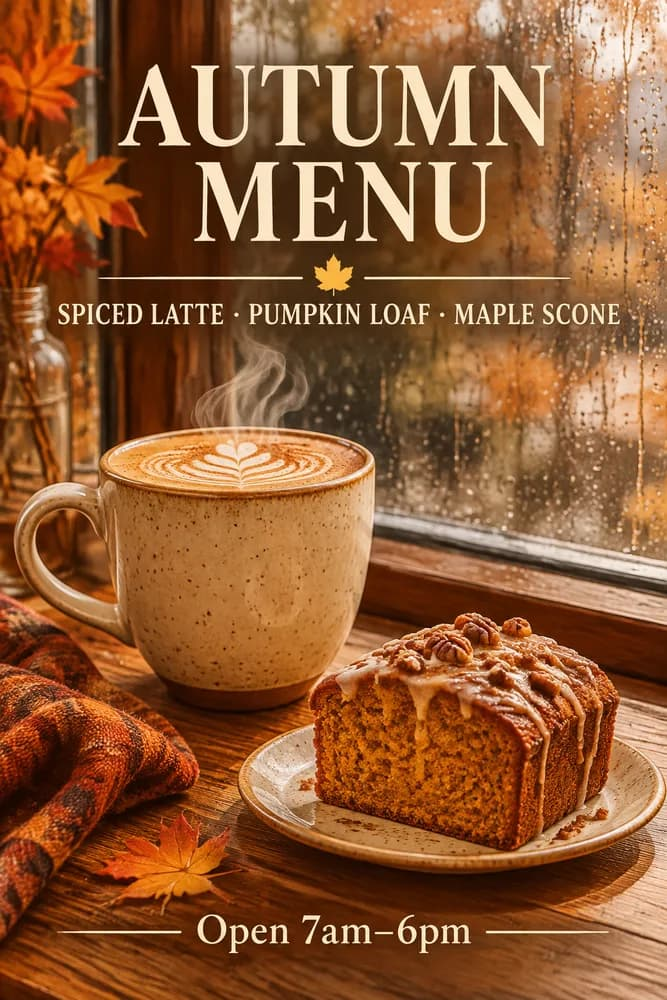

<!-- Generated by scripts/build_readme.py. Edit source data, locale catalogs and generator scripts. -->

# Coffee poster: vague prompt versus structured brief

[← Back to external website archive](../../README.md#all-cases)

 

**Creator-reported model · Source-only; not independently reproduced**

Platform-attributed example; no independent generation was performed. The public original prompt is linked at the source rather than republished here. The vague and structured prompts form one controlled comparison, not two cases. The served files are 667×1000 JPEG previews; the page reports generation settings of 1024×1536, high. Other guide examples already collected elsewhere are excluded.

## Images / GIFs

- [Café photograph from the short prompt, JPEG comparison image](https://www.gptimagehub.com/_next/image?url=%2Fguides%2Fgpt-image-2-6%2Fprompt-vague.webp&w=2048&q=75&dpl=dpl_FyR6M3BaZMqhLFojFeokF6X2yge5) · image
  - Credit: GPT Image Hub
  - Reuse: source-attributed. Unchanged publisher-served media. On 2026-11-08 the known file URL returned bytes identical to the retained SHA-256 and size. No explicit redistribution licence was verified. Public availability and attribution are not permission; repository MIT does not cover this media.
  - [Provenance / rights evidence](https://www.gptimagehub.com/guides/how-to-prompt-gpt-image-2-6)

- [Autumn menu poster from the structured brief, JPEG comparison image](https://www.gptimagehub.com/_next/image?url=%2Fguides%2Fgpt-image-2-6%2Fprompt-structured.webp&w=2048&q=75&dpl=dpl_FyR6M3BaZMqhLFojFeokF6X2yge5) · image
  - Credit: GPT Image Hub
  - Reuse: source-attributed. Unchanged publisher-served media. On 2026-11-08 the known file URL returned bytes identical to the retained SHA-256 and size. No explicit redistribution licence was verified. Public availability and attribution are not permission; repository MIT does not cover this media.
  - [Provenance / rights evidence](https://www.gptimagehub.com/guides/how-to-prompt-gpt-image-2-6)

## Source-page and media access

- Checked: 2026-11-08 (UTC)
- Original page: Accessible. Only the already-known source and model pages were reopened to verify this existing local case. Their example URLs and model labels were checked. All retained media URLs were fetched successfully and matched their original SHA-256 and byte counts. No new case search.
- Media: Archived locally. Original bytes retained. All stills and every GIF frame were fully decoded and visually reviewed. Reference composites are not generated outputs. No QA derivative is published.
- [Per-file attempts and results](../../../docs/302_GPTIMAGEHUB_RECOVERY_AUDIT_2026-11-08.md)

## Original prompt

[Original prompt at source](https://www.gptimagehub.com/guides/how-to-prompt-gpt-image-2-6)

The source publishes the actual prompt. This repository links to it rather than inventing or republishing the full text. Required inputs and parameters remain at the source.

## Attribution and verification

- ID: gptimagehub-structured-coffee-poster
- Author: GPT Image Hub
- [Original source](https://www.gptimagehub.com/guides/how-to-prompt-gpt-image-2-6)
- Model: GPT Image 2.6
- Variant: Flare
- Evidence: Each of the two comparison captions explicitly names “GPT Image 2.6 Flare, 1024x1536, high”. The guide describes these as prompts tested on GPT Image Hub, with the matching outputs alongside. This is the platform’s own test claim, not our reproduction.
- Collected: 2026-11-06 (UTC)
- Source checked: 2026-11-08 (UTC)

Attribution does not grant a media license. Repository MIT terms do not cover third-party outputs. Local files record provenance and reuse status; source-attributed does not mean open-licensed.
