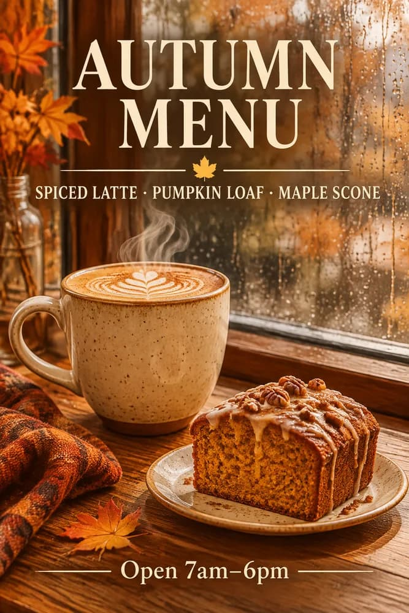

<!-- Generated by scripts/build_readme.py. Edit source data, locale catalogs and generator scripts. -->

# 咖啡海报：模糊提示与结构化简报对照

[← 返回外站素材目录](../../README.md#all-cases)

 

**作者自报模型 · 仅核对来源；未独立复现**

案例依据平台自身署名，未进行独立生成复现。公开原始提示词仅链接至来源，不在此转载全文。 模糊提示与结构化提示构成同一组对照，不拆成两个案例。实际下载文件为 667×1000 的 JPEG 预览图；页面报告的生成设置为 1024×1536、高画质。指南中已在其他来源收录的示例不重复计算。

## 图片 / GIF

- [简短提示生成的咖啡馆照片，JPEG 对照图](https://www.gptimagehub.com/_next/image?url=%2Fguides%2Fgpt-image-2-6%2Fprompt-vague.webp&w=2048&q=75&dpl=dpl_FyR6M3BaZMqhLFojFeokF6X2yge5) · image
  - 署名：GPT Image Hub
  - 使用条件：source-attributed. 保留发布方提供的原始素材。2026-11-08从已知文件地址取得的字节与留存SHA-256及大小一致。未验证明确转载许可，公开可访问及署名不等于授权，仓库MIT不覆盖此素材。
  - [来源 / 权利依据](https://www.gptimagehub.com/guides/how-to-prompt-gpt-image-2-6)

- [结构化简报生成的秋季菜单海报，JPEG 对照图](https://www.gptimagehub.com/_next/image?url=%2Fguides%2Fgpt-image-2-6%2Fprompt-structured.webp&w=2048&q=75&dpl=dpl_FyR6M3BaZMqhLFojFeokF6X2yge5) · image
  - 署名：GPT Image Hub
  - 使用条件：source-attributed. 保留发布方提供的原始素材。2026-11-08从已知文件地址取得的字节与留存SHA-256及大小一致。未验证明确转载许可，公开可访问及署名不等于授权，仓库MIT不覆盖此素材。
  - [来源 / 权利依据](https://www.gptimagehub.com/guides/how-to-prompt-gpt-image-2-6)

## 原帖与素材获取状态

- 核对日期：2026-11-08 (UTC)
- 原帖：可打开. 仅重新打开已知来源与模型页面，为既有本地案例核对示例地址及模型标签。所有留存素材地址均成功取得文件，SHA-256及字节数与原件一致，未搜索新案例。
- 素材：已存入仓库. 保留原始字节；所有静图及GIF全部帧完整解码并目视核验。参考拼图不是生成输出，不发布质检派生图。
- [逐项尝试与结果](../../../docs/302_GPTIMAGEHUB_RECOVERY_AUDIT_2026-11-08.md)

## 原始提示词

[原提示词见来源](https://www.gptimagehub.com/guides/how-to-prompt-gpt-image-2-6)

来源公开了真实提示词。本仓库链接原文，不伪造或转载完整长提示词；所需输入与参数请在原文查看。

## 来源与核对信息

- ID: gptimagehub-structured-coffee-poster
- 作者：GPT Image Hub
- [原始来源](https://www.gptimagehub.com/guides/how-to-prompt-gpt-image-2-6)
- 模型：GPT Image 2.6
- 版本：Flare
- 依据：两张对照图的说明均明确标注“GPT Image 2.6 Flare, 1024x1536, high”；指南说明这是 GPT Image Hub 自测提示词及其对应结果。这是平台自报测试，并非本项目复现。
- 收录：2026-11-06 (UTC)
- 来源核对：2026-11-08 (UTC)

标注来源不等于取得素材许可。仓库 MIT 协议不覆盖第三方输出；本地素材逐项记录来源与使用状态，source-attributed 不代表开放许可。
