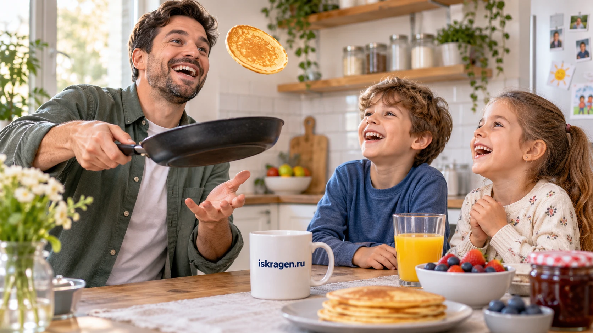
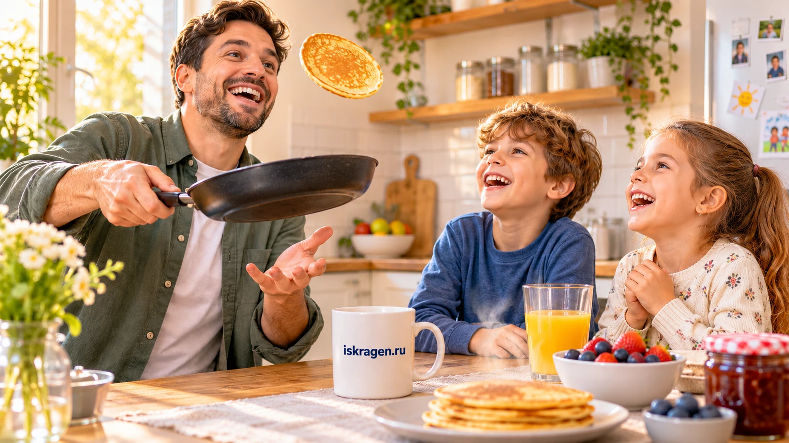

<!-- Generated by scripts/build_readme.py. Edit source data, locale catalogs and generator scripts. -->

# Family pancakes: original and sunny-light edit

[← Back to external website archive](../../README.md#all-cases)

 

**Creator-reported model · Source-only; not independently reproduced**

Creator/publisher-reported example, not independently reproduced. Full original Russian prompts appear beside the corresponding output. Generation and its subsequent edit are kept together.

## Images / GIFs

- [Family pancakes: original and sunny-light edit — Source output or labeled comparison 1](https://iskragen.ru/blog/models/gpt-image-2-6/assets/economy-t2i.webp) · image
  - Credit: IskraGen
  - Reuse: source-attributed. Original public-source media retained unchanged with attribution. No independent redistribution license has been verified. Attribution is not permission, and the repository MIT license does not cover this file.
  - [Provenance / rights evidence](https://iskragen.ru/blog/models/gpt-image-2-6)

- [Family pancakes: original and sunny-light edit — Source output or labeled comparison 2](https://iskragen.ru/blog/models/gpt-image-2-6/assets/economy-i2i.webp) · image
  - Credit: IskraGen
  - Reuse: source-attributed. Original public-source media retained unchanged with attribution. No independent redistribution license has been verified. Attribution is not permission, and the repository MIT license does not cover this file.
  - [Provenance / rights evidence](https://iskragen.ru/blog/models/gpt-image-2-6)

## Source-page and media access

- Checked: 2026-11-08 (UTC)
- Original page: Accessible. Directly revisited the known original public page and matched each archived media URL to the current HTML or embedded prediction record. No new-case search was performed.
- Media: Archived locally. Retained original bytes were checked against recorded SHA-256 and size, fully decoded and visually inspected, including every animation/video frame. No new generation or media download was performed.
- [Per-file attempts and results](../../../docs/FIVE_SOURCES_BACKLOG_AUDIT_2026-11-08.md)

## Original prompt

[Original prompt at source](https://iskragen.ru/blog/models/gpt-image-2-6)

The source publishes the actual prompt. This repository links to it rather than inventing or republishing the full text. Required inputs and parameters remain at the source.

## Attribution and verification

- ID: iskragen-pancake-kitchen-light-edit
- Author: IskraGen
- [Original source](https://iskragen.ru/blog/models/gpt-image-2-6)
- Model: GPT Image 2.6
- Variant: Variant unspecified
- Evidence: IskraGen’s own test labels this output GPT Image 2.6 Economy. Economy is a provider label; no Flare/Sunburst identity is established.
- Collected: 2026-11-06 (UTC)
- Source checked: 2026-11-08 (UTC)

Attribution does not grant a media license. Repository MIT terms do not cover third-party outputs. Local files record provenance and reuse status; source-attributed does not mean open-licensed.
