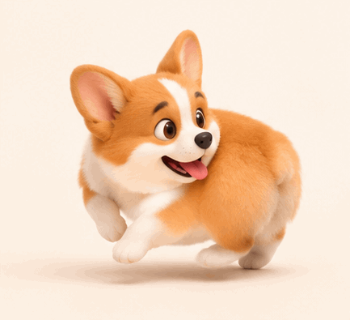

<!-- Generated by scripts/build_readme.py. Edit source data, locale catalogs and generator scripts. -->

# Corgi chasing its tail

[← Back to external website archive](../../README.md#all-cases)

 

**Creator-reported model · Source-only; not independently reproduced**

A stylized corgi turns in a circle on a cream background. Original provider asset archived byte-for-byte. All nine frames were decoded and inspected as sequential contact sheets; real-time playback was not performed. Each frame is 200 ms, total 1.8 s. The retained original page and this asset’s registry provide a description but no full generation prompt. No prompt was reconstructed. The adjacent capability copy discusses a stretch loop, but the embedded per-asset record and inspected frames identify this as the corgi loop. The record follows the asset-specific evidence and preserves that mismatch. Offline recovery recheck on 2026-11-08 confirms retained source mapping and original file integrity, not backend execution or current availability.

## Images / GIFs

- [A stylized corgi turns in a circle on a cream background.](https://cdn.kavel.ai/images/kavel/models/corgi-tail-chase-ai-image.gif) · gif
  - Credit: Kavel
  - Reuse: source-attributed. Public provider asset archived unmodified with source attribution. No redistribution license was located; attribution is not permission or an open license. Terms checked on 2026-11-05: https://www.kavel.ai/terms-of-service. Customer-output commercial-use statements do not license these site samples. The repository MIT license does not cover this third-party file.
  - [Provenance / rights evidence](https://www.kavel.ai/image/gpt-image-2-6)

## Source-page and media access

- Checked: 2026-11-05 (UTC)
- Original page: Accessible. Source access was recorded on 2026-11-05. Retained original source evidence was rechecked offline on 2026-11-08; no current availability claim is made.
- Media: Archived locally. The retained 2026-11-05 response manifest records ordinary HTTP 200 for these files. This audit verified unchanged bytes, MIME, hashes, all frames, pixels and metadata without new requests. GIF C2PA signatures were not cryptographically verified.
- [Per-file attempts and results](../../../docs/KAVEL_YIR_RECOVERY_AUDIT_2026-11-08.md)

## Original prompt

**PLACEHOLDER: prompt not publicly provided.**

## Attribution and verification

- ID: kavel-corgi
- Author: Kavel
- [Original source](https://www.kavel.ai/image/gpt-image-2-6)
- Model: GPT Image 2.6
- Variant: Flare
- Evidence: For corgi chasing its tail, Kavel’s per-asset metadata names gpt-image-2.6-flare-c and the date 2026-11-05, and attributes generation to Kavel. This records the provider’s claim; it is not an independent reproduction or confirmation of an official API endpoint.
- Collected: 2026-11-05 (UTC)
- Source checked: 2026-11-08 (UTC)

Attribution does not grant a media license. Repository MIT terms do not cover third-party outputs. Local files record provenance and reuse status; source-attributed does not mean open-licensed.
