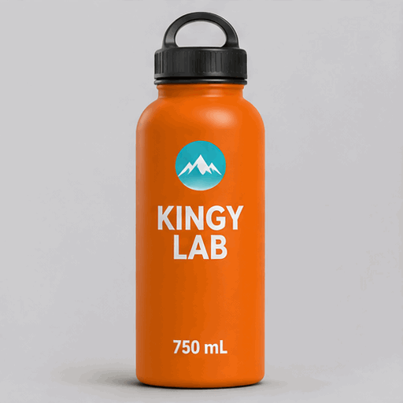

<!-- Generated by scripts/build_readme.py. Edit source data, locale catalogs and generator scripts. -->

# KINGY LAB 水瓶摇摆 GIF

[← 返回外站素材目录](../../README.md#all-cases)

 

**作者自报模型 · 仅核对来源；未独立复现**

原始 GIF89a 文件为 512 × 512，解码得到 10 个不同帧，每帧 200 毫秒，共两秒并无限循环。正常浏览器播放中观察到直立、右倾和左倾姿态，并检查了全部十帧。动作步进和末帧到首帧的姿态变化较明显。青绿色徽章出现白色山形图案，来源指出此细节未经要求。未收录 2.5 GIF 或模型未披露的 ChatGPT 网页输出，不声称使用了图片输入，亦未复现生成。 来源宣传包含准确提示词及凭据的 ZIP，但尚未检查包内内容。完整原始提示词的可获取状态未核实，不声称其确定公开或未公开。

## 图片 / GIF

- [浅灰背景上左右摇摆的橙色 KINGY LAB 750 mL 水瓶动图](https://kingy.ai/wp-content/uploads/2026/11/kingy-images26-test-26-T4.gif) · gif
  - 署名：Curtis Pyke / Kingy AI
  - 使用条件：source-attributed. 原样存档的公开来源文件，保留来源署名。未找到明确转载许可证；署名、公开可见性及网站版权声明均不构成授权，仓库 MIT 许可不覆盖此文件。
  - [来源 / 权利依据](https://kingy.ai/blog/chatgpt-gifs-images-2-6-vs-2-5-hands-on-test/)

## 原帖与素材获取状态

- 核对日期：2026-11-05 (UTC)
- 原帖：可打开. 原始公开页面无需登录即可正常打开，已在浏览器重新核对单图配文、准确媒体地址和测试方法。
- 素材：已存入仓库. 直接 HTTP 请求返回 403，但原始页面及准确媒体在浏览器中可正常访问。已通过浏览器支持的媒体下载功能保存文件，并核查文件头、MIME、完整解码、尺寸、大小和 SHA-256，亦检查了图片像素。 已观察浏览器实际播放，并检查全部十个解码帧。
- [逐项尝试与结果](../../../docs/KINGY_GIF_SOURCES_2026-11-06.md)

## 原始提示词

**提示词公开状态待核验**

尚未核实原始提示词是否公开。原始来源见下方署名信息。

## 来源与核对信息

- ID: kingy-sunburst-bottle-rocking
- 作者：Curtis Pyke / Kingy AI
- [原始来源](https://kingy.ai/blog/chatgpt-gifs-images-2-6-vs-2-5-hands-on-test/)
- 模型：GPT Image 2.6
- 版本：Sunburst
- 依据：该作品单独配文为“The native GIF returned by GPT Image 2.6 Sunburst.”。测试方法明确请求 API 模型 gpt-image-2.6-sunburst。这是来源创作者的模型归因，不是独立复现生成。另行测试的 ChatGPT 网页输出模型未披露，已排除。
- 收录：2026-11-05 (UTC)
- 来源核对：2026-11-05 (UTC)

标注来源不等于取得素材许可。仓库 MIT 协议不覆盖第三方输出；本地素材逐项记录来源与使用状态，source-attributed 不代表开放许可。
