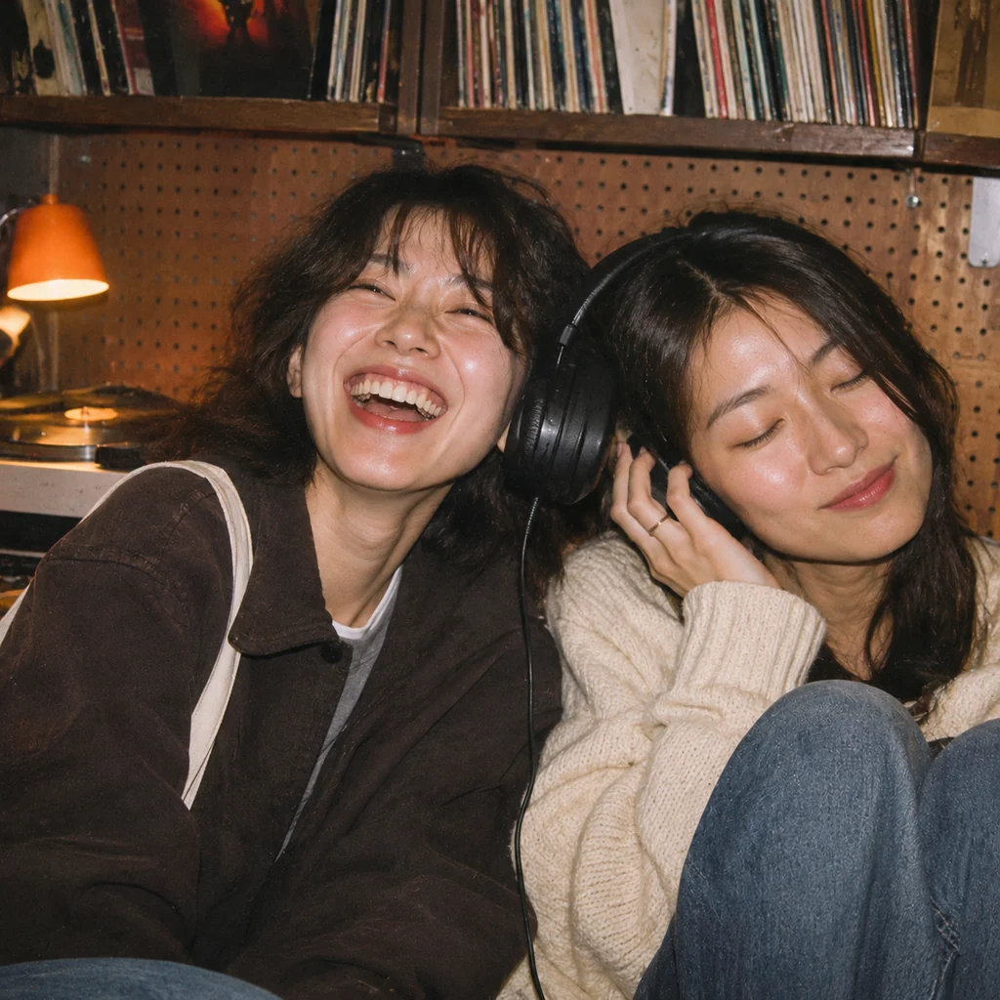

<!-- Generated by scripts/build_readme.py. Edit source data, locale catalogs and generator scripts. -->

# Made Listening booth

[← Back to external website archive](../../README.md#all-cases)

 

**Creator-reported model · Source-only; not independently reproduced**

Two people sit close together sharing headphones against the pegboard walls of a listening booth. Archived source JPEG: 1024 × 1024. A public prompt for this item was recorded during the source inspection on 2026-11-05. The link is retained as source-only; the prompt wording was not independently rechecked in the later review. Generation settings and reference inputs were not independently verified; playground defaults and advertised maximum sizes are not example settings. No independent GPT Image 2.6 generation has been verified. This single image does not establish cross-image character consistency. Independently recreated on 2026-11-10 as a new AI-generated photograph from public text descriptions, without using the source image as an input. Old third-party JPG removed from the current repository tree; replacement is not a verified GPT Image 2.6 model output.

## Images / GIFs

- [Two friends sit close together sharing headphones against the pegboard walls of a listening booth.](https://github.com/RaphaelAI-OpenLab/awesome-gpt-image-2-6/blob/main/external-sites/assets/recreated/characters-consistency/made-sunburst-listening-booth.webp) · image
  - Credit: RaphaelAI-OpenLab
  - Reuse: original. Repository-created new AI-generated photograph from the public textual concept. Original third-party image pixels were not reused and no source image was supplied to the artwork tool. The Made/Yir example remains credited as inspiration and original source; this new work is not a verified GPT Image 2.6 output.
  - [Provenance / rights evidence](https://github.com/RaphaelAI-OpenLab/awesome-gpt-image-2-6/blob/main/external-sites/RECREATION_STATUS.md)

## Source-page and media access

- Checked: 2026-11-05 (UTC)
- Original page: Accessible. The public gallery was inspected on 2026-11-05. Its item label, exact media URL and presence of a public prompt were recorded. The 2026-11-06 review used those retained observations and local files; it did not make a new availability check or independently recheck the prompt wording.
- Media: Archived locally. The source image was downloaded directly without login on 2026-11-05. The retained JPEG was checked again on 2026-11-06 for magic bytes, MIME, full decode, dimensions, byte count, SHA-256 and embedded metadata. The labelled contact sheet was visually reviewed. Embedded provenance was not cryptographically validated and does not verify the named model variant. On 2026-11-10 the previously archived third-party JPG was removed from the current tree and replaced with independently made artwork; original source audit remains as history.
- [Per-file attempts and results](../../../docs/MADE_SUNBURST_SOURCES_2026-11-06.md)

## Original prompt

[Original prompt at source](https://www.made.app/models/gpt-image-2-6-sunburst#examples-heading)

The source publishes the actual prompt. This repository links to it rather than inventing or republishing the full text. Required inputs and parameters remain at the source.

## Attribution and verification

- ID: made-sunburst-listening-booth
- Author: Made / Made Inc.
- [Original source](https://www.made.app/models/gpt-image-2-6-sunburst#examples-heading)
- Model: GPT Image 2.6
- Variant: Sunburst
- Evidence: Made’s original-results gallery labels this item “GPT Image 2.6 Sunburst: Listening booth” and says these examples use media produced for Made. This is creator attribution, not an independently reproduced generation.
- Collected: 2026-11-05 (UTC)
- Source checked: 2026-11-05 (UTC)

Attribution does not grant a media license. Repository MIT terms do not cover third-party outputs. Local files record provenance and reuse status; source-attributed does not mean open-licensed.
